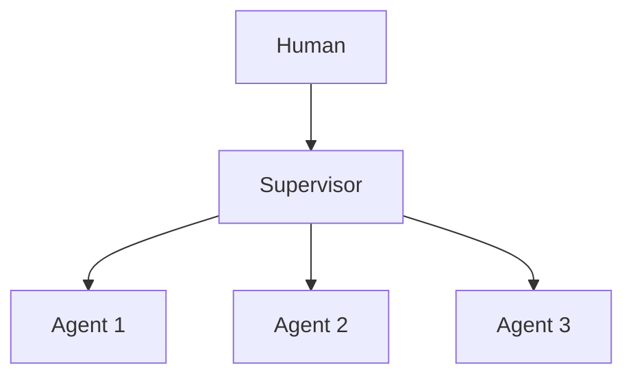

# Chapter 48: Front-Desk Triage

**Part V — Multi-Agent Topologies**

## Front-Desk Triage Pattern Overview

Cheap intake agent classifies and routes; specialists handle; triage retains escalation authority.

**Front-Desk Triage** is catalogued in the **Multi-Agent Topologies** part of the catalog (id `specialist-triage`). It is tagged for support, healthcare, legal and is assembled from 3 components.

Intake classifies intent plus risk; routes to the specialist; the specialist may return to triage with notes. Triage is the cheapest decision point and the most consequential: under-classification (emergency rated routine) delays the human response that mattered, and the specialist that never re-escalates in time completes the failure. Over-triage bias for safety-critical domains plus mandatory human routes for self-harm, violence, and legal triggers are what keep the cheap lane safe.

**Definition 1 (Fail-safe triage).** Triage is *fail-safe* iff (i) safety-critical domains default to over-triage (uncertain cases route up, never down), (ii) self-harm/violence/legal triggers have mandatory human routes that no classification can bypass, and (iii) specialists can return cases to triage with notes intact (re-escalation is a designed path, not an apology).

**Theorem 1 (Under-classification is bounded by bias).** Under fail-safe triage, the worst miscategorization sends a routine case to a human (wasted attention) rather than an emergency to a routine lane: errors default upward, and the mandatory triggers cannot be classified away.

*Proof.* Over-triage bias (i) shifts the decision boundary toward escalation: uncertain cases route up, so misclassification lands on the expensive-but-safe side (a human reviews a routine case). Mandatory triggers (ii) remove the highest-stakes categories from classification entirely — self-harm, violence, and legal triggers route to humans regardless of what the intake model thinks, so under-classification is structurally impossible for exactly the cases where it would cost most. Re-escalation (iii) bounds the residual: a specialist receiving a misrouted case returns it with notes, and the notes carry what the intake missed. Verify trigger coverage; audit routing and handoff logs for downgrades; confirm specialists can return cases with notes intact. ∎

## Practical Applications & Use Cases

Domains the catalog tags this pattern for:

- support
- healthcare
- legal

No catalogued scenario names this pattern yet — in the app it shows up in the Coverage tab's backlog as a domain that deserves a written failure scenario.

It also appears in 3 composition cascades:

| Cascade | Class | Blast radius | Impact |
|---|---|---|---|
| Agent Handoff / Swarm — privilege escalation via handoff | Inherent | single-agent | High |
| Front-Desk Triage — triage under-classification | Inherent | service | High |
| Routing — router poisoning | Inherent | single-agent | High |

## How It Works

1. Intake classifies intent + risk.
2. Route to specialist.
3. Specialist may return to triage with notes.

## Components

- Triage agent
- Specialist pool
- Escalation ladder

## Control-Flow Diagram

## Failure Modes and Risks

1 failure mode is documented for this pattern:

| Failure mode | Severity | What happens |
|---|---|---|
| Triage under-classification | High | Emergency rated routine; delayed human response. |

## Protections

1. Over-triage bias for safety-critical domains (fail safe).
2. Mandatory human route for self-harm/violence/legal triggers.

## At a Glance

| Field | Value |
|---|---|
| Catalog id | `specialist-triage` |
| Part | V — Multi-Agent Topologies |
| Domains | support, healthcare, legal |
| Components | Triage agent, Specialist pool, Escalation ladder |
| Failure modes | 1 |
| Protections | 2 |
| Related patterns | Routing, Agent Handoff / Swarm |
| Linked scenarios | 0 |
| Linked cascades | 3 |

## Key Takeaways

- Cheap intake agent classifies and routes; specialists handle; triage retains escalation authority.
- Over-triage bias for safety-critical domains (fail safe).
- Mandatory human route for self-harm/violence/legal triggers.
- Know its failure modes: Triage under-classification (high).

## References and Related Patterns

| Related pattern | Part | Summary |
|---|---|---|
| Routing | Workflow Orchestration | Classifier dispatches input to a specialized downstream prompt/model; cheap fast path, expensive path only when needed. |
| Agent Handoff / Swarm | Multi-Agent Topologies | Peers hand the conversation/task to the best-fit agent; full context transfers; any agent may route back. |

## Council deliberation

- **Continual-learning researcher:** Front-Desk Triage uses a cheap intake agent to classify intent and risk through a Triage agent, Specialist pool, and Escalation ladder, routing to specialists while retaining escalation authority. That helps support, healthcare, and legal move fast on routine work. The tension is Triage under-classification, where an emergency is rated routine and human response is delayed because the intake underestimated risk and the specialist never re-escalates in time.
- **Safety researcher:** Speed cannot come at the cost of missing the emergency. The protections that carry weight are over-triage bias for safety-critical domains to fail safe and a mandatory human route for self-harm, violence, and legal triggers. The operator should verify trigger coverage, audit routing and handoff-swarm handoffs for downgrades, and confirm specialists can return cases to triage with notes intact.

## Council reading

- **Red team:** Start with Triage under-classification (high): Emergency rated routine; delayed human response. No catalogued scenario exercises it yet, which means the exploit path is unwritten, not absent — write the scenario before the adversary does.
- **Blue team:** Hold with Over-triage bias for safety-critical domains (fail safe); Mandatory human route for self-harm/violence/legal triggers. Compose with Routing, Agent Handoff / Swarm so a failure in one pattern meets a control in another.
- **Operator:** Deploy where it is tagged (support, healthcare, legal), and watch the 3 linked cascades — Agent Handoff / Swarm — privilege escalation via handoff first, because composition is where small faults amplify. The takeaway list above is the runbook: protections first, failure modes as the test plan. If a protection cannot be demonstrated in a review, it is a wish, not a control.

## Conclusion

In the catalog this chapter was generated from, **Front-Desk Triage** is one of 107 patterns in *Multi-Agent Topologies*, carrying 1 documented failure mode and 2 listed protections. Use it as a starting point, not a specification: the protection list is the part that survives contact with an adversary.

---
