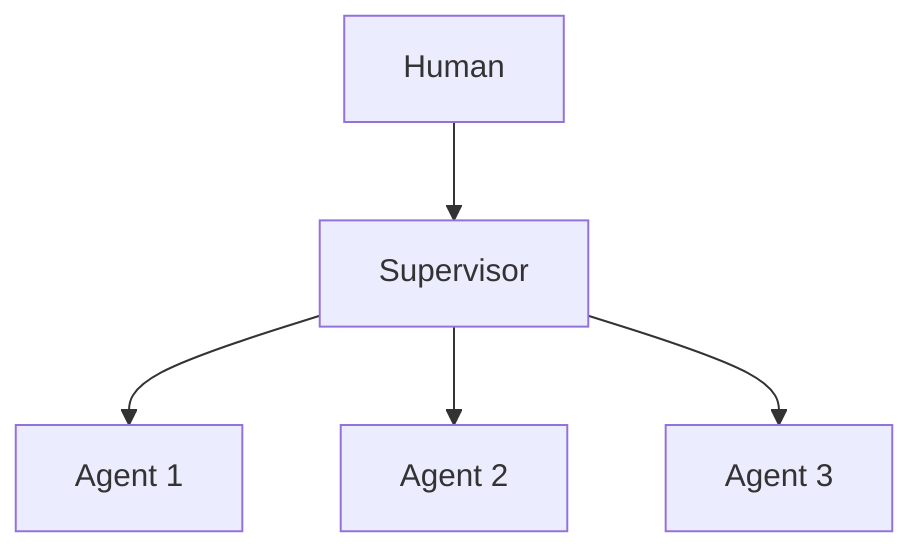

# Chapter 49: Sequential Handoff Pipeline

**Part V — Multi-Agent Topologies**

## Sequential Handoff Pipeline Pattern Overview

Specialist agents in a fixed order each transforming the artifact (draft → fact-check → legal → style).

**Sequential Handoff Pipeline** is catalogued in the **Multi-Agent Topologies** part of the catalog (id `sequential-pipeline`). It is tagged for content, engineering, legal and is assembled from 2 components.

Fixed stage order; each stage passes or fails with rationale; failed stages loop back to their producer. The pipeline's integrity depends on each gate judging alone: gate capture by upstream style — later stages deferring to an earlier confident tone instead of applying independent scrutiny — lets defects flow through polished prose. Independent contexts per stage plus explicit machine-checkable gate criteria are what keep the assembly line honest.

**Definition 1 (Independent-stage pipeline).** A sequential pipeline is *independent* iff (i) each stage runs in its own context (no confidence leakage across steps), (ii) every gate applies explicit machine-checkable criteria, and (iii) failures loop back to the producing stage rather than being waved through.

**Theorem 1 (Style cannot capture independent gates).** Under independent stages with checkable criteria, an upstream stage's confident tone cannot pass a downstream gate it does not satisfy: each gate judges the artifact against its own criteria in its own context, and failures return to their producer.

*Proof.* Gate capture requires the downstream gate to defer to upstream style — possible only if the gate shares the upstream context (confidence contagion) or its criteria are impressionistic (nothing to check against). Independent contexts (i) remove the shared framing: each stage sees the artifact, not the previous stage's confidence. Machine-checkable criteria (ii) remove impressionistic passing: the gate computes rather than feels. Loop-back on failure (iii) removes silent advance: failed artifacts return to their producer with the rationale, so defects recirculate until fixed rather than flowing downstream. The catalogued proof (affiliate claims shipped through polished copy) is exactly gate capture defeating a shared-context pipeline: verify stage contexts do not leak confidence, check gate logs for prompt-chaining and evaluator rigor, confirm failures loop back. ∎

## Practical Applications & Use Cases

Domains the catalog tags this pattern for:

- content
- engineering
- legal

1 documented failure scenario exercises it:

| Scenario | Severity | Likelihood | Domain |
|---|---|---|---|
| Content agent ships undisclosed affiliate claims into published articles | High | High | content |

It also appears in 3 composition cascades:

| Cascade | Class | Blast radius | Impact |
|---|---|---|---|
| Content agent ships undisclosed affiliate claims into published articles | Derived | service | High |
| Prompt Chaining — error compounding | Inherent | single-agent | Medium |
| Sequential Handoff Pipeline — gate capture by upstream style | Inherent | service | Medium |

## How It Works

1. Fixed stage order.
2. Each stage passes/fails with rationale.
3. Failed stage loops back to its producer.

## Components

- Stage agents
- Stage gates

## Control-Flow Diagram

## Failure Modes and Risks

1 failure mode is documented for this pattern:

| Failure mode | Severity | What happens |
|---|---|---|
| Gate capture by upstream style | Medium | Later stages defer to earlier confident tone. |

## Protections

1. Independent contexts per stage.
2. Gates with explicit machine-checkable criteria.

## At a Glance

| Field | Value |
|---|---|
| Catalog id | `sequential-pipeline` |
| Part | V — Multi-Agent Topologies |
| Domains | content, engineering, legal |
| Components | Stage agents, Stage gates |
| Failure modes | 1 |
| Protections | 2 |
| Related patterns | Prompt Chaining, Evaluator–Optimizer |
| Linked scenarios | 1 |
| Linked cascades | 3 |

## Key Takeaways

- Specialist agents in a fixed order each transforming the artifact (draft → fact-check → legal → style).
- Independent contexts per stage.
- Gates with explicit machine-checkable criteria.
- Know its failure modes: Gate capture by upstream style (medium).

## References and Related Patterns

| Related pattern | Part | Summary |
|---|---|---|
| Prompt Chaining | Workflow Orchestration | Decompose a task into a fixed sequence of LLM calls, each with structured output feeding the next; gates between steps. |
| Evaluator–Optimizer | Workflow Orchestration | One model generates, another evaluates against explicit criteria, loop until pass or budget exhausted. |

## Council deliberation

- **Evaluation methodologist:** Sequential Handoff Pipeline orders specialist Stage agents with Stage gates to transform an artifact through fixed stages, each passing or failing with rationale and looping back to its producer on failure. That helps content, engineering, and legal keep draft, fact-check, and review responsibilities separate. The tension is Gate capture by upstream style, where later stages defer to an earlier confident tone instead of applying independent scrutiny and defects flow through polished prose.
- **Safety researcher:** Order helps only if each gate judges alone. The protections that carry weight are independent contexts per stage and gates with explicit machine-checkable criteria. The operator should verify stage contexts do not leak confidence across steps, check gate logs for prompt-chaining and evaluator-optimizer rigor, and confirm failures actually loop back rather than being waved through.

## Council reading

- **Red team:** Start with Gate capture by upstream style (medium): Later stages defer to an earlier confident tone. Content agent ships undisclosed affiliate claims into published articles is the catalogued proof — high severity, content domain — so rehearse that exact chain before any other.
- **Blue team:** Hold with Independent contexts per stage; Gates with explicit machine-checkable criteria. Compose with Prompt Chaining, Evaluator–Optimizer so a failure in one pattern meets a control in another.
- **Operator:** Deploy where it is tagged (content, engineering, legal), and watch the 3 linked cascades — Content agent ships undisclosed affiliate claims into published articles first, because composition is where small faults amplify. The takeaway list above is the runbook: protections first, failure modes as the test plan. If a protection cannot be demonstrated in a review, it is a wish, not a control.

## Conclusion

In the catalog this chapter was generated from, **Sequential Handoff Pipeline** is one of 107 patterns in *Multi-Agent Topologies*, carrying 1 documented failure mode and 2 listed protections. Use it as a starting point, not a specification: the protection list is the part that survives contact with an adversary.

---
