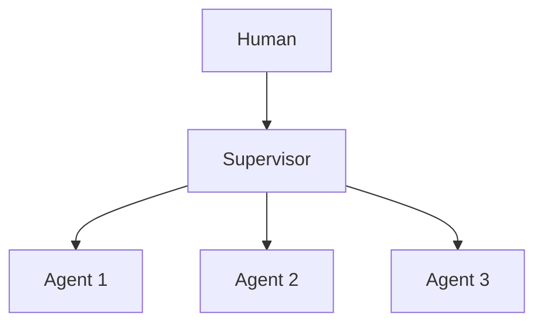

# Chapter 51: Group Chat with Moderator

**Part V — Multi-Agent Topologies**

## Group Chat with Moderator Pattern Overview

Open forum of agents; a moderator controls turn-taking, prevents loops, and summarizes.

**Group Chat with Moderator** is catalogued in the **Multi-Agent Topologies** part of the catalog (id `group-chat-moderator`). It is tagged for general, strategy and is assembled from 3 components.

The moderator grants the floor; speakers contribute; the moderator summarizes and closes. Openness surfaces diverse views — and creates two capture points: injected content manipulating who speaks (moderator capture, high) and endless rounds producing cost without decision (runaway discussion, medium). Once floor control is steered, the summary inherits the attacker's framing: the moderator is the single point whose compromise redirects the whole forum.

**Definition 1 (Pinned moderation).** Moderation is *pinned* iff (i) turn/round caps are enforced (discussions close, with or without consensus), (ii) the moderator prompt is pinned (speakers cannot re-instruct the chair mid-thread), (iii) every moderator decision is logged, and (iv) deadlock escalates to a human rather than looping.

**Theorem 1 (Captured chairs are visible).** Under pinned moderation with logged decisions, moderator capture cannot operate silently: steered floor grants, suppressed speakers, and framed summaries each contradict the log, the caps, or the pinned prompt — visibly.

*Proof.* Capture works by steering who speaks (suppressing dissent, amplifying plants) or by framing the summary. Pinned prompts (ii) block re-instruction: speaker content cannot rewrite the chair's rules mid-thread. Caps (i) bound runaway discussion: endless rounds terminate by construction, and termination forces a decision record. Logged decisions (iii) make every grant and summary auditable: a steered floor shows as a skewed grant pattern, a framed summary as a deviation from the logged contributions. Deadlock escalation (iv) prevents the infinite loop from substituting for a decision. Verify caps actually close discussions; review logs for debate-council and handoff-swarm manipulation; confirm the moderator cannot be re-instructed by speaker content mid-thread. ∎

## Practical Applications & Use Cases

Domains the catalog tags this pattern for:

- general
- strategy

1 documented failure scenario exercises it:

| Scenario | Severity | Likelihood | Domain |
|---|---|---|---|
| Debate council suppresses dissent and converges on a confident wrong call | High | High | strategy |

It also appears in 3 composition cascades:

| Cascade | Class | Blast radius | Impact |
|---|---|---|---|
| Agent Handoff / Swarm — privilege escalation via handoff | Inherent | single-agent | High |
| Debate council suppresses dissent and converges on a confident wrong call | Derived | service | High |
| Group Chat with Moderator — moderator capture | Inherent | single-agent | High |

## How It Works

1. Moderator grants the floor.
2. Speakers contribute.
3. Moderator summarizes and closes.

## Components

- Moderator
- Speakers
- Turn controller

## Control-Flow Diagram

## Failure Modes and Risks

2 failure modes are documented for this pattern:

| Failure mode | Severity | What happens |
|---|---|---|
| Moderator capture | High | Injected content manipulates who gets the floor. |
| Runaway discussion | Medium | Endless rounds, no decision. |

## Protections

1. Turn/round caps; moderator prompt pinned.
2. Moderator decisions logged; escalation on deadlock.

## At a Glance

| Field | Value |
|---|---|
| Catalog id | `group-chat-moderator` |
| Part | V — Multi-Agent Topologies |
| Domains | general, strategy |
| Components | Moderator, Speakers, Turn controller |
| Failure modes | 2 |
| Protections | 2 |
| Related patterns | Multi-Agent Debate / Council, Agent Handoff / Swarm |
| Linked scenarios | 1 |
| Linked cascades | 3 |

## Key Takeaways

- Open forum of agents; a moderator controls turn-taking, prevents loops, and summarizes.
- Turn/round caps; moderator prompt pinned.
- Moderator decisions logged; escalation on deadlock.
- Know its failure modes: Moderator capture (high); Runaway discussion (medium).

## References and Related Patterns

| Related pattern | Part | Summary |
|---|---|---|
| Multi-Agent Debate / Council | Multi-Agent Topologies | Several agents argue positions or independently answer, then converge — surfaces disagreements before they surface in production. |
| Agent Handoff / Swarm | Multi-Agent Topologies | Peers hand the conversation/task to the best-fit agent; full context transfers; any agent may route back. |

## Council deliberation

- **Evaluation methodologist:** Group Chat with Moderator hosts open speakers under a Moderator and Turn controller that grants the floor, prevents loops, and summarizes for general and strategy work. That openness helps diverse views surface. The tension is control capture, with Moderator capture where injected content manipulates who speaks and Runaway discussion where endless rounds produce cost without decision. Once floor control is steered, the summary inherits the attacker framing.
- **Safety researcher:** Openness needs a pinned chair. The protections that carry weight are turn and round caps with a pinned moderator prompt, logged moderator decisions, and escalation on deadlock. The operator should verify caps actually close discussions, review logs for debate-council and handoff-swarm manipulation, and confirm the moderator cannot be re-instructed by speaker content mid-thread.

## Council reading

- **Red team:** Start with Moderator capture (high): Injected content manipulates who gets the floor. Debate council suppresses dissent and converges on a confident wrong call is the catalogued proof — high severity, strategy domain — so rehearse that exact chain before any other.
- **Blue team:** Hold with Turn/round caps; moderator prompt pinned; Moderator decisions logged; escalation on deadlock. Compose with Multi-Agent Debate / Council, Agent Handoff / Swarm so a failure in one pattern meets a control in another.
- **Operator:** Deploy where it is tagged (general, strategy), and watch the 3 linked cascades — Agent Handoff / Swarm — privilege escalation via handoff first, because composition is where small faults amplify. The takeaway list above is the runbook: protections first, failure modes as the test plan. If a protection cannot be demonstrated in a review, it is a wish, not a control.

## Conclusion

In the catalog this chapter was generated from, **Group Chat with Moderator** is one of 107 patterns in *Multi-Agent Topologies*, carrying 2 documented failure modes and 2 listed protections. Use it as a starting point, not a specification: the protection list is the part that survives contact with an adversary.

---
