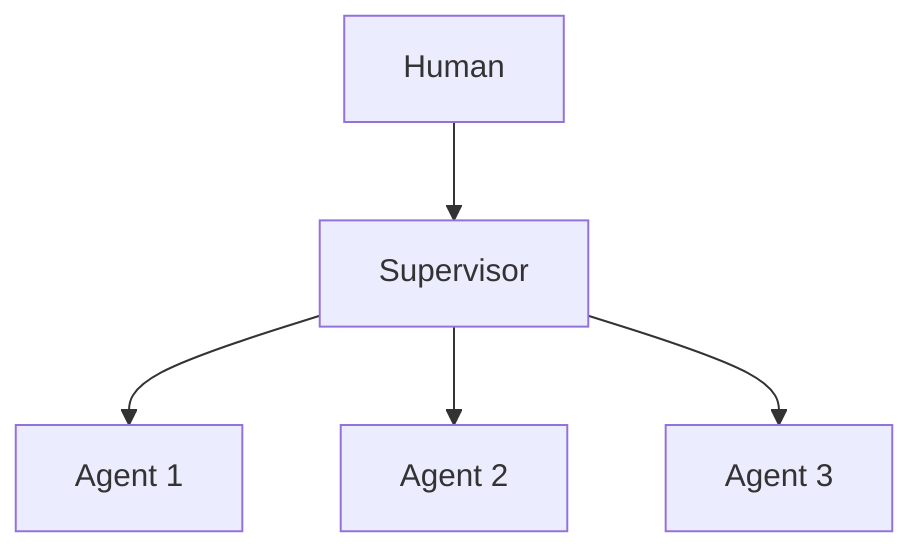

# Chapter 53: Shadow Agents (Dry-Run Parity)

**Part V — Multi-Agent Topologies**

## Shadow Agents (Dry-Run Parity) Pattern Overview

A silent twin agent runs alongside production decisions to compare outcomes before trusting new prompts/models.

**Shadow Agents (Dry-Run Parity)** is catalogued in the **Multi-Agent Topologies** part of the catalog (id `shadow-agents`). It is tagged for devops, finance, general and is assembled from 2 components.

The shadow receives the same inputs and produces parallel decisions; the differ compares; promotion happens only after parity. Divergence is the signal — and the failure is ignoring it: alerts accumulate, nobody triages, and production keeps running while evidence of mismatch piles up unreviewed. A divergence SLO with a named owner plus sandbox-guaranteed side-effect-freedom is what keeps the twin honest.

**Definition 1 (Owned shadow).** A shadow deployment is *owned* iff (i) divergence carries an SLO with a named owner and burn-down, (ii) the shadow provably has no side effects (sandbox-enforced, verified — never assumed), and (iii) divergence blocks promotion (parity is a gate, not a metric).

**Theorem 1 (Untriaged divergence is theater).** A shadow whose divergences are logged but never triaged provides zero protection regardless of fidelity: the evidence exists, the decision ignores it, and the outcome equals having no shadow — minus the compute bill.

*Proof.* Protection requires the decision (promote / hold / roll back) to depend on divergence: promotion conditioned on parity. Untriaged divergence breaks the conditioning — promotion proceeds on schedule while alerts accumulate, so the shadow's output has no causal path to any decision. Sandbox side-effect-freedom keeps the twin safe to run, but safety without ownership is monitoring without response (the detect-only trap: everything found, nothing stopped). Verify alert triage timeliness; confirm sandbox isolation; audit the canary and dry-run promotion criteria so divergence blocks promotion rather than merely logging it. The catalogued proof (silent provider update drifting behavior) is exactly the shape shadows exist to catch — if anyone reads the diff. ∎

## Practical Applications & Use Cases

Domains the catalog tags this pattern for:

- devops
- finance
- general

1 documented failure scenario exercises it:

| Scenario | Severity | Likelihood | Domain |
|---|---|---|---|
| Model provider silently updates; agent behavior drifts | Medium | High | general |

It also appears in 7 composition cascades — the 6 most impactful of 7:

| Cascade | Class | Blast radius | Impact |
|---|---|---|---|
| Provider outage → retry storm → cost halt | Cascading | fleet | Critical |
| Canary & Shadow Deployment — canary without containment | Inherent | single-agent | High |
| Guardrail adversarial drift | Emergent | service | High |
| Guardrail bypass by composition | Emergent | service | High |
| Tool-call race / double-execution | Emergent | service | High |
| Model provider silently updates; agent behavior drifts | Derived | single-agent | Medium |

## How It Works

1. Shadow receives same inputs, produces parallel decision.
2. Diff vs production; alert on divergence.
3. Promote only after parity.

## Components

- Shadow runtime
- Differ

## Control-Flow Diagram

## Failure Modes and Risks

1 failure mode is documented for this pattern:

| Failure mode | Severity | What happens |
|---|---|---|
| Shadow divergence ignored | Medium | Alerts accumulate, nobody triages. |

## Protections

1. Divergence SLO with owner and burn-down.
2. Shadow has no side effects (enforced by sandbox).

## At a Glance

| Field | Value |
|---|---|
| Catalog id | `shadow-agents` |
| Part | V — Multi-Agent Topologies |
| Domains | devops, finance, general |
| Components | Shadow runtime, Differ |
| Failure modes | 1 |
| Protections | 2 |
| Related patterns | Canary & Shadow Deployment, Dry-Run / Diff Mode Tools |
| Linked scenarios | 1 |
| Linked cascades | 7 |

## Key Takeaways

- A silent twin agent runs alongside production decisions to compare outcomes before trusting new prompts/models.
- Divergence SLO with owner and burn-down.
- Shadow has no side effects (enforced by sandbox).
- Know its failure modes: Shadow divergence ignored (medium).

## References and Related Patterns

| Related pattern | Part | Summary |
|---|---|---|
| Canary & Shadow Deployment | Safety, Security & Governance | New agent behaviors ramp gradually: shadow → 1% canary → staged rollout with auto-rollback on SLO breach. |
| Dry-Run / Diff Mode Tools | Tools & Environment | State-changing tools return the would-be diff instead of applying, until confirmed. |

## Council deliberation

- **Evaluation methodologist:** Shadow Agents run a silent twin alongside production through a Shadow runtime and Differ, receiving the same inputs, comparing parallel decisions, and promoting only after parity for devops, finance, and general changes. That helps catch prompt and model regressions before trust shifts. The tension is Shadow divergence ignored, where diff alerts accumulate without triage and production keeps running while evidence of mismatch piles up unreviewed.
- **Safety researcher:** Parity without ownership is theater. The protections that carry weight are a divergence SLO with a named owner and burn-down plus sandbox enforcement guaranteeing the shadow has no side effects. The operator should verify alert triage timeliness, confirm sandbox isolation, and audit canary-shadow and dry-run-tools promotion criteria so divergence blocks promotion rather than merely logging it.

## Council reading

- **Red team:** Start with Shadow divergence ignored (medium): Alerts accumulate, nobody triages. Model provider silently updates; agent behavior drifts is the catalogued proof — medium severity, general domain — so rehearse that exact chain before any other.
- **Blue team:** Hold with Divergence SLO with owner and burn-down; Shadow has no side effects (enforced by sandbox). Compose with Canary & Shadow Deployment, Dry-Run / Diff Mode Tools so a failure in one pattern meets a control in another.
- **Operator:** Deploy where it is tagged (devops, finance, general), and watch the 7 linked cascades — Provider outage → retry storm → cost halt first, because composition is where small faults amplify. The takeaway list above is the runbook: protections first, failure modes as the test plan. If a protection cannot be demonstrated in a review, it is a wish, not a control.

## Conclusion

In the catalog this chapter was generated from, **Shadow Agents (Dry-Run Parity)** is one of 107 patterns in *Multi-Agent Topologies*, carrying 1 documented failure mode and 2 listed protections. Use it as a starting point, not a specification: the protection list is the part that survives contact with an adversary.

---
