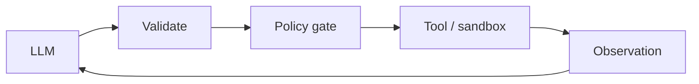

# Chapter 54: Structured Function Calling

**Part VI — Tools & Environment**

## Structured Function Calling Pattern Overview

JSON-schema-constrained tool calls with runtime validation; the mechanical backbone of every action an agent takes.

**Structured Function Calling** is catalogued in the **Tools & Environment** part of the catalog (id `function-calling`). It is tagged for general and is assembled from 3 components.

Tools described with strict schemas; the model emits a call; the runtime validates syntax and semantics; results return verbatim, never re-interpreted. The backbone metaphor is literal: every agent action in every later chapter crosses this boundary. Two failure classes live here — schema bypass through free text (unvalidated string fields carrying injection payloads) and result re-interpretation (the model reading tool error strings as instructions).

**Definition 1 (Closed call boundary).** A tool-call boundary is *closed* iff (i) calls validate against JSON Schema plus semantic rules (allowlists, ranges, cross-field constraints), (ii) unknown fields are rejected (`additionalProperties: false`), and (iii) results return as quoted, delimited data — never re-interpreted as instructions.

**Theorem 1 (No free-text side channels).** Under a closed call boundary, neither arguments nor results carry executable meaning outside their schema: injection payloads in string fields fail semantic validation, hallucinated tools fail schema lookup, and error text arrives quoted — readable, never obeyable.

*Proof.* Arguments: strict schemas plus semantic checks validate structure and meaning; free-text fields that bypass validation are rejected by unknown-field rules or caught by allowlists/ranges/cross-field checks. Tools: calls name registered tools; hallucinated tools have no schema and cannot validate. Results: verbatim, delimited delivery means the model receives data marked as data — re-interpretation (reading an error string as an instruction, the catalogued high-severity failure) requires treating quoted data as commands, which the delimiter discipline forbids at the boundary. Verify validators against both tool-use and structured-output expectations; confirm error text cannot become instructions. The tool-error-message scenario is the boundary tested: quoted, delimited, inert. ∎

## Practical Applications & Use Cases

Domains the catalog tags this pattern for:

- general

1 documented failure scenario exercises it:

| Scenario | Severity | Likelihood | Domain |
|---|---|---|---|
| Tool error message contains injected instructions | High | Medium | general |

It also appears in 4 composition cascades:

| Cascade | Class | Blast radius | Impact |
|---|---|---|---|
| Tool Use / Function Calling — confused deputy | Inherent | single-agent | Critical |
| Structured Function Calling — result re-interpretation | Inherent | single-agent | High |
| Tool error message contains injected instructions | Derived | service | High |
| Structured Output (Constrained Decoding) — schema without semantics | Inherent | single-agent | Medium |

## How It Works

1. Tools described with strict schemas.
2. Model emits call; runtime validates (syntax + semantics).
3. Result returned verbatim (not re-interpreted).

## Components

- Schema registry
- Validator
- Result normalizer

## Control-Flow Diagram

## Failure Modes and Risks

2 failure modes are documented for this pattern:

| Failure mode | Severity | What happens |
|---|---|---|
| Schema-bypass via free text | Medium | Unvalidated string fields carry injection payloads. |
| Result re-interpretation | High | Model reads tool error strings as instructions. |

## Protections

1. Semantic validation beyond JSON Schema (allowlists, ranges, cross-field rules).
2. Tool results rendered as quoted data with delimiters.
3. Unknown fields rejected (additionalProperties: false).

## At a Glance

| Field | Value |
|---|---|
| Catalog id | `function-calling` |
| Part | VI — Tools & Environment |
| Domains | general |
| Components | Schema registry, Validator, Result normalizer |
| Failure modes | 2 |
| Protections | 3 |
| Related patterns | Tool Use / Function Calling, Structured Output (Constrained Decoding) |
| Linked scenarios | 1 |
| Linked cascades | 4 |

## Key Takeaways

- JSON-schema-constrained tool calls with runtime validation; the mechanical backbone of every action an agent takes.
- Semantic validation beyond JSON Schema (allowlists, ranges, cross-field rules).
- Tool results rendered as quoted data with delimiters.
- Unknown fields rejected (additionalProperties: false).
- Know its failure modes: Schema-bypass via free text (medium); Result re-interpretation (high).

## References and Related Patterns

| Related pattern | Part | Summary |
|---|---|---|
| Tool Use / Function Calling | Agent Loop & Control | Expose typed tools to the model; model emits structured calls the runtime validates and executes. |
| Structured Output (Constrained Decoding) | Safety, Security & Governance | Force actions/answers into schemas via constrained decoding or strict validation; no free-form side channels. |

## Council deliberation

- **Memory-systems researcher:** Structured Function Calling constrains tool use with a Schema registry, Validator, and Result normalizer, describing tools with strict schemas, validating syntax and semantics at runtime, and returning results verbatim without reinterpretation. That mechanical backbone helps general actions stay typed. The tension pairs Schema-bypass via free text carrying injection in unvalidated strings with Result re-interpretation where the model reads tool error strings as instructions to obey.
- **Safety researcher:** Typing must extend into meaning and presentation. The protections that carry weight are semantic validation beyond JSON Schema with allowlists, ranges, and cross-field rules, rendering tool results as quoted data with delimiters, and rejecting unknown fields. The operator should verify validators against tool-use and structured-output expectations and confirm error text cannot become instructions.

## Council reading

- **Red team:** Start with Result re-interpretation (high): Model reads tool error strings as instructions. Tool error message contains injected instructions is the catalogued proof — high severity, general domain — so rehearse that exact chain before any other.
- **Blue team:** Hold with Semantic validation beyond JSON Schema (allowlists, ranges, cross-field rules); Tool results rendered as quoted data with delimiters. Then layer the remaining 1: defence here is the list, not any single item. Compose with Tool Use / Function Calling, Structured Output (Constrained Decoding) so a failure in one pattern meets a control in another.
- **Operator:** Deploy where it is tagged (general), and watch the 4 linked cascades — Tool Use / Function Calling — confused deputy first, because composition is where small faults amplify. The takeaway list above is the runbook: protections first, failure modes as the test plan. If a protection cannot be demonstrated in a review, it is a wish, not a control.

## Conclusion

In the catalog this chapter was generated from, **Structured Function Calling** is one of 107 patterns in *Tools & Environment*, carrying 2 documented failure modes and 3 listed protections. Use it as a starting point, not a specification: the protection list is the part that survives contact with an adversary.

---
