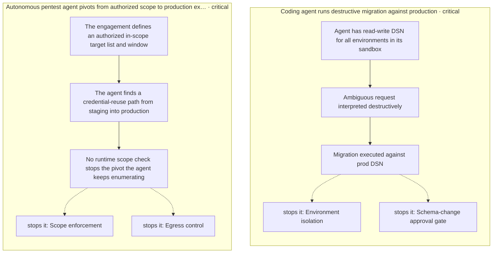
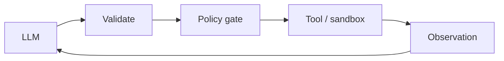

# Part VI: Tools & Environment

Acting on the world: function calling, code execution, browsers, sandboxes.

*Tools & Environment* holds 11 of the catalog's 107 patterns, which appear in 12 catalogued failure scenarios and 39 composition cascades. Each chapter below follows the same order and shape as every other part.

## Council deliberation

- **Safety researcher:** Tools let the agent act on the world through function calls, code execution, browsers, GUIs, sandboxes and registries, which makes tooling the largest side-effect surface in the system. Architecturally every action needs validation beyond syntax, scoped per-caller credentials without ambient authority, dry-run or diff modes before state changes, and disposable sandboxes with default-deny egress. Tool descriptions themselves must be pinned and vetted, since a poisoned registry entry or smuggled tool injects instructions into every client that binds it.
- **Memory-systems researcher:** Execution leaves artifacts, and artifacts become memory: stdout, diffs, files and retrieved pages all re-enter context and shape the next decision. That is why results should arrive verbatim through delimited data channels rather than re-interpreted as instructions, and why end-state verification matters more than click fidelity for GUI and browser work. Scoped workspaces, secret scanning on write and read-back distrust keep the scratchpad and the tool channel from becoming durable compromise.
- **Evaluation methodologist:** I would judge tooling by containment and fidelity: does the sandbox actually bound network, filesystem and secrets, and does the dry-run diff actually match real apply including secondary effects. Simulation against twins and shadow parity runs give rehearsal without consequence, while mode enforcement in signed responses prevents mode confusion. Heterogeneous fallbacks and promotion gates on eval pass keep capability upgrades honest, since a new tool or skill should prove parity before it earns production rights.

**Incident anatomy.** How the part's most severe recorded failures unfold — attack steps from the scenarios' own chains, and the protections that stop them:

| Chapter | Pattern | Domains |
|---|---|---|
| 54 | Structured Function Calling | general |
| 55 | Dynamic Tool Retrieval | general, enterprise |
| 56 | Code-as-Action | engineering, data, devops |
| 57 | Computer Use (GUI Agent) | operations, general |
| 58 | Browser / Web Research Agent | research, general, procurement |
| 59 | Sandboxed Execution | engineering, devops, general |
| 60 | Simulation / Digital Twin | robotics, logistics, finance, energy |
| 61 | Dry-Run / Diff Mode Tools | devops, finance, procurement |
| 62 | Tool Registry / MCP-Style Server | enterprise, general |
| 63 | Skill Library (Reusable Capabilities) | enterprise, engineering |
| 64 | Tool Dry-Run Tier (Alias: Safe-Mode Tools) | general, devops |

---
