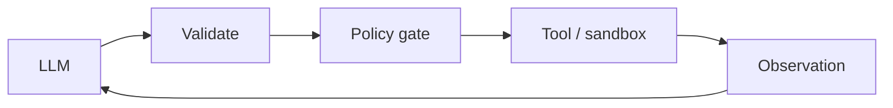

# Chapter 55: Dynamic Tool Retrieval

**Part VI — Tools & Environment**

## Dynamic Tool Retrieval Pattern Overview

Instead of exposing 500 tools, retrieve the k most relevant tool schemas per task.

**Dynamic Tool Retrieval** is catalogued in the **Tools & Environment** part of the catalog (id `tool-retrieval`). It is tagged for general, enterprise and is assembled from 3 components.

Index tool descriptions; retrieve top-k per task; the model uses the retrieved subset. Retrieval by relevance is efficient — and relevance is not trust: a malicious third-party tool that ranks well gets invoked because the model treats retrieved availability as permission (tool smuggling, high). Permission first, then relevance; vetting plus sandbox-tier for the untrusted.

**Definition 1 (Permission-first retrieval).** Tool retrieval is *permission-first* iff (i) the candidate set is filtered by caller permission before relevance ranking (unpermitted tools never enter the ranking), and (ii) new or low-reputation tools require human vetting plus sandbox-only tier before production context.

**Theorem 1 (Relevance cannot grant authority).** Under permission-first retrieval, a tool's rank determines visibility, never authority: unpermitted tools are invisible regardless of relevance, and unvetted tools are sandboxed regardless of rank.

*Proof.* Filtering before ranking removes unpermitted tools from the candidate set — relevance scores are computed over permitted tools only, so a malicious tool with perfect relevance scores zero visibility (it never enters the ranked set). Vetting gates the remainder: new or low-reputation tools that pass the permission filter land in the sandbox-only tier, where invocation is contained and observed. The catalogued proof (MCP description rewrite injecting all clients) is relevance-without-permission: a description engineered to rank, consumed as authority. Permission-first inverts the order — trust first, relevance second — and the model never sees a tool it may not use. Verify permission filters run before ranking; audit registry bindings; confirm unvetted tools cannot reach production context through ranking tricks. ∎

## Practical Applications & Use Cases

Domains the catalog tags this pattern for:

- general
- enterprise

1 documented failure scenario exercises it:

| Scenario | Severity | Likelihood | Domain |
|---|---|---|---|
| MCP server rewrites tool descriptions to inject all clients | Critical | Medium | engineering |

It also appears in 5 composition cascades:

| Cascade | Class | Blast radius | Impact |
|---|---|---|---|
| Cross-scenario cascade in engineering | Cascading | fleet | Critical |
| MCP server rewrites tool descriptions to inject all clients | Derived | service | Critical |
| Tool Registry / MCP-Style Server — tool poisoning | Inherent | single-agent | Critical |
| Context-window silent truncation | Emergent | service | High |
| Dynamic Tool Retrieval — tool smuggling | Inherent | single-agent | High |

## How It Works

1. Index tool descriptions.
2. Retrieve top-k per task.
3. Model uses retrieved subset.

## Components

- Tool index
- Retriever
- Allowlist filter

## Control-Flow Diagram

## Failure Modes and Risks

1 failure mode is documented for this pattern:

| Failure mode | Severity | What happens |
|---|---|---|
| Tool smuggling | High | Malicious tool (registered by third party) ranks into context and gets invoked. |

## Protections

1. Retrieval scoped by caller permission before relevance ranking.
2. New/low-reputation tools require human vetting + sandbox-only tier.

## At a Glance

| Field | Value |
|---|---|
| Catalog id | `tool-retrieval` |
| Part | VI — Tools & Environment |
| Domains | general, enterprise |
| Components | Tool index, Retriever, Allowlist filter |
| Failure modes | 1 |
| Protections | 2 |
| Related patterns | Tool Registry / MCP-Style Server, Tool Use / Function Calling |
| Linked scenarios | 1 |
| Linked cascades | 5 |

## Key Takeaways

- Instead of exposing 500 tools, retrieve the k most relevant tool schemas per task.
- Retrieval scoped by caller permission before relevance ranking.
- New/low-reputation tools require human vetting + sandbox-only tier.
- Know its failure modes: Tool smuggling (high).

## References and Related Patterns

| Related pattern | Part | Summary |
|---|---|---|
| Tool Registry / MCP-Style Server | Tools & Environment | Central registry of tools (e.g., Model Context Protocol servers) with ownership, reputation, and permission metadata. |
| Tool Use / Function Calling | Agent Loop & Control | Expose typed tools to the model; model emits structured calls the runtime validates and executes. |

## Council deliberation

- **Memory-systems researcher:** Dynamic Tool Retrieval indexes tool descriptions and retrieves the top-k schemas per task through a Tool index, Retriever, and Allowlist filter instead of exposing hundreds of tools at once. That helps general and enterprise agents stay focused and within context. The tension is Tool smuggling, where a malicious third-party tool ranks into context and gets invoked because relevance outranked trust and the model treats retrieved availability as permission.
- **Safety researcher:** Relevance cannot outrank permission. The protections that carry weight are scoping retrieval by caller permission before relevance ranking and requiring human vetting plus sandbox-only tier for new or low-reputation tools. The operator should verify permission filters run first, audit registry and tool-use bindings, and confirm unvetted tools cannot reach production context through ranking tricks.

## Council reading

- **Red team:** Start with Tool smuggling (high): Malicious tool (registered by third party) ranks into context and gets invoked. MCP server rewrites tool descriptions to inject all clients is the catalogued proof — critical severity, engineering domain — so rehearse that exact chain before any other.
- **Blue team:** Hold with Retrieval scoped by caller permission before relevance ranking; New/low-reputation tools require human vetting + sandbox-only tier. Compose with Tool Registry / MCP-Style Server, Tool Use / Function Calling so a failure in one pattern meets a control in another.
- **Operator:** Deploy where it is tagged (general, enterprise), and watch the 5 linked cascades — Cross-scenario cascade in engineering first, because composition is where small faults amplify. The takeaway list above is the runbook: protections first, failure modes as the test plan. If a protection cannot be demonstrated in a review, it is a wish, not a control.

## Conclusion

In the catalog this chapter was generated from, **Dynamic Tool Retrieval** is one of 107 patterns in *Tools & Environment*, carrying 1 documented failure mode and 2 listed protections. Use it as a starting point, not a specification: the protection list is the part that survives contact with an adversary.

---
