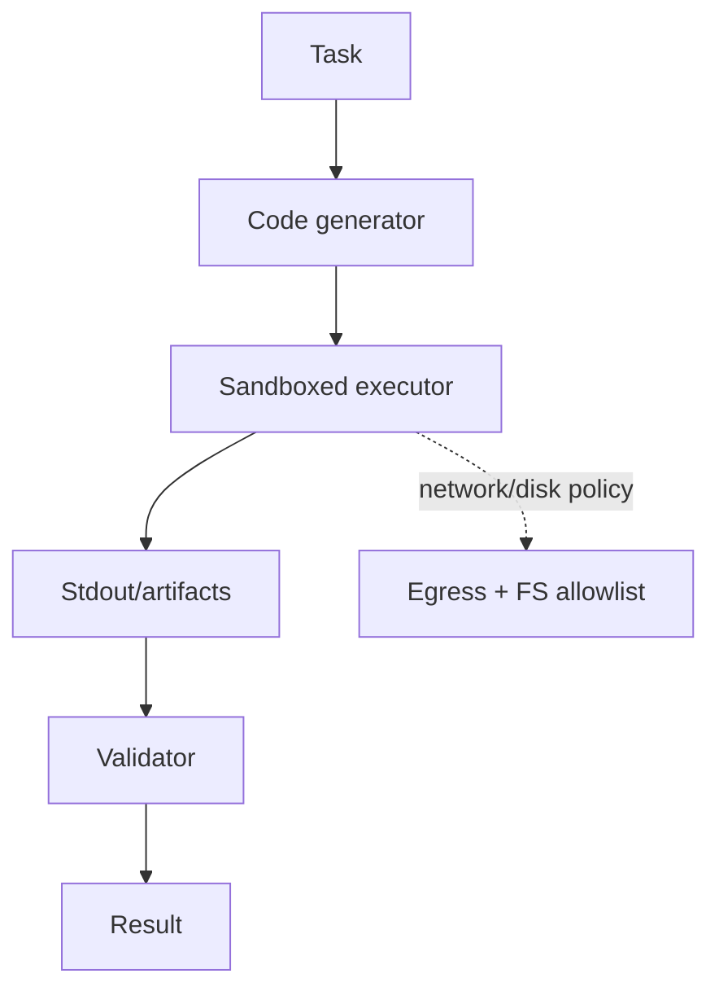

# Chapter 56: Code-as-Action

**Part VI — Tools & Environment**

## Code-as-Action Pattern Overview

Agent writes and executes code instead of chaining many tool calls — more capable, far riskier.

**Code-as-Action** is catalogued in the **Tools & Environment** part of the catalog (id `code-as-action`). It is tagged for engineering, data, devops and is assembled from 3 components.

The model writes a program against a tool SDK; it runs in a sandbox; stdout and artifacts are captured. Code compresses capability (complex logic in one artifact instead of dozens of tool calls) and concentrates risk (all three documented failures are critical): sandbox escape to host, cloud metadata, or secrets; destructive code against shared volumes or prod; exfiltration of secrets through allowed egress. Default-deny sandboxing with no standing secrets is the whole posture.

**Definition 1 (Default-deny execution).** Code execution is *default-deny* iff (i) it runs in a Micro-VM/container sandbox with no network by default, egress allowlists, read-only FS plus tmpfs, (ii) no production credentials are ever mounted (short-lived scoped tokens only), and (iii) pre-execution static scans plus post-execution artifact review gate every run.

**Theorem 1 (Generated code cannot reach standing secrets).** Under default-deny execution, generated code — however malicious, mistaken, or injected — can neither exfiltrate standing secrets (none are mounted) nor persist beyond the sandbox (no network, read-only FS, tmpfs) nor evade review (scan before, artifacts after).

*Proof.* Exfiltration needs secrets and a road: (ii) removes standing secrets (scoped tokens are short-lived and task-bound), (i) removes the road (no network by default; allowlisted egress only) and the persistence (read-only FS, tmpfs evaporates). Escape to host/cloud metadata needs a vulnerable boundary: Micro-VM/container isolation with seccomp narrows the syscall surface below container grade. Destructive code needs writable shared state: read-only mounts plus scratch-only writes confine damage to the sandbox. Pre-execution scans catch the known-bad; post-execution artifact review catches the novel-bad. Verify no generated code can reach standing secrets; audit the sandbox, computer-use, and DLP controls — the catalogued schema-rewrite proof is what un-sandboxed code does to production. ∎

## Practical Applications & Use Cases

Domains the catalog tags this pattern for:

- engineering
- data
- devops

1 documented failure scenario exercises it:

| Scenario | Severity | Likelihood | Domain |
|---|---|---|---|
| Data agent rewrites a schema and silently corrupts downstream dashboards | High | High | data |

It also appears in 5 composition cascades:

| Cascade | Class | Blast radius | Impact |
|---|---|---|---|
| Browser / Web Research Agent — hidden-text injection | Inherent | service | Critical |
| Code-as-Action — sandbox escape | Inherent | service | Critical |
| Coding Agent Pipeline — destructive migrations | Inherent | single-agent | Critical |
| Sandboxed Execution — misconfigured egress | Inherent | service | Critical |
| Data agent rewrites a schema and silently corrupts downstream dashboards | Derived | service | High |

## How It Works

1. Model writes program against a tool SDK.
2. Runs in sandbox.
3. Captures stdout/artifacts.

## Components

- Code generator
- Sandbox runtime
- Result parser

## Control-Flow Diagram

## Failure Modes and Risks

3 failure modes are documented for this pattern:

| Failure mode | Severity | What happens |
|---|---|---|
| Sandbox escape | Critical | Generated code reaches host, cloud metadata, or secrets. |
| Destructive code | Critical | rm -rf on shared volumes; DROP TABLE against prod. |
| Exfiltration | Critical | Secrets read in sandbox, shipped out via allowed egress. |

## Protections

1. Micro-VM/container sandbox: no network by default, egress allowlist, read-only FS + tmpfs.
2. Never mount production credentials; use short-lived scoped tokens.
3. Pre-execution static scan + post-execution artifact review.

## At a Glance

| Field | Value |
|---|---|
| Catalog id | `code-as-action` |
| Part | VI — Tools & Environment |
| Domains | engineering, data, devops |
| Components | Code generator, Sandbox runtime, Result parser |
| Failure modes | 3 |
| Protections | 3 |
| Related patterns | Sandboxed Execution, Computer Use (GUI Agent), Data Loss Prevention |
| Linked scenarios | 1 |
| Linked cascades | 5 |

## Key Takeaways

- Agent writes and executes code instead of chaining many tool calls — more capable, far riskier.
- Micro-VM/container sandbox: no network by default, egress allowlist, read-only FS + tmpfs.
- Never mount production credentials; use short-lived scoped tokens.
- Pre-execution static scan + post-execution artifact review.
- Know its failure modes: Sandbox escape (critical); Destructive code (critical); Exfiltration (critical).

## References and Related Patterns

| Related pattern | Part | Summary |
|---|---|---|
| Sandboxed Execution | Tools & Environment | Every untrusted computation runs in a disposable, capability-limited environment. |
| Computer Use (GUI Agent) | Tools & Environment | Agent operates a real UI via screenshots + click/typing actions when no API exists. |
| Data Loss Prevention | Safety, Security & Governance | Control what data may cross system boundaries: egress allowlists, secret scanning, destination reputation. |

## Council deliberation

- **Continual-learning researcher:** Code-as-Action has the agent write and execute code against a tool SDK through a Code generator, Sandbox runtime, and Result parser, capturing stdout and artifacts instead of chaining many tool calls. That helps engineering, data, and devops express complex logic compactly. Yet its critical failure modes compound, with Sandbox escape to host or secrets, Destructive code harming shared volumes or production tables, and Exfiltration shipping secrets out through allowed egress.
- **Safety researcher:** Capability here demands default denial. The protections that carry weight are micro-VM or container sandboxing with no network by default, egress allowlists, read-only filesystems with tmpfs, short-lived scoped tokens instead of production credentials, and pre-execution scans plus artifact review. The operator should verify sandbox-execution, computer-use, and data-loss-prevention controls and confirm generated code cannot reach standing secrets.

## Council reading

- **Red team:** Start with Sandbox escape (critical): Generated code reaches host, cloud metadata, or secrets. Data agent rewrites a schema and silently corrupts downstream dashboards is the catalogued proof — high severity, data domain — so rehearse that exact chain before any other.
- **Blue team:** Hold with Micro-VM/container sandbox: no network by default, egress allowlist, read-only FS + tmpfs; Never mount production credentials; use short-lived scoped tokens. Then layer the remaining 1: defence here is the list, not any single item. Compose with Sandboxed Execution, Computer Use (GUI Agent) so a failure in one pattern meets a control in another.
- **Operator:** Deploy where it is tagged (engineering, data, devops), and watch the 5 linked cascades — Browser / Web Research Agent — hidden-text injection first, because composition is where small faults amplify. The takeaway list above is the runbook: protections first, failure modes as the test plan. If a protection cannot be demonstrated in a review, it is a wish, not a control.

## Conclusion

In the catalog this chapter was generated from, **Code-as-Action** is one of 107 patterns in *Tools & Environment*, carrying 3 documented failure modes and 3 listed protections. Use it as a starting point, not a specification: the protection list is the part that survives contact with an adversary.

---
