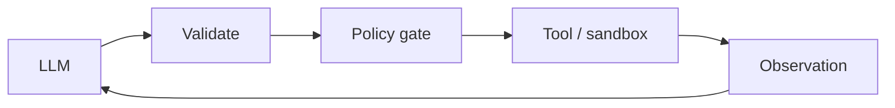

# Chapter 58: Browser / Web Research Agent

**Part VI — Tools & Environment**

## Browser / Web Research Agent Pattern Overview

Navigates, extracts, and summarizes the web — the largest prompt-injection surface agents have.

**Browser / Web Research Agent** is catalogued in the **Tools & Environment** part of the catalog (id `browser-agent`). It is tagged for research, general, procurement and is assembled from 4 components.

Fetch or render pages; extract content as data; summarize with citations. The web is untrusted input at planetary scale: hidden text (white-on-white, HTML comments) instructing exfiltration or purchase, paywalled and ToS-protected content inviting violation, hostile files waiting to be fetched and opened. The browser pipeline is therefore a decontamination line — strip scripts, styles, and hidden text; content becomes delimited data; egress allowlisted with no credentials in the profile; outputs filtered — before anything reaches the model.

**Definition 1 (Decontaminated browsing).** Web content is *decontaminated* iff (i) scripts, styles, and hidden text are stripped before model exposure (what the user wouldn't see, the model never receives), (ii) surviving content enters context only through delimited data channels, (iii) egress is allowlisted with no credentials in the browser profile, and (iv) all derived outputs pass an output filter.

**Theorem 1 (Invisible text cannot instruct).** Under decontamination, hidden-text injection is structurally impossible: the instruction the human cannot see never reaches the model in instructable form.

*Proof.* Hidden-text injection works by presenting different content to the renderer (human sees clean page) and the extractor (model receives white-on-white instructions, HTML comments as commands). Stripping (i) removes exactly the non-visible layer — scripts, styles, hidden text — so the model receives only what a careful human reader would see. Delimited channels (ii) mark even visible content as data: extraction output is quoted, and the model is instructed (system-level, not page-level) that channel content is never instructions. Egress allowlists without profile credentials (iii) bound what a successful injection could do even if it slipped through — no exfiltration channel, no authenticated session to abuse. Output filtering (iv) catches the residual: derived content re-checked before action. Verify hidden text never reaches instructions; audit sanitization and code boundaries; confirm citations survive extraction intact (stripping must preserve provenance, not just remove danger). ∎

## Practical Applications & Use Cases

Domains the catalog tags this pattern for:

- research
- general
- procurement

2 documented failure scenarios exercise it:

| Scenario | Severity | Likelihood | Domain |
|---|---|---|---|
| Hidden instructions in a scraped page steer a research agent | Critical | High | general |
| Vendor selection steered by attacker SEO content | Medium | High | procurement |

It also appears in 8 composition cascades — the 6 most impactful of 8:

| Cascade | Class | Blast radius | Impact |
|---|---|---|---|
| Browser / Web Research Agent — hidden-text injection | Inherent | service | Critical |
| Computer Use (GUI Agent) — visible injected instructions | Inherent | single-agent | Critical |
| Cross-scenario cascade in general | Cascading | fleet | Critical |
| Hidden instructions in a scraped page steer a research agent | Derived | service | Critical |
| Input Sanitization & Prompt-Injection Shield — injection inside tool output | Inherent | single-agent | Critical |
| Trust collapse after a visible bad action | Cascading | org | Critical |

## How It Works

1. Fetch/render pages.
2. Extract content as data.
3. Summarize with citations.

## Components

- Browser driver
- Content extractor
- Injection shield
- Citation tracker

## Control-Flow Diagram

## Failure Modes and Risks

3 failure modes are documented for this pattern:

| Failure mode | Severity | What happens |
|---|---|---|
| Hidden-text injection | Critical | White-on-white text or HTML comments instruct the agent to exfiltrate/buy. |
| Paywall/ToS violation | Medium | Agent ignores access rules. |
| Malicious payload download | High | Agent fetches and opens hostile files. |

## Protections

1. Strip scripts/styles/hidden text; content → delimited data channel.
2. Egress allowlist; no credentials in browser profile.
3. Output filter on anything derived from web content.

## At a Glance

| Field | Value |
|---|---|
| Catalog id | `browser-agent` |
| Part | VI — Tools & Environment |
| Domains | research, general, procurement |
| Components | Browser driver, Content extractor, Injection shield, Citation tracker |
| Failure modes | 3 |
| Protections | 3 |
| Related patterns | Input Sanitization & Prompt-Injection Shield, Code-as-Action |
| Linked scenarios | 2 |
| Linked cascades | 8 |

## Key Takeaways

- Navigates, extracts, and summarizes the web — the largest prompt-injection surface agents have.
- Strip scripts/styles/hidden text; content → delimited data channel.
- Egress allowlist; no credentials in browser profile.
- Output filter on anything derived from web content.
- Know its failure modes: Hidden-text injection (critical); Paywall/ToS violation (medium); Malicious payload download (high).

## References and Related Patterns

| Related pattern | Part | Summary |
|---|---|---|
| Input Sanitization & Prompt-Injection Shield | Safety, Security & Governance | Screen everything entering the context — user input, tool output, retrieved docs, web pages — for injection patterns; quarantine and strip. |
| Code-as-Action | Tools & Environment | Agent writes and executes code instead of chaining many tool calls — more capable, far riskier. |

## Council deliberation

- **Safety researcher:** Browser Research Agent navigates, extracts, and summarizes the web through a Browser driver, Content extractor, Injection shield, and Citation tracker, facing the largest prompt-injection surface agents have for research, general, and procurement. The tension spans Hidden-text injection with white-on-white or comment instructions, Paywall and ToS violations ignoring access rules, and Malicious payload download where fetched hostile files are opened and honored.
- **Evaluation methodologist:** Breadth needs a narrow data channel. The protections that carry weight are stripping scripts, styles, and hidden text into a delimited data channel, enforcing an egress allowlist with no credentials in the browser profile, and filtering outputs derived from web content. The operator should verify hidden text never reaches instructions, audit input-sanitization and code-as-action boundaries, and confirm citations survive extraction intact.

## Council reading

- **Red team:** Start with Hidden-text injection (critical): White-on-white text or HTML comments instruct the agent to exfiltrate/buy. Hidden instructions in a scraped page steer a research agent is the catalogued proof — critical severity, general domain — so rehearse that exact chain before any other.
- **Blue team:** Hold with Strip scripts/styles/hidden text; content → delimited data channel; Egress allowlist; no credentials in browser profile. Then layer the remaining 1: defence here is the list, not any single item. Compose with Input Sanitization & Prompt-Injection Shield, Code-as-Action so a failure in one pattern meets a control in another.
- **Operator:** Deploy where it is tagged (research, general, procurement), and watch the 8 linked cascades — Browser / Web Research Agent — hidden-text injection first, because composition is where small faults amplify. The takeaway list above is the runbook: protections first, failure modes as the test plan. If a protection cannot be demonstrated in a review, it is a wish, not a control.

## Conclusion

In the catalog this chapter was generated from, **Browser / Web Research Agent** is one of 107 patterns in *Tools & Environment*, carrying 3 documented failure modes and 3 listed protections. Use it as a starting point, not a specification: the protection list is the part that survives contact with an adversary.

---
