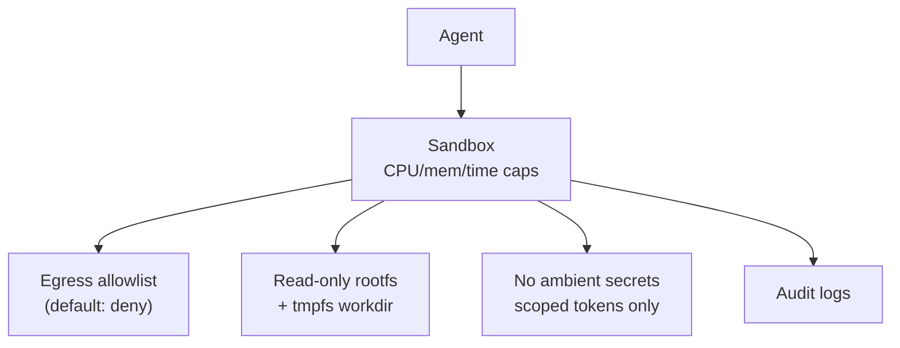

# Chapter 59: Sandboxed Execution

**Part VI — Tools & Environment**

## Sandboxed Execution Pattern Overview

Every untrusted computation runs in a disposable, capability-limited environment.

**Sandboxed Execution** is catalogued in the **Tools & Environment** part of the catalog (id `sandbox-execution`). It is tagged for engineering, devops, general and is assembled from 3 components.

Per-task microVM or container; capabilities capped (CPU, memory, time); no network or egress-allowlisted; destroyed after the task with audit logs retained. Fourteen cascades and four catalogued scenarios touch this pattern — the most-connected containment control in the catalog — because disposability plus default-deny egress is what makes every other tool pattern survivable: code-as-action, browser research, and computer use all assume the sandbox holds.

**Definition 1 (Disposable default-deny sandbox).** A sandbox is *disposable default-deny* iff (i) it is fresh per task (never reused — no shared state, no seeded secrets across tasks), (ii) egress defaults to deny with explicit per-task hostname allowlists, (iii) hostile code runs under MicroVM-class isolation with seccomp profiles, and (iv) audit logs are retained after destruction (destruction without amnesia).

**Theorem 1 (Three escapes, three closures).** Misconfigured egress, shared-sandbox reuse, and kernel escape are each closed by construction: explicit allowlists (no broad wildcards) close the egress hole, fresh-per-task closes the reuse hole, and MicroVM-plus-seccomp narrows the kernel hole below container grade.

*Proof.* Misconfigured egress (broad wildcard allowlists): explicit per-task hostname allowlists make every destination a reviewed decision — the wildcard that lets data leave anyway cannot exist by construction, and default-deny means omissions fail closed. Shared reuse (state/secrets leaking across tasks): fresh sandbox per task means no task inherits another's filesystem, memory, or seeded secrets — each run starts sterile. Kernel escape (container breakout via kernel flaws): MicroVM-class isolation (gVisor/Firecracker) plus seccomp profiles shrink the reachable syscall surface far below plain containers; the escape needs a vulnerability in a much smaller surface. Audit logs retained post-destruction preserve evidence: destruction ends the workload, not the record — confirm retained logs cannot reintroduce secrets. Verify allowlists; audit egress and DLP logs; confirm no reuse, ever. ∎

## Practical Applications & Use Cases

Domains the catalog tags this pattern for:

- engineering
- devops
- general

4 documented failure scenarios exercise it:

| Scenario | Severity | Likelihood | Domain |
|---|---|---|---|
| Autonomous pentest agent pivots from authorized scope to production exfil | Critical | Medium | cybersecurity |
| Code-execution sandbox escape reaches cloud metadata service | Critical | Low | engineering |
| Coding agent runs destructive migration against production | Critical | Medium | engineering |
| Agent installs typosquatted package with postinstall exfil | High | High | engineering |

It also appears in 14 composition cascades — the 6 most impactful of 14:

| Cascade | Class | Blast radius | Impact |
|---|---|---|---|
| Autonomous pentest agent pivots from authorized scope to production exfil | Derived | service | Critical |
| Code-as-Action — sandbox escape | Inherent | service | Critical |
| Code-execution sandbox escape reaches cloud metadata service | Derived | service | Critical |
| Coding Agent Pipeline — destructive migrations | Inherent | single-agent | Critical |
| Coding agent runs destructive migration against production | Derived | service | Critical |
| Cross-scenario cascade in engineering | Cascading | fleet | Critical |

## How It Works

1. Per-task microVM/container.
2. Capabilities: CPU/mem/time limits, no net or egress allowlist.
3. Destroy after task; audit logs retained.

## Components

- Sandbox manager
- Policy (seccomp/AppArmor/egress)
- Log shipper

## Control-Flow Diagram

## Failure Modes and Risks

3 failure modes are documented for this pattern:

| Failure mode | Severity | What happens |
|---|---|---|
| Misconfigured egress | Critical | 'Allowlist' includes broad wildcard; data leaves anyway. |
| Shared sandbox reuse | High | State/seeded secrets leak across tasks. |
| Kernel escape | Critical | Container escape via kernel vuln. |

## Protections

1. Default-deny egress; explicit hostname allowlist per task.
2. Fresh sandbox per task; no reuse.
3. MicroVMs (gVisor/Firecracker-class) for hostile code; seccomp profiles.

## At a Glance

| Field | Value |
|---|---|
| Catalog id | `sandbox-execution` |
| Part | VI — Tools & Environment |
| Domains | engineering, devops, general |
| Components | Sandbox manager, Policy (seccomp/AppArmor/egress), Log shipper |
| Failure modes | 3 |
| Protections | 3 |
| Related patterns | Code-as-Action, Network Egress Control, Data Loss Prevention |
| Linked scenarios | 4 |
| Linked cascades | 14 |

## Key Takeaways

- Every untrusted computation runs in a disposable, capability-limited environment.
- Default-deny egress; explicit hostname allowlist per task.
- Fresh sandbox per task; no reuse.
- MicroVMs (gVisor/Firecracker-class) for hostile code; seccomp profiles.
- Know its failure modes: Misconfigured egress (critical); Shared sandbox reuse (high); Kernel escape (critical).

## References and Related Patterns

| Related pattern | Part | Summary |
|---|---|---|
| Code-as-Action | Tools & Environment | Agent writes and executes code instead of chaining many tool calls — more capable, far riskier. |
| Network Egress Control | Safety, Security & Governance | Agent runtimes can only talk to explicitly allowlisted endpoints; DNS and IP ranges controlled. |
| Data Loss Prevention | Safety, Security & Governance | Control what data may cross system boundaries: egress allowlists, secret scanning, destination reputation. |

## Council deliberation

- **Safety researcher:** Sandboxed Execution runs every untrusted computation in a disposable capability-limited environment through a Sandbox manager, seccomp and AppArmor and egress policy, and a Log shipper, with per-task microVMs, CPU and memory and time limits, and destruction after the task. That helps engineering, devops, and general isolation. Yet its documented failure modes warn of Misconfigured egress with broad wildcards, Shared sandbox reuse leaking state and secrets, and Kernel escape through container flaws.
- **Evaluation methodologist:** Disposability must be literal and default-deny. The protections that carry weight are default-deny egress with explicit per-task hostname allowlists, fresh sandboxes per task with no reuse, and microVM-class isolation with seccomp profiles for hostile code. The operator should verify allowlists against code-as-action needs, audit egress-control and data-loss-prevention logs, and confirm retained audit logs cannot reintroduce secrets.

## Council reading

- **Red team:** Start with Misconfigured egress (critical): 'Allowlist' includes broad wildcard; data leaves anyway. Coding agent runs destructive migration against production is the catalogued proof — critical severity, engineering domain — so rehearse that exact chain before any other.
- **Blue team:** Hold with Default-deny egress; explicit hostname allowlist per task; Fresh sandbox per task; no reuse. Then layer the remaining 1: defence here is the list, not any single item. Compose with Code-as-Action, Network Egress Control so a failure in one pattern meets a control in another.
- **Operator:** Deploy where it is tagged (engineering, devops, general), and watch the 14 linked cascades — Autonomous pentest agent pivots from authorized scope to production exfil first, because composition is where small faults amplify. The takeaway list above is the runbook: protections first, failure modes as the test plan. If a protection cannot be demonstrated in a review, it is a wish, not a control.

## Conclusion

In the catalog this chapter was generated from, **Sandboxed Execution** is one of 107 patterns in *Tools & Environment*, carrying 3 documented failure modes and 3 listed protections. Use it as a starting point, not a specification: the protection list is the part that survives contact with an adversary.

---
