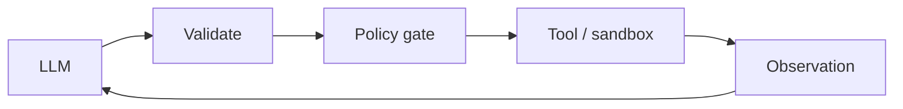

# Chapter 60: Simulation / Digital Twin

**Part VI — Tools & Environment**

## Simulation / Digital Twin Pattern Overview

Rehearse plans against a simulated copy of the environment before touching reality.

**Simulation / Digital Twin** is catalogued in the **Tools & Environment** part of the catalog (id `simulation-twin`). It is tagged for robotics, logistics, finance, energy and is assembled from 3 components.

Build or load the twin with current state; simulate the plan and score outcomes; promote only plans passing safety constraints. The twin buys rehearsal without consequence — but only for the failure modes it models: the sim-to-real gap (the twin omits the failure mode that happens in reality) turns passing simulation into false confidence. A failure-mode library the twin must reproduce plus advisory-only status (real-world guardrails still enforced) are what keep rehearsal honest.

**Definition 1 (Honest twin).** A twin is *honest* iff (i) it reproduces a maintained failure-mode library (every catalogued failure shape for the domain must occur in simulation before the twin may clear a plan touching it), and (ii) simulation is advisory only — promotion requires independent real-world guardrails, never simulated approval alone.

**Theorem 1 (Unmodeled failures are invisible by construction).** A plan that passes a twin missing failure mode $F$ carries zero evidence about $F$: the pass proves the plan survives the modeled world, which excludes $F$ by definition — treating the pass as safety evidence for $F$ is the sim-to-real fallacy.

*Proof.* Simulation evaluates the plan against the twin's model $M$; $F \notin M$ means no simulated trajectory can exhibit $F$, so passing trajectories contain no information about behavior under $F$ (the test cannot fail for a reason it cannot represent). Advisory-only status (ii) encodes this boundary: real-world guardrails decide independently of the twin's verdict, so the twin informs preparation without authorizing action. The failure-mode library (i) shrinks the gap deliberately: each catalogued shape (occupancy-sensor blindness, twin drift over-scheduling) must be reproducible in simulation, so the twin demonstrably covers known failures — and the residual (unknown failures) stays explicitly uncovered rather than implicitly assumed covered. Verify library coverage; check dry-run and canary promotion evidence; confirm no plan reaches reality on simulated approval alone. ∎

## Practical Applications & Use Cases

Domains the catalog tags this pattern for:

- robotics
- logistics
- finance
- energy

2 documented failure scenarios exercise it:

| Scenario | Severity | Likelihood | Domain |
|---|---|---|---|
| Warehouse robot agent ignores occupancy sensor, near-miss with worker | Critical | Medium | robotics |
| Grid simulation twin drifts from the plant; agent over-schedules load | High | Medium | energy |

It also appears in 4 composition cascades:

| Cascade | Class | Blast radius | Impact |
|---|---|---|---|
| Correlated config change | Cascading | fleet | Critical |
| Warehouse robot agent ignores occupancy sensor, near-miss with worker | Derived | service | Critical |
| Grid simulation twin drifts from the plant; agent over-schedules load | Derived | service | High |
| Simulation / Digital Twin — sim-to-real gap | Inherent | service | High |

## How It Works

1. Build/load twin with current state.
2. Simulate plan; score outcomes.
3. Promote only plans passing safety constraints.

## Components

- Simulator
- Constraint checker
- Promotion gate

## Control-Flow Diagram

## Failure Modes and Risks

1 failure mode is documented for this pattern:

| Failure mode | Severity | What happens |
|---|---|---|
| Sim-to-real gap | High | Twin omits the failure mode that happens in reality. |

## Protections

1. Maintain a failure-mode library the twin must reproduce.
2. Simulation is advisory — real-world guardrails still enforced.

## At a Glance

| Field | Value |
|---|---|
| Catalog id | `simulation-twin` |
| Part | VI — Tools & Environment |
| Domains | robotics, logistics, finance, energy |
| Components | Simulator, Constraint checker, Promotion gate |
| Failure modes | 1 |
| Protections | 2 |
| Related patterns | Dry-Run / Diff Mode Tools, Canary & Shadow Deployment |
| Linked scenarios | 2 |
| Linked cascades | 4 |

## Key Takeaways

- Rehearse plans against a simulated copy of the environment before touching reality.
- Maintain a failure-mode library the twin must reproduce.
- Simulation is advisory — real-world guardrails still enforced.
- Know its failure modes: Sim-to-real gap (high).

## References and Related Patterns

| Related pattern | Part | Summary |
|---|---|---|
| Dry-Run / Diff Mode Tools | Tools & Environment | State-changing tools return the would-be diff instead of applying, until confirmed. |
| Canary & Shadow Deployment | Safety, Security & Governance | New agent behaviors ramp gradually: shadow → 1% canary → staged rollout with auto-rollback on SLO breach. |

## Council deliberation

- **Continual-learning researcher:** Simulation or Digital Twin rehearses plans against a simulated environment copy through a Simulator, Constraint checker, and Promotion gate, loading current state, scoring outcomes, and promoting only plans passing safety constraints. That helps robotics, logistics, finance, and energy test before touching reality. The tension is Sim-to-real gap, where the twin omits the very failure mode that occurs in reality and a passing simulation confers false confidence on an unsafe plan.
- **Safety researcher:** Simulation should inform, never authorize. The protections that carry weight are maintaining a failure-mode library the twin must reproduce and keeping simulation advisory while real-world guardrails stay enforced. The operator should verify library coverage, check dry-run-tools and canary-shadow promotion evidence, and confirm no plan reaches reality on simulated approval alone without independent checks.

## Council reading

- **Red team:** Start with Sim-to-real gap (high): Twin omits the failure mode that happens in reality. Warehouse robot agent ignores occupancy sensor, near-miss with worker is the catalogued proof — critical severity, robotics domain — so rehearse that exact chain before any other.
- **Blue team:** Hold with Maintain a failure-mode library the twin must reproduce; Simulation is advisory — real-world guardrails still enforced. Compose with Dry-Run / Diff Mode Tools, Canary & Shadow Deployment so a failure in one pattern meets a control in another.
- **Operator:** Deploy where it is tagged (robotics, logistics, finance, energy), and watch the 4 linked cascades — Correlated config change first, because composition is where small faults amplify. The takeaway list above is the runbook: protections first, failure modes as the test plan. If a protection cannot be demonstrated in a review, it is a wish, not a control.

## Conclusion

In the catalog this chapter was generated from, **Simulation / Digital Twin** is one of 107 patterns in *Tools & Environment*, carrying 1 documented failure mode and 2 listed protections. Use it as a starting point, not a specification: the protection list is the part that survives contact with an adversary.

---
