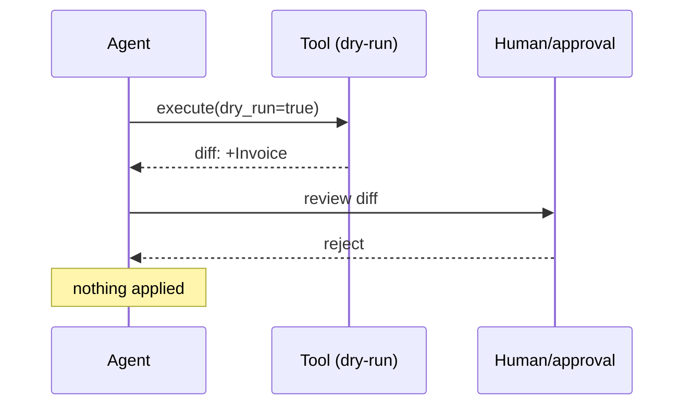

# Chapter 61: Dry-Run / Diff Mode Tools

**Part VI — Tools & Environment**

## Dry-Run / Diff Mode Tools Pattern Overview

State-changing tools return the would-be diff instead of applying, until confirmed.

**Dry-Run / Diff Mode Tools** is catalogued in the **Tools & Environment** part of the catalog (id `dry-run-tools`). It is tagged for devops, finance, procurement and is assembled from 3 components.

The tool supports mode=dry_run; it returns the diff or simulated receipt; the confirmed call applies with an idempotency key. Preview-then-apply converts blind action into reviewed action — provided the preview is honest and the mode is real. Dry-run lies (simulated diff differs from real apply: hidden webhooks, secondary effects) and mode confusion (the agent believes it is previewing while applying for real) are the two ways the preview becomes the hazard.

**Definition 1 (Honest preview).** A dry-run is *honest* iff (i) mode is server-enforced and included in the signed response (the agent cannot mistake or misrepresent which mode it is in), (ii) the diff enumerates all secondary effects (notifications, webhooks — not just the primary change), and (iii) dry-run receipts are logged to the audit trail (previews are attributable).

**Theorem 1 (Preview must be server truth).** If mode enforcement or diff completeness lives client-side, then dry-run is theater: the agent (or its injector) can misstate the mode or omit the side effect, and the human confirms a fiction.

*Proof.* Mode confusion is a client-side belief about server state: the agent "believes" dry-run while the server applies. Server-enforced mode with signed responses (i) removes the belief — the mode is a server fact, cryptographically attached to the response, not an agent assumption. Dry-run lies are incomplete diffs: hidden webhooks fire on apply but not on preview. Enumerating secondary effects (ii) makes the diff complete by construction — what the preview omits cannot be approved knowingly. Audit-logged receipts (iii) make previews attributable and comparable to applies: deviations between previewed and applied become findings, not mysteries. Verify mode flags against checkpoint-rollback and approval-gates; confirm the diff reliably predicts the real apply; check the catalogued proof (wrong-fleet restart) runs through preview first. ∎

## Practical Applications & Use Cases

Domains the catalog tags this pattern for:

- devops
- finance
- procurement

1 documented failure scenario exercises it:

| Scenario | Severity | Likelihood | Domain |
|---|---|---|---|
| Self-healing agent restarts the wrong fleet during an incident | Critical | Medium | operations |

It also appears in 5 composition cascades:

| Cascade | Class | Blast radius | Impact |
|---|---|---|---|
| Self-healing agent restarts the wrong fleet during an incident | Derived | service | Critical |
| Dry-Run / Diff Mode Tools — dry-run lies | Inherent | service | High |
| Simulation / Digital Twin — sim-to-real gap | Inherent | service | High |
| Shadow Agents (Dry-Run Parity) — shadow divergence ignored | Inherent | service | Medium |
| Tool Dry-Run Tier (Alias: Safe-Mode Tools) — simulate/apply divergence | Inherent | single-agent | Medium |

## How It Works

1. Tool supports mode=dry_run.
2. Returns diff/simulated receipt.
3. Confirmed call applies with idempotency key.

## Components

- Dry-run capable tools
- Diff visualizer
- Confirm flow

## Control-Flow Diagram

## Failure Modes and Risks

2 failure modes are documented for this pattern:

| Failure mode | Severity | What happens |
|---|---|---|
| Dry-run lies | High | Simulated diff differs from real apply (hidden side effects like webhooks). |
| Mode confusion | High | Agent believes it is in dry-run while applying for real. |

## Protections

1. Mode is server-enforced and included in signed response.
2. Enumerate secondary effects (notifications, webhooks) in the diff.
3. Dry-run receipts logged to audit trail.

## At a Glance

| Field | Value |
|---|---|
| Catalog id | `dry-run-tools` |
| Part | VI — Tools & Environment |
| Domains | devops, finance, procurement |
| Components | Dry-run capable tools, Diff visualizer, Confirm flow |
| Failure modes | 2 |
| Protections | 3 |
| Related patterns | Checkpointing & Rollback, Approval Gates for Irreversible Actions |
| Linked scenarios | 1 |
| Linked cascades | 5 |

## Key Takeaways

- State-changing tools return the would-be diff instead of applying, until confirmed.
- Mode is server-enforced and included in signed response.
- Enumerate secondary effects (notifications, webhooks) in the diff.
- Dry-run receipts logged to audit trail.
- Know its failure modes: Dry-run lies (high); Mode confusion (high).

## References and Related Patterns

| Related pattern | Part | Summary |
|---|---|---|
| Checkpointing & Rollback | Agent Loop & Control | Snapshot state before risky operations so the agent can revert on failure. |
| Approval Gates for Irreversible Actions | Safety, Security & Governance | Irreversible or high-impact actions require explicit human approval with full context — no exceptions by design. |

## Council deliberation

- **Evaluation methodologist:** Dry-Run Diff Mode gives state-changing tools a would-be diff path through dry-run capable tools, a Diff visualizer, and Confirm flow, returning simulated receipts until a confirmed call applies with an idempotency key. That helps devops, finance, and procurement preview impact. The tension pairs Dry-run lies where hidden webhooks diverge from the preview with Mode confusion where the agent believes it previews while actually applying for real.
- **Safety researcher:** Preview value depends on server truth. The protections that carry weight are server-enforced mode included in signed responses, enumerating secondary effects like notifications and webhooks in the diff, and logging dry-run receipts to the audit trail. The operator should verify mode flags against checkpoint-rollback and approval-gates, and confirm the diff reliably predicts the real apply before confirmation.

## Council reading

- **Red team:** Start with Dry-run lies (high): Simulated diff differs from real apply (hidden side effects like webhooks). Self-healing agent restarts the wrong fleet during an incident is the catalogued proof — critical severity, operations domain — so rehearse that exact chain before any other.
- **Blue team:** Hold with Mode is server-enforced and included in signed response; Enumerate secondary effects (notifications, webhooks) in the diff. Then layer the remaining 1: defence here is the list, not any single item. Compose with Checkpointing & Rollback, Approval Gates for Irreversible Actions so a failure in one pattern meets a control in another.
- **Operator:** Deploy where it is tagged (devops, finance, procurement), and watch the 5 linked cascades — Self-healing agent restarts the wrong fleet during an incident first, because composition is where small faults amplify. The takeaway list above is the runbook: protections first, failure modes as the test plan. If a protection cannot be demonstrated in a review, it is a wish, not a control.

## Conclusion

In the catalog this chapter was generated from, **Dry-Run / Diff Mode Tools** is one of 107 patterns in *Tools & Environment*, carrying 2 documented failure modes and 3 listed protections. Use it as a starting point, not a specification: the protection list is the part that survives contact with an adversary.

---
