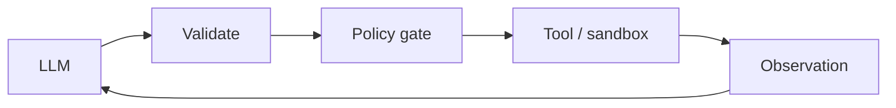

# Chapter 62: Tool Registry / MCP-Style Server

**Part VI — Tools & Environment**

## Tool Registry / MCP-Style Server Pattern Overview

Central registry of tools (e.g., Model Context Protocol servers) with ownership, reputation, and permission metadata.

**Tool Registry / MCP-Style Server** is catalogued in the **Tools & Environment** part of the catalog (id `mcp-registry`). It is tagged for enterprise, general and is assembled from 4 components.

Tools registered with owner, scope, and data class; the registry enforces which agent may bind which tool; versioned schemas with change review. Centralization concentrates trust — which concentrates attack value: tool poisoning (malicious server rewriting descriptions to inject every client, critical), rug-pull updates (trusted tools swapped for exfiltrating versions post-vetting), and shadow tools (agents binding directly to unvetted endpoints). Pinning, registry-sourced descriptions, and binding policy are what keep the center trustworthy.

**Definition 1 (Pinned registry).** A registry is *pinned* iff (i) tool schema hashes are pinned with re-vetting on any change, (ii) agents receive descriptions from the registry (never the live server), and (iii) binding policy restricts which agent-plus-task classes may use which tool tiers — with direct endpoint bypass denied.

**Theorem 1 (Trust the registry, not the server).** Under a pinned registry, a compromised or malicious tool server cannot inject clients, swap vetted tools, or be bypassed: descriptions come from the pinned record, changes trigger re-vetting, and bindings enforce tiers regardless of what the live server claims.

*Proof.* Poisoning rewrites live descriptions; registry-sourced descriptions (ii) mean clients never read the live server's words — the poisoned text is where clients don't look. Rug-pull updates swap vetted tools post-vetting; hash pinning with re-vetting (i) detects the swap (hash mismatch) and blocks the new version pending review — trust does not survive modification silently. Shadow tools bypass the registry entirely; binding policy (iii) plus denied direct bypass means unvetted endpoints are unreachable regardless of agent intent. Verify hash pins; audit retrieval and least-privilege bindings; confirm direct endpoint bypass is denied. The catalogued proof (MCP description rewrite injecting all clients) is exactly the live-server-trust failure the pinned registry removes. ∎

## Practical Applications & Use Cases

Domains the catalog tags this pattern for:

- enterprise
- general

1 documented failure scenario exercises it:

| Scenario | Severity | Likelihood | Domain |
|---|---|---|---|
| MCP server rewrites tool descriptions to inject all clients | Critical | Medium | engineering |

It also appears in 6 composition cascades:

| Cascade | Class | Blast radius | Impact |
|---|---|---|---|
| Cross-scenario cascade in engineering | Cascading | fleet | Critical |
| MCP server rewrites tool descriptions to inject all clients | Derived | service | Critical |
| Tool Registry / MCP-Style Server — tool poisoning | Inherent | single-agent | Critical |
| Context-window silent truncation | Emergent | service | High |
| Dynamic Tool Retrieval — tool smuggling | Inherent | single-agent | High |
| Skill Library (Reusable Capabilities) — skill with hidden tool calls | Inherent | single-agent | High |

## How It Works

1. Tools registered with owner + scope + data class.
2. Registry enforces which agent may bind which tool.
3. Versioned schemas; change review.

## Components

- Registry
- Binding policy
- Reputation/scoring
- Audit

## Control-Flow Diagram

## Failure Modes and Risks

3 failure modes are documented for this pattern:

| Failure mode | Severity | What happens |
|---|---|---|
| Tool poisoning | Critical | Malicious server rewrites its tool descriptions to inject instructions into every client. |
| Rug-pull update | High | Trusted server swaps tools to exfiltrating versions after vetting. |
| Shadow tools | Medium | Agents bind directly to unvetted endpoints. |

## Protections

1. Pin tool schema hashes; changes require re-vetting.
2. Tool descriptions from registry, not from the live server.
3. Binding policy: which agent+task classes may use which tool tiers.

## At a Glance

| Field | Value |
|---|---|
| Catalog id | `mcp-registry` |
| Part | VI — Tools & Environment |
| Domains | enterprise, general |
| Components | Registry, Binding policy, Reputation/scoring, Audit |
| Failure modes | 3 |
| Protections | 3 |
| Related patterns | Dynamic Tool Retrieval, Least Privilege Scoping |
| Linked scenarios | 1 |
| Linked cascades | 6 |

## Key Takeaways

- Central registry of tools (e.g., Model Context Protocol servers) with ownership, reputation, and permission metadata.
- Pin tool schema hashes; changes require re-vetting.
- Tool descriptions from registry, not from the live server.
- Binding policy: which agent+task classes may use which tool tiers.
- Know its failure modes: Tool poisoning (critical); Rug-pull update (high); Shadow tools (medium).

## References and Related Patterns

| Related pattern | Part | Summary |
|---|---|---|
| Dynamic Tool Retrieval | Tools & Environment | Instead of exposing 500 tools, retrieve the k most relevant tool schemas per task. |
| Least Privilege Scoping | Safety, Security & Governance | The agent holds the minimum credentials and data access needed for the current task — nothing ambient, nothing standing. |

## Council deliberation

- **Memory-systems researcher:** Tool Registry in MCP style centralizes tools through a Registry, Binding policy, Reputation scoring, and Audit, registering owner, scope, and data class, restricting which agents may bind which tools, and versioning schemas with change review. That helps enterprise and general governance. Yet its documented failure modes escalate, with Tool poisoning rewriting descriptions into instructions, Rug-pull update swapping trusted tools after vetting, and Shadow tools binding directly to unvetted endpoints.
- **Safety researcher:** Centralization must pin trust, not just list it. The protections that carry weight are pinning tool schema hashes with re-vetting on change, serving descriptions from the registry rather than the live server, and binding policy limiting which agent and task classes may use which tiers. The operator should verify hash pins, audit tool-retrieval and least-privilege bindings, and confirm direct endpoint bypass is denied.

## Council reading

- **Red team:** Start with Tool poisoning (critical): Malicious server rewrites its tool descriptions to inject instructions into every client. MCP server rewrites tool descriptions to inject all clients is the catalogued proof — critical severity, engineering domain — so rehearse that exact chain before any other.
- **Blue team:** Hold with Pin tool schema hashes; changes require re-vetting; Tool descriptions from registry, not from the live server. Then layer the remaining 1: defence here is the list, not any single item. Compose with Dynamic Tool Retrieval, Least Privilege Scoping so a failure in one pattern meets a control in another.
- **Operator:** Deploy where it is tagged (enterprise, general), and watch the 6 linked cascades — Cross-scenario cascade in engineering first, because composition is where small faults amplify. The takeaway list above is the runbook: protections first, failure modes as the test plan. If a protection cannot be demonstrated in a review, it is a wish, not a control.

## Conclusion

In the catalog this chapter was generated from, **Tool Registry / MCP-Style Server** is one of 107 patterns in *Tools & Environment*, carrying 3 documented failure modes and 3 listed protections. Use it as a starting point, not a specification: the protection list is the part that survives contact with an adversary.

---
