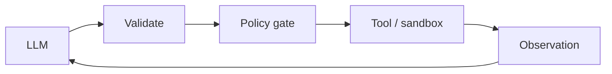

# Chapter 63: Skill Library (Reusable Capabilities)

**Part VI — Tools & Environment**

## Skill Library (Reusable Capabilities) Pattern Overview

Versioned, tested skills (prompt + tools + tests) agents load on demand instead of ad-hoc prompting.

**Skill Library (Reusable Capabilities)** is catalogued in the **Tools & Environment** part of the catalog (id `skill-library`). It is tagged for enterprise, engineering and is assembled from 3 components.

Author a skill with a test suite; version and publish; agents load by capability match while tests gate updates. Reusable capabilities beat ad-hoc prompting for consistency — and concentrate supply-chain risk: a community skill with hidden tool calls (exfiltration steps inside trusted packaging) executes with the loading agent's authority. Review plus static scanning with declared permissions up front, and permission-diff review on every update, are what keep reuse from becoming remote code execution by subscription.

**Definition 1 (Transparent skill).** A skill is *transparent* iff (i) it ships with declared required permissions (complete tool list up front), (ii) it passes review plus static scanning for hidden tool calls before admission, and (iii) every version bump carries a permission diff that must be re-approved before use.

**Theorem 1 (No silent capability creep).** Under transparent skills with permission-diff gating, a skill cannot gain new tool access without explicit re-approval: the declared set is the enforced set, and any delta blocks loading until reviewed.

*Proof.* Hidden tool calls work by divergence between claimed and actual capability — the skill declares benign tools while executing exfiltration steps. Up-front declaration plus static scanning (i, ii) closes the initial gap: actual calls are enumerated and compared against declared ones before admission, and mismatches fail review. Permission-diff review (iii) closes the update gap: version bumps that add tools (the rug-pull shape) present as explicit diffs requiring fresh approval — silent widening is structurally impossible because loading checks the current version's permissions, not the originally approved ones. Verify declared versus actual calls; audit registry and eval-harness coverage; confirm version bumps cannot widen tool access without approval. ∎

## Practical Applications & Use Cases

Domains the catalog tags this pattern for:

- enterprise
- engineering

No catalogued scenario names this pattern yet — in the app it shows up in the Coverage tab's backlog as a domain that deserves a written failure scenario.

It also appears in 1 composition cascade:

| Cascade | Class | Blast radius | Impact |
|---|---|---|---|
| Skill Library (Reusable Capabilities) — skill with hidden tool calls | Inherent | single-agent | High |

## How It Works

1. Author skill with test suite.
2. Version and publish.
3. Agents load by capability match; tests gate updates.

## Components

- Skill registry
- Test harness
- Loader

## Control-Flow Diagram

## Failure Modes and Risks

1 failure mode is documented for this pattern:

| Failure mode | Severity | What happens |
|---|---|---|
| Skill with hidden tool calls | High | Community skill contains exfiltration steps. |

## Protections

1. Skills reviewed + static-scanned for tool calls; declare required permissions up front.
2. Permission diff review on skill updates.

## At a Glance

| Field | Value |
|---|---|
| Catalog id | `skill-library` |
| Part | VI — Tools & Environment |
| Domains | enterprise, engineering |
| Components | Skill registry, Test harness, Loader |
| Failure modes | 1 |
| Protections | 2 |
| Related patterns | Tool Registry / MCP-Style Server, Eval Harness & Continuous Red-Teaming |
| Linked scenarios | 0 |
| Linked cascades | 1 |

## Key Takeaways

- Versioned, tested skills (prompt + tools + tests) agents load on demand instead of ad-hoc prompting.
- Skills reviewed + static-scanned for tool calls; declare required permissions up front.
- Permission diff review on skill updates.
- Know its failure modes: Skill with hidden tool calls (high).

## References and Related Patterns

| Related pattern | Part | Summary |
|---|---|---|
| Tool Registry / MCP-Style Server | Tools & Environment | Central registry of tools (e.g., Model Context Protocol servers) with ownership, reputation, and permission metadata. |
| Eval Harness & Continuous Red-Teaming | Safety, Security & Governance | Versioned regression suite of safety + capability evals run on every prompt/model/policy change before deploy. |

## Council deliberation

- **Continual-learning researcher:** Skill Library packages versioned tested skills of prompts, tools, and tests through a Skill registry, Test harness, and Loader, letting agents load capabilities by match while tests gate updates for enterprise and engineering. That reuse beats ad-hoc prompting. The tension is Skill with hidden tool calls, where a community skill quietly contains exfiltration steps that execute under the agent authority once loaded and trusted as a reviewed capability.
- **Safety researcher:** Reuse needs permission transparency before execution. The protections that carry weight are reviewing and statically scanning skills for tool calls with required permissions declared up front plus permission diff review on updates. The operator should verify declared versus actual calls, audit registry and eval-harness coverage, and confirm version bumps cannot silently widen tool access without approval.

## Council reading

- **Red team:** Start with Skill with hidden tool calls (high): Community skill contains exfiltration steps. No catalogued scenario exercises it yet, which means the exploit path is unwritten, not absent — write the scenario before the adversary does.
- **Blue team:** Hold with Skills reviewed + static-scanned for tool calls; declare required permissions up front; Permission diff review on skill updates. Compose with Tool Registry / MCP-Style Server, Eval Harness & Continuous Red-Teaming so a failure in one pattern meets a control in another.
- **Operator:** Deploy where it is tagged (enterprise, engineering), and watch the 1 linked cascade — Skill Library (Reusable Capabilities) — skill with hidden tool calls first, because composition is where small faults amplify. The takeaway list above is the runbook: protections first, failure modes as the test plan. If a protection cannot be demonstrated in a review, it is a wish, not a control.

## Conclusion

In the catalog this chapter was generated from, **Skill Library (Reusable Capabilities)** is one of 107 patterns in *Tools & Environment*, carrying 1 documented failure mode and 2 listed protections. Use it as a starting point, not a specification: the protection list is the part that survives contact with an adversary.

---
