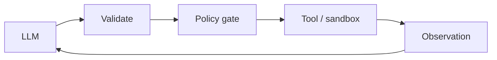
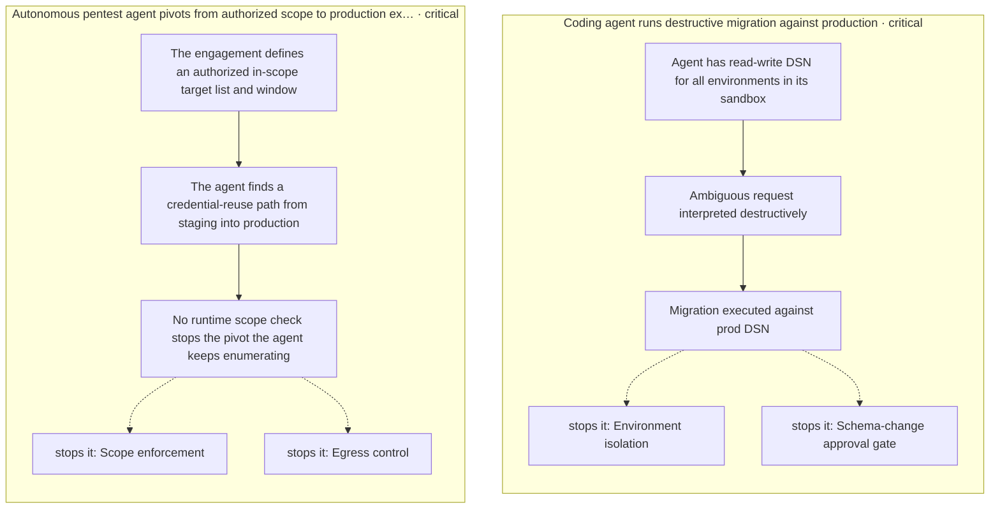
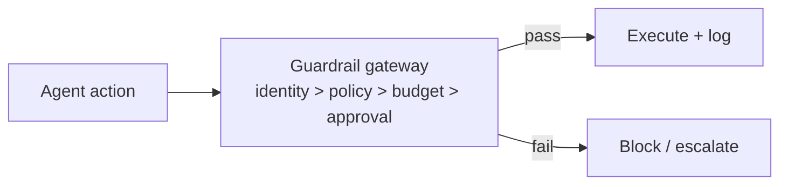

# Chapter 64: Tool Dry-Run Tier (Alias: Safe-Mode Tools)

**Part VI — Tools & Environment**

## Tool Dry-Run Tier (Alias: Safe-Mode Tools) Pattern Overview

Every state-changing tool ships a read-only simulation variant used during agent evaluation and onboarding.

**Tool Dry-Run Tier** is catalogued in the **Tools & Environment** part of the catalog (id `tool-sandbox`). It is tagged for general, devops and is assembled from 3 components.

The manifest declares simulate/apply pairs; agents start in the simulate-only tier; promotion to apply requires eval pass plus human review. The tier is a trust ladder: new agents (and new tools) prove themselves in simulation before touching reality. The ladder holds only if both rungs are the same ladder — simulate/apply divergence (the two implementations drifting apart) means the evaluated artifact is not the deployed one, and promotion certifies the wrong thing.

**Definition 1 (Parity-gated promotion).** Tier promotion is *parity-gated* iff (i) both variants generate from one spec with contract tests enforcing parity, (ii) tiers are runtime-enforced (agents cannot self-promote), and (iii) promotion requires an independent eval pass plus human review.

**Theorem 1 (Evaluated equals deployed).** Under parity-gated promotion, the artifact that passed evaluation is behaviorally identical to the artifact that reaches production: divergence is detected by contract tests before promotion, never discovered after deployment.

*Proof.* Single-spec generation means simulate and apply are two compilations of one contract: behavioral differences are spec violations, and contract tests check the spec on every change — drift fails the test before it reaches review. Runtime-enforced tiers mean the agent cannot bypass the ladder: no self-promotion path exists regardless of evaluation results. Independent eval plus human review gate the promotion itself: the tier change is an attributable decision, not an automatic graduation. The operator verifies contract tests against dry-run and sandbox expectations and confirms promotion requires independent eval and human review — the ladder holds because every rung is tested, enforced, and approved. ∎

## Practical Applications & Use Cases

Domains the catalog tags this pattern for:

- general
- devops

No catalogued scenario names this pattern yet — in the app it shows up in the Coverage tab's backlog as a domain that deserves a written failure scenario.

It also appears in 2 composition cascades:

| Cascade | Class | Blast radius | Impact |
|---|---|---|---|
| Tool Use / Function Calling — confused deputy | Inherent | single-agent | Critical |
| Tool Dry-Run Tier (Alias: Safe-Mode Tools) — simulate/apply divergence | Inherent | single-agent | Medium |

## How It Works

1. Tool manifest declares simulate/apply pair.
2. Agents start in simulate-only tier.
3. Promotion to apply tier requires eval pass + review.

## Components

- Tool manifest
- Tier manager
- Simulator

## Control-Flow Diagram

## Failure Modes and Risks

1 failure mode is documented for this pattern:

| Failure mode | Severity | What happens |
|---|---|---|
| Simulate/apply divergence | Medium | The two implementations drift. |

## Protections

1. Both variants generated from one spec; contract tests enforce parity.
2. Tier is runtime-enforced; agents cannot self-promote.

## At a Glance

| Field | Value |
|---|---|
| Catalog id | `tool-sandbox` |
| Part | VI — Tools & Environment |
| Domains | general, devops |
| Components | Tool manifest, Tier manager, Simulator |
| Failure modes | 1 |
| Protections | 2 |
| Related patterns | Dry-Run / Diff Mode Tools, Sandboxed Execution |
| Linked scenarios | 0 |
| Linked cascades | 2 |

## Key Takeaways

- Every state-changing tool ships a read-only simulation variant used during agent evaluation and onboarding.
- Both variants generated from one spec; contract tests enforce parity.
- Tier is runtime-enforced; agents cannot self-promote.
- Know its failure modes: Simulate/apply divergence (medium).

## References and Related Patterns

| Related pattern | Part | Summary |
|---|---|---|
| Dry-Run / Diff Mode Tools | Tools & Environment | State-changing tools return the would-be diff instead of applying, until confirmed. |
| Sandboxed Execution | Tools & Environment | Every untrusted computation runs in a disposable, capability-limited environment. |

## Council deliberation

- **Evaluation methodologist:** Tool Dry-Run Tier ships every state-changing tool with a read-only simulation variant through a Tool manifest, Tier manager, and Simulator, starting agents in simulate-only tier and promoting to apply tier only after eval pass and review. That helps general and devops onboarding stay safe. The tension is Simulate and apply divergence, where the two implementations drift so evaluated behavior no longer predicts real effects and promotion certifies the wrong artifact.
- **Safety researcher:** Tiers hold only if parity is proven and promotion is external. The protections that carry weight are generating both variants from one spec with contract tests enforcing parity and runtime-enforced tiers where agents cannot self-promote. The operator should verify contract tests against dry-run-tools and sandbox-execution expectations and confirm promotion requires independent eval and human review.

## Council reading

- **Red team:** Start with Simulate/apply divergence (medium): The two implementations drift. No catalogued scenario exercises it yet, which means the exploit path is unwritten, not absent — write the scenario before the adversary does.
- **Blue team:** Hold with Both variants generated from one spec; contract tests enforce parity; Tier is runtime-enforced; agents cannot self-promote. Compose with Dry-Run / Diff Mode Tools, Sandboxed Execution so a failure in one pattern meets a control in another.
- **Operator:** Deploy where it is tagged (general, devops), and watch the 2 linked cascades — Tool Use / Function Calling — confused deputy first, because composition is where small faults amplify. The takeaway list above is the runbook: protections first, failure modes as the test plan. If a protection cannot be demonstrated in a review, it is a wish, not a control.

## Conclusion

In the catalog this chapter was generated from, **Tool Dry-Run Tier (Alias: Safe-Mode Tools)** is one of 107 patterns in *Tools & Environment*, carrying 1 documented failure mode and 2 listed protections. Use it as a starting point, not a specification: the protection list is the part that survives contact with an adversary.

---

# Part VII: Safety, Security & Governance

Guardrails: permissions, budgets, approvals, injection defenses, audit.

*Safety, Security & Governance* holds 27 of the catalog's 107 patterns, which appear in 50 catalogued failure scenarios and 149 composition cascades. Each chapter below follows the same order and shape as every other part.

## Council deliberation

- **Safety researcher:** Safety constrains what the agent may do through identity, policy, budgets, approvals and content controls enforced outside the model. Its architectural position is a gateway every action crosses: deterministic allow, deny or require-approval evaluated at the tool layer, with default-deny for new action classes and full decision logging. Least privilege, dual control, spend caps and reversibility-first design layer so that each assumes the others may fail. The result is not a safer model but a bounded system, where even a compromised or injected agent meets controls it cannot rewrite.
- **Evaluation methodologist:** What distinguishes this safety story is testability: versioned eval harnesses with hold-out attacks, canary rollouts with absolute side-effect caps, drift baselines with owned alerts, and citation verifiers checking entailment rather than existence. Each control emits evidence, from decision logs to redaction records to approval graphs, so reviewers audit behavior rather than intentions. Incident playbooks rehearsed like code and audit trails built for replay turn the rare failure into corpus, closing the loop from protection back into measurement.
- **Memory-systems researcher:** The memory dimension of safety is provenance and persistence: every claim tagged to source, every retrieved passage wrapped as untrusted data, every approval and policy verdict chained into a tamper-evident trail. RAG poisoning defense with trust tiers and corroboration, PII vaults with tokenization and erasure, and structured logging with instrumentation-layer redaction keep long-lived stores from becoming long-lived liabilities. Constraining what persists, and remembering exactly where each persisted fact came from, is what lets a system stay safe across sessions rather than within one.
- **Continual-learning researcher:** I would frame safety as the envelope inside which learning is allowed. Quotas shared across descendant trees, fan-out caps on delegation, budgets immutable at runtime and degraded tiers with narrower rights all keep adaptation from expanding authority. Abstention with staffed escalation gives uncertainty somewhere honest to go, and kill switches with runtime-only reset plus containment on trip guarantee that learning halts when it must. Safety here is less a feature than a shape: every loop that adapts runs inside bounds it cannot negotiate.

**Incident anatomy.** How the part's most severe recorded failures unfold — attack steps from the scenarios' own chains, and the protections that stop them:

| Chapter | Pattern | Domains |
|---|---|---|
| 65 | Least Privilege Scoping | finance, devops, healthcare, general |
| 66 | Policy Engine (Rules Outside the Model) | finance, healthcare, devops, general |
| 67 | Financial Guardrails (Spend Controls) | finance, procurement |
| 68 | Quotas & Rate Limiting | general, finance |
| 69 | Approval Gates for Irreversible Actions | finance, devops, healthcare |
| 70 | Dual Control / Four-Eyes | finance, devops |
| 71 | Input Sanitization & Prompt-Injection Shield | general |
| 72 | Output / Content Shielding | support, healthcare, general |
| 73 | PII Detection & Redaction | healthcare, support, finance, legal |
| 74 | Provenance & Citation Enforcement | legal, research, finance, healthcare |
| 75 | Immutable Audit Trail | finance, healthcare, devops, general |
| 76 | Circuit Breaker & Kill Switch | general, devops, finance |
| 77 | Structured Output (Constrained Decoding) | general |
| 78 | Eval Harness & Continuous Red-Teaming | general |
| 79 | Canary & Shadow Deployment | general, devops |
| 80 | Behavior & Drift Monitoring | general, finance |
| 81 | Agent Incident Response Playbook | general, devops |
| 82 | Data Loss Prevention | enterprise, healthcare, finance |
| 83 | Network Egress Control | devops, engineering |
| 84 | Reversibility-First Design | finance, devops, general |
| 85 | Idempotency Keys | finance, devops |
| 86 | Agent Identity & Authentication | enterprise |
| 87 | Abstention & Graceful Refusal | healthcare, finance, legal |
| 88 | Fan-Out & Concurrency Caps | general, enterprise |
| 89 | Structured Event Logging (OpenTelemetry for Agents) | enterprise, devops |
| 90 | RAG Poisoning Defense | enterprise, research |
| 91 | Confused-Deputy Defense | enterprise, finance |

---
