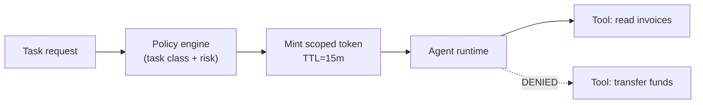

# Chapter 65: Least Privilege Scoping

**Part VII — Safety, Security & Governance**

## Least Privilege Scoping Pattern Overview

The agent holds the minimum credentials and data access needed for the current task — nothing ambient, nothing standing.

**Least Privilege Scoping** is catalogued in the **Safety, Security & Governance** part of the catalog (id `least-privilege`). It is tagged for finance, devops, healthcare, general and is assembled from 3 components.

Per-task capability set from policy; short-lived scoped tokens minted per task; access denied by default with elevation logged. Seven scenarios and twenty-three cascades touch this pattern — the most-connected guardrail in the book — because ambient authority is the root enabler: standing broad credentials turn one injected prompt into a full breach, scope creep silently widens yesterday's tight grant, and token relay hands credentials to untrusted tools.

**Definition 1 (Least-privilege grant).** A grant is *least-privilege* iff (i) it is minted per task, per tool, with TTL in minutes (never days, never standing), (ii) it is audience-bound to specific tool endpoints (unusable elsewhere, unrelayable), and (iii) unused grants are automatically revoked with quarterly permission-diff review.

**Theorem 1 (Breach bounded by task, tool, and minutes).** Under least-privilege grants with default-deny elevation, a fully compromised agent (injected prompt, complete instruction takeover) can exercise at most its current task's scoped tools for at most the token TTL — the blast radius is bounded in capability, place, and time simultaneously.

*Proof.* Capability: per-task, per-tool minting means the compromised agent holds only what the task needs — no admin keys, no standing grants, nothing ambient to spend (standing broad credentials, the critical failure, cannot exist by construction). Place: audience binding means the token authorizes exactly its endpoints — relay to an untrusted tool yields an invalid token, and default-deny elevation logs the attempt. Time: minute-scale TTLs bound the window; automatic revocation of unused grants plus quarterly diffs bound the creep (scope added for edge cases is removed when unused, not accumulated forever). Elevation is logged, so the rare legitimate expansion is audited rather than silent. Verify scopes per caller; verify TTLs; verify the diff review actually prunes — the \$50,000 corporate-card purchase is what ambient authority buys the attacker, and this pattern un-buys it. ∎

## Practical Applications & Use Cases

Domains the catalog tags this pattern for:

- finance
- devops
- healthcare
- general

7 documented failure scenarios exercise it:

| Scenario | Severity | Likelihood | Domain |
|---|---|---|---|
| Agent includes privileged documents in a discovery export | Critical | Medium | legal |
| Code-execution sandbox escape reaches cloud metadata service | Critical | Low | engineering |
| Prompt injection triggers \$50,000 purchase on corporate card | Critical | High | finance |
| Agent commits secrets and pastes them into a public gist | High | Medium | engineering |
| Agent installs typosquatted package with postinstall exfil | High | High | engineering |
| Attacker impersonates the agent to other systems | High | Low | enterprise |
| Memory-armed SDR agent leaks a competitor's account history across tenants | High | Medium | sales |

It also appears in 23 composition cascades — the 6 most impactful of 23:

| Cascade | Class | Blast radius | Impact |
|---|---|---|---|
| Agent Identity & Authentication — shared service identity | Inherent | single-agent | Critical |
| Agent includes privileged documents in a discovery export | Derived | service | Critical |
| Cascading tenant failure via shared sandbox | Cascading | fleet | Critical |
| Code-execution sandbox escape reaches cloud metadata service | Derived | service | Critical |
| Confused-Deputy Defense — agent-ambient authority | Inherent | single-agent | Critical |
| Credential compromise across tenants | Cascading | org | Critical |

## How It Works

1. Per-task capability set from policy.
2. Short-lived scoped tokens minted per task.
3. Access denied by default; elevation logged.

## Components

- Identity broker
- Policy engine
- Short-lived token service

## Control-Flow Diagram

## Failure Modes and Risks

3 failure modes are documented for this pattern:

| Failure mode | Severity | What happens |
|---|---|---|
| Standing broad credentials | Critical | Agent holds admin API keys; one injected prompt = full breach. |
| Scope creep over time | High | Permissions added for edge cases, never removed. |
| Token relay | High | Agent passes its token to an untrusted tool/webhook. |

## Protections

1. Mint per-task, per-tool tokens; TTL minutes not days.
2. Quarterly permission diff review; automatic revocation of unused grants.
3. Tokens audience-bound to specific tool endpoints.

## At a Glance

| Field | Value |
|---|---|
| Catalog id | `least-privilege` |
| Part | VII — Safety, Security & Governance |
| Domains | finance, devops, healthcare, general |
| Components | Identity broker, Policy engine, Short-lived token service |
| Failure modes | 3 |
| Protections | 3 |
| Related patterns | Policy Engine (Rules Outside the Model), Agent Identity & Authentication, Tool Use / Function Calling |
| Linked scenarios | 7 |
| Linked cascades | 23 |

## Key Takeaways

- The agent holds the minimum credentials and data access needed for the current task — nothing ambient, nothing standing.
- Mint per-task, per-tool tokens; TTL minutes not days.
- Quarterly permission diff review; automatic revocation of unused grants.
- Tokens audience-bound to specific tool endpoints.
- Know its failure modes: Standing broad credentials (critical); Scope creep over time (high); Token relay (high).

## References and Related Patterns

| Related pattern | Part | Summary |
|---|---|---|
| Policy Engine (Rules Outside the Model) | Safety, Security & Governance | Deterministic allow/deny rules evaluated in the runtime for every action — policy is code, not prompt text. |
| Agent Identity & Authentication | Safety, Security & Governance | Every agent has a distinct, verifiable identity; actions are attributable; requester identity travels with the task (avoid confused deputy). |
| Tool Use / Function Calling | Agent Loop & Control | Expose typed tools to the model; model emits structured calls the runtime validates and executes. |

## Council deliberation

- **Safety researcher:** Least Privilege Scoping gives the agent only the minimum credentials and data access the current task needs, with per-task capability sets and short-lived scoped tokens minted from policy, and denial by default. I read its value against standing broad credentials where one injected prompt means full breach, plus scope creep over time and token relay to untrusted tools. The counter is per-task per-tool tokens with short TTL, review and revocation of unused grants, and audience-bound tokens, close to policy engine and agent identity work.
- **Evaluation methodologist:** What convinces me here is that the control is structural rather than rhetorical, since elevation is logged and access denied by default. I would sharpen the claim though: short-lived tokens only help if scope creep is actually pruned, because permissions added for edge cases tend to persist. The record answers that with periodic permission diff review and automatic revocation, plus audience binding to specific tool endpoints, which keeps finance, devops, healthcare and general deployments honest.

## Council reading

- **Red team:** Start with Standing broad credentials (critical): Agent holds admin API keys; one injected prompt = full breach. Prompt injection triggers \$50,000 purchase on corporate card is the catalogued proof — critical severity, finance domain — so rehearse that exact chain before any other.
- **Blue team:** Hold with Mint per-task, per-tool tokens; TTL minutes not days; Quarterly permission diff review; automatic revocation of unused grants. Then layer the remaining 1: defence here is the list, not any single item. Compose with Policy Engine (Rules Outside the Model), Agent Identity & Authentication so a failure in one pattern meets a control in another.
- **Operator:** Deploy where it is tagged (finance, devops, healthcare, general), and watch the 23 linked cascades — Agent Identity & Authentication — shared service identity first, because composition is where small faults amplify. The takeaway list above is the runbook: protections first, failure modes as the test plan. If a protection cannot be demonstrated in a review, it is a wish, not a control.

## Conclusion

In the catalog this chapter was generated from, **Least Privilege Scoping** is one of 107 patterns in *Safety, Security & Governance*, carrying 3 documented failure modes and 3 listed protections. Use it as a starting point, not a specification: the protection list is the part that survives contact with an adversary.

---
