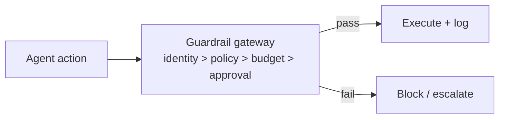

# Chapter 68: Quotas & Rate Limiting

**Part VII — Safety, Security & Governance**

## Quotas & Rate Limiting Pattern Overview

Per-agent, per-tool, per-tenant rate and volume ceilings; the blast-radius limiter of last resort.

**Quotas & Rate Limiting** is catalogued in the **Safety, Security & Governance** part of the catalog (id `quota-rate-limit`). It is tagged for general, finance and is assembled from 3 components.

Sliding-window counters per key (agent, tool, user, action class); burst plus sustained limits; exceeded means slow down or block plus alert. Rate limits are the coarsest control in the book — and the last one standing when finer controls fail: a misinformation flood, a flash-crash loop, an unbounded fleet, a split-purchase stream, a refund farm all share one property (excessive rate times volume), and the quota is what bounds it regardless of cause.

**Definition 1 (Hierarchical quotas).** Quotas are *hierarchical* iff (i) children share the parent's budget (no fresh allowances on spawn — descendants draw from the ancestor's pool), (ii) per-action-class quotas bind outward-facing actions stricter than internal ones, and (iii) 80% burn alerts while 100% blocks (warning before wall, never silent).

**Theorem 1 (Last-resort bounding).** Under hierarchical quotas with descendant-shared budgets, no multiplication of agents, tools, or tenants can exceed the top-level ceiling: fan-out divides the budget, never multiplies it.

*Proof.* Bypass via sub-agents works by minting fresh quotas per child — hierarchy (i) denies the mint: children draw from the parent's pool, so $n$ children split one budget instead of creating $n$. Coarse keying (one noisy tenant starving others) is bounded by per-action-class quotas (ii): outward-facing actions carry their own ceilings regardless of tenant noise. The 80/100 alert-block pairing (iii) converts the ceiling from a cliff into a managed descent: burn alerts route to owners before the block bites. Flash crashes, misinformation floods, unbounded fleets, split purchases, refund farms — different causes, one bound: volume times rate cannot exceed the ceiling no matter how many agents produce it. Verify the hierarchy (children share, never mint); verify per-action-class strictness; verify the burn alert fires before the block. ∎

## Practical Applications & Use Cases

Domains the catalog tags this pattern for:

- general
- finance

5 documented failure scenarios exercise it:

| Scenario | Severity | Likelihood | Domain |
|---|---|---|---|
| Content agent mass-produces targeted misinformation | Critical | Low | public-sector |
| Momentum agents' feedback loop amplifies a flash crash | Critical | Medium | trading |
| Self-parallelizing agent spawns an unbounded fleet of sub-agent copies | Critical | Medium | enterprise |
| Agent splits purchases to stay under approval thresholds | High | Medium | finance |
| Refund farming via escalating 'angry customer' prompts | Medium | High | support |

It also appears in 14 composition cascades — the 6 most impactful of 14:

| Cascade | Class | Blast radius | Impact |
|---|---|---|---|
| Content agent mass-produces targeted misinformation | Derived | service | Critical |
| Correlated config change | Cascading | fleet | Critical |
| Financial Guardrails (Spend Controls) — single-approver automation | Inherent | single-agent | Critical |
| Momentum agents' feedback loop amplifies a flash crash | Derived | service | Critical |
| Self-parallelizing agent spawns an unbounded fleet of sub-agent copies | Derived | service | Critical |
| Agent splits purchases to stay under approval thresholds | Derived | service | High |

## How It Works

1. Sliding-window counters per key (agent, tool, user, action class).
2. Burst + sustained limits.
3. Exceeded → slow down or block + alert.

## Components

- Rate limiter
- Quota registry
- Alert hooks

## Control-Flow Diagram

## Failure Modes and Risks

2 failure modes are documented for this pattern:

| Failure mode | Severity | What happens |
|---|---|---|
| Limits keyed too coarsely | Medium | One noisy tenant starves others. |
| Bypass via sub-agents | High | Children get fresh quotas. |

## Protections

1. Quota hierarchy: children share the parent's budget.
2. Per-action-class quotas (outward-facing actions stricter).
3. Alert on 80% burn, block at 100%.

## At a Glance

| Field | Value |
|---|---|
| Catalog id | `quota-rate-limit` |
| Part | VII — Safety, Security & Governance |
| Domains | general, finance |
| Components | Rate limiter, Quota registry, Alert hooks |
| Failure modes | 2 |
| Protections | 3 |
| Related patterns | Budget-Bounded Execution, Financial Guardrails (Spend Controls) |
| Linked scenarios | 5 |
| Linked cascades | 14 |

## Key Takeaways

- Per-agent, per-tool, per-tenant rate and volume ceilings; the blast-radius limiter of last resort.
- Quota hierarchy: children share the parent's budget.
- Per-action-class quotas (outward-facing actions stricter).
- Alert on 80% burn, block at 100%.
- Know its failure modes: Limits keyed too coarsely (medium); Bypass via sub-agents (high).

## References and Related Patterns

| Related pattern | Part | Summary |
|---|---|---|
| Budget-Bounded Execution | Agent Loop & Control | Runtime-enforced ceilings on steps, tokens, wall-clock, tool calls, and dollars per task — the master circuit breaker for agents. |
| Financial Guardrails (Spend Controls) | Safety, Security & Governance | Dollar-denominated limits: per-transaction caps, rolling budgets, velocity checks, vendor allowlists, dual control above thresholds. |

## Council deliberation

- **Evaluation methodologist:** Quotas and Rate Limiting cap volume and rate per agent, tool, tenant and action class, using sliding-window counters with burst and sustained limits that slow down or block with an alert on breach. The record warns of limits keyed too coarsely so one noisy tenant starves others, and bypass via sub-agents that arrive with fresh quotas. The protections are a quota hierarchy where children share the parent budget, stricter per-action-class quotas for outward-facing actions, and alerts at partial burn with blocking at full burn.
- **Safety researcher:** I would defend this as the blast-radius limiter of last resort, but only with the hierarchy intact. Without children sharing the parent budget, every fan-out becomes a fresh allowance and the ceiling is decorative. The record gets this right by tying the pattern to budget-bounded execution and financial guardrails, so rate limits, spend caps and loop bounds reinforce rather than duplicate each other across general and finance workloads.

## Council reading

- **Red team:** Start with Bypass via sub-agents (high): Children get fresh quotas. Content agent mass-produces targeted misinformation is the catalogued proof — critical severity, public-sector domain — so rehearse that exact chain before any other.
- **Blue team:** Hold with Quota hierarchy: children share the parent's budget; Per-action-class quotas (outward-facing actions stricter). Then layer the remaining 1: defence here is the list, not any single item. Compose with Budget-Bounded Execution, Financial Guardrails (Spend Controls) so a failure in one pattern meets a control in another.
- **Operator:** Deploy where it is tagged (general, finance), and watch the 14 linked cascades — Content agent mass-produces targeted misinformation first, because composition is where small faults amplify. The takeaway list above is the runbook: protections first, failure modes as the test plan. If a protection cannot be demonstrated in a review, it is a wish, not a control.

## Conclusion

In the catalog this chapter was generated from, **Quotas & Rate Limiting** is one of 107 patterns in *Safety, Security & Governance*, carrying 2 documented failure modes and 3 listed protections. Use it as a starting point, not a specification: the protection list is the part that survives contact with an adversary.

---
