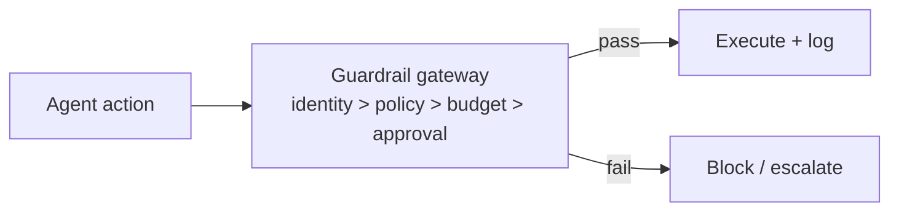

# Chapter 70: Dual Control / Four-Eyes

**Part VII — Safety, Security & Governance**

## Dual Control / Four-Eyes Pattern Overview

High-risk actions require two independent approvers (or human+policy engine) — neither of which can be the acting agent.

**Dual Control / Four-Eyes** is catalogued in the **Safety, Security & Governance** part of the catalog (id `dual-control`). It is tagged for finance, devops and is assembled from 3 components.

Action classes require $N$ distinct approvals; approvers come from separate identities and contexts; all-or-nothing with expiry and full audit. Two failure modes attack the independence the whole pattern assumes: approval rings (automated agents approving each other — formal dual control, real single control) and the single human with two tabs. Approver identity bound to distinct humans (or human plus policy engine), categorical exclusion of agents as approvers, and periodic collusion-pattern review are what keep "two" meaning two.

**Definition 1 (Genuine duality).** Dual control is *genuine* iff (i) approvers are distinct authenticated identities in distinct contexts (human + human, or human + policy engine — never the acting agent, never two tabs of one human), (ii) agents are categorically ineligible as approvers, and (iii) approval graphs are periodically reviewed for collusion patterns (rings, shared contexts, correlated approvals).

**Theorem 1 (Two means two).** Under genuine duality with authenticated distinct approvers and graph review, no single compromised party — human, agent, or model — can authorize a high-risk action alone: authorization requires two independent compromises or one compromise plus a failed review.

*Proof.* Approval rings fail (i): automated agents approving each other share context and control — distinct authenticated identities with distinct contexts excludes them, since coordinated agents cannot present as independent. Single-human-two-tabs fails (i) the same way: one identity, two windows, one approver counted twice — authentication binds the approver, not the tab. Agents-as-approvers are categorically barred (ii): the acting agent can never be its own second eye, closing the self-approval loop that single-approver automation exploits. Collusion patterns (correlated approvals, ring structures) are caught by periodic graph review (iii): independence is audited, not assumed. The deepfaked-executive-voice wire transfer is the catalogued proof that one compromised channel must never suffice — duality held would have demanded a second, independent approval the deepfake could not supply. Verify identity binding with authentication; test the escalation paths; audit the approval graphs. ∎

## Practical Applications & Use Cases

Domains the catalog tags this pattern for:

- finance
- devops

3 documented failure scenarios exercise it:

| Scenario | Severity | Likelihood | Domain |
|---|---|---|---|
| Deepfaked executive voice approves a wire transfer | Critical | Low | finance |
| Prompt injection triggers \$50,000 purchase on corporate card | Critical | High | finance |
| Agent approves AI-generated fake vendor invoices | High | High | finance |

It also appears in 17 composition cascades — the 6 most impactful of 17:

| Cascade | Class | Blast radius | Impact |
|---|---|---|---|
| Approval Gates for Irreversible Actions — gate bypass via abstraction | Inherent | service | Critical |
| Correlated config change | Cascading | fleet | Critical |
| Credential compromise across tenants | Cascading | org | Critical |
| Cross-scenario cascade in finance | Cascading | fleet | Critical |
| Deepfaked executive voice approves a wire transfer | Derived | service | Critical |
| Financial Guardrails (Spend Controls) — single-approver automation | Inherent | single-agent | Critical |

## How It Works

1. Action class requires N distinct approvals.
2. Approvers from separate identities/contexts.
3. All-or-nothing; expiry; full audit.

## Components

- Approver registry
- Tally + expiry
- Audit trail

## Control-Flow Diagram

## Failure Modes and Risks

2 failure modes are documented for this pattern:

| Failure mode | Severity | What happens |
|---|---|---|
| Approval rings | High | Automated agents approve each other. |
| Single human with two tabs | Medium | Formal dual control, real single control. |

## Protections

1. Approver identity bound to distinct humans (or human + policy engine), with authentication.
2. Agents categorically cannot be approvers.
3. Periodic review of approval graphs for collusion patterns.

## At a Glance

| Field | Value |
|---|---|
| Catalog id | `dual-control` |
| Part | VII — Safety, Security & Governance |
| Domains | finance, devops |
| Components | Approver registry, Tally + expiry, Audit trail |
| Failure modes | 2 |
| Protections | 3 |
| Related patterns | Approval Gates for Irreversible Actions, Consensus / Voting Protocols |
| Linked scenarios | 3 |
| Linked cascades | 17 |

## Key Takeaways

- High-risk actions require two independent approvers (or human+policy engine) — neither of which can be the acting agent.
- Approver identity bound to distinct humans (or human + policy engine), with authentication.
- Agents categorically cannot be approvers.
- Periodic review of approval graphs for collusion patterns.
- Know its failure modes: Approval rings (high); Single human with two tabs (medium).

## References and Related Patterns

| Related pattern | Part | Summary |
|---|---|---|
| Approval Gates for Irreversible Actions | Safety, Security & Governance | Irreversible or high-impact actions require explicit human approval with full context — no exceptions by design. |
| Consensus / Voting Protocols | Multi-Agent Topologies | Formal voting rules (quorum, weighted votes) over agent decisions; risky actions need k-of-n approval. |

## Council deliberation

- **Safety researcher:** Dual Control requires two independent approvers for high-risk actions, where neither approver may be the acting agent, using an approver registry with tally, expiry and full audit. Its failures are approval rings where automated agents approve each other, and one human with two tabs producing formal but not real dual control. Protections bind approver identity to distinct humans or a human plus policy engine with authentication, bar agents categorically from approving, and review approval graphs periodically for collusion patterns, alongside approval gates and voting protocols.
- **Evaluation methodologist:** I find the four-eyes framing persuasive precisely because it names its own defeat modes. Approval rings are the case I would test first, since agent approvers can look independent while sharing context. The record answers with distinct identities and contexts plus authentication, and the periodic review of approval graphs gives an evaluator something observable to check in finance and devops deployments rather than a promise of independence.

## Council reading

- **Red team:** Start with Approval rings (high): Automated agents approve each other. Prompt injection triggers \$50,000 purchase on corporate card is the catalogued proof — critical severity, finance domain — so rehearse that exact chain before any other.
- **Blue team:** Hold with Approver identity bound to distinct humans (or human + policy engine), with authentication; Agents categorically cannot be approvers. Then layer the remaining 1: defence here is the list, not any single item. Compose with Approval Gates for Irreversible Actions, Consensus / Voting Protocols so a failure in one pattern meets a control in another.
- **Operator:** Deploy where it is tagged (finance, devops), and watch the 17 linked cascades — Approval Gates for Irreversible Actions — gate bypass via abstraction first, because composition is where small faults amplify. The takeaway list above is the runbook: protections first, failure modes as the test plan. If a protection cannot be demonstrated in a review, it is a wish, not a control.

## Conclusion

In the catalog this chapter was generated from, **Dual Control / Four-Eyes** is one of 107 patterns in *Safety, Security & Governance*, carrying 2 documented failure modes and 3 listed protections. Use it as a starting point, not a specification: the protection list is the part that survives contact with an adversary.

---
