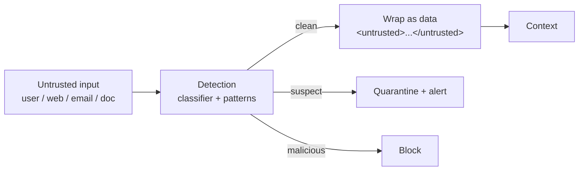

# Chapter 71: Input Sanitization & Prompt-Injection Shield

**Part VII — Safety, Security & Governance**

## Input Sanitization & Prompt-Injection Shield Pattern Overview

Screen everything entering the context — user input, tool output, retrieved docs, web pages — for injection patterns; quarantine and strip.

**Input Sanitization & Prompt-Injection Shield** is catalogued in the **Safety, Security & Governance** part of the catalog (id `input-sanitization`). It is tagged for general and is assembled from 4 components.

Detect instruction-override phrases, hidden text, encoded payloads, exfiltration instructions; sanitize, strip, or mark as inert data with delimiters; high-risk goes to block plus human review. The attack surface is everything entering the context — and the critical failure is watching only user input while the email, the web page, and the tool output carry the real payload. Assume 100% of external content is hostile; defense in depth (shield plus least privilege plus approval gates, never the shield alone).

**Definition 1 (Data-instruction separation).** Context assembly satisfies *separation* iff (i) every untrusted input is wrapped as delimited inert data (never concatenated as instructions), (ii) detection covers instruction-override phrases, hidden text, encoded payloads, and exfil instructions across all four channels (user, tool, retrieval, web), and (iii) high-risk detections block plus route to human review (never silent strip-and-continue alone).

**Theorem 1 (No unexamined instructions execute).** Under separation with defense in depth, an injected instruction reaches execution only by defeating the classifier AND the delimiter AND least privilege AND the approval gate — four independent layers, each of which stops it alone.

*Proof.* Pattern-list myopia (novel phrasings, encoded instructions evading regex/classifier) defeats layer one — which is why detection is not the whole defense. Delimiters (ii) neutralize what detection misses: wrapped content is data by construction, so even an undetected instruction cannot execute as one (the model would have to violate the data/instruction boundary, which is architectural, not advisory). Least privilege bounds what a successful injection can do (no ambient authority to spend), and approval gates bound the irreversible remainder. Over-blocking (legitimate security discussion flagged) is the measured cost — tuned via the attack corpus and block-rate drift monitoring, not by gut. Assume hostility everywhere; separate always; quarantine and strip; test against the corpus; monitor the drift. The \$50,000 purchase and the steered research agent are what unseparated context costs. ∎

## Practical Applications & Use Cases

Domains the catalog tags this pattern for:

- general

5 documented failure scenarios exercise it:

| Scenario | Severity | Likelihood | Domain |
|---|---|---|---|
| Hidden instructions in a scraped page steer a research agent | Critical | High | general |
| Prompt injection triggers \$50,000 purchase on corporate card | Critical | High | finance |
| Agent tasked with self-optimization gradually edits its own safety instructions away | High | High | general |
| Autonomous social agent posts offensive thread from poisoned reply | High | Medium | marketing |
| Tool error message contains injected instructions | High | Medium | general |

It also appears in 16 composition cascades — the 6 most impactful of 16:

| Cascade | Class | Blast radius | Impact |
|---|---|---|---|
| Browser / Web Research Agent — hidden-text injection | Inherent | service | Critical |
| Computer Use (GUI Agent) — visible injected instructions | Inherent | single-agent | Critical |
| Cross-scenario cascade in finance | Cascading | fleet | Critical |
| Cross-scenario cascade in general | Cascading | fleet | Critical |
| Hidden instructions in a scraped page steer a research agent | Derived | service | Critical |
| Input Sanitization & Prompt-Injection Shield — injection inside tool output | Inherent | single-agent | Critical |

## How It Works

1. Detect: instruction-override phrases, hidden text, encoded payloads, exfil instructions.
2. Sanitize/strip or mark as inert data with delimiters.
3. High-risk → block + human review.

## Components

- Injection classifier
- Sanitizer
- Delimiter wrapper
- Quarantine store

## Control-Flow Diagram

## Failure Modes and Risks

3 failure modes are documented for this pattern:

| Failure mode | Severity | What happens |
|---|---|---|
| Pattern-list myopia | High | Novel phrasings and encoded instructions evade regex/classifier. |
| Over-blocking | Low | Legitimate security discussion flagged. |
| Injection inside tool output | Critical | Team focuses on user input; the email/web page is the real vector. |

## Protections

1. Assume 100% of external content is hostile; defense in depth (shield + least privilege + approval gates, not shield alone).
2. Data/instruction separation: untrusted content never concatenated as instructions.
3. Attack corpus regression tests; monitor block-rate drift.

## At a Glance

| Field | Value |
|---|---|
| Catalog id | `input-sanitization` |
| Part | VII — Safety, Security & Governance |
| Domains | general |
| Components | Injection classifier, Sanitizer, Delimiter wrapper, Quarantine store |
| Failure modes | 3 |
| Protections | 3 |
| Related patterns | Browser / Web Research Agent, Output / Content Shielding, RAG Poisoning Defense |
| Linked scenarios | 5 |
| Linked cascades | 16 |

## Key Takeaways

- Screen everything entering the context — user input, tool output, retrieved docs, web pages — for injection patterns; quarantine and strip.
- Assume 100% of external content is hostile; defense in depth (shield + least privilege + approval gates, not shield alone).
- Data/instruction separation: untrusted content never concatenated as instructions.
- Attack corpus regression tests; monitor block-rate drift.
- Know its failure modes: Pattern-list myopia (high); Over-blocking (low); Injection inside tool output (critical).

## References and Related Patterns

| Related pattern | Part | Summary |
|---|---|---|
| Browser / Web Research Agent | Tools & Environment | Navigates, extracts, and summarizes the web — the largest prompt-injection surface agents have. |
| Output / Content Shielding | Safety, Security & Governance | Screen agent outputs before they leave the system: PII, secrets, toxic/brand-damaging content, compliance violations. |
| RAG Poisoning Defense | Safety, Security & Governance | Protect the retrieval corpus: ingestion scanning, source trust tiers, anomaly detection on retrieved content, and instruction isolation. |

## Council deliberation

- **Safety researcher:** Input Sanitization screens everything entering context, including user input, tool output, retrieved documents and web pages, detecting instruction overrides, hidden text, encoded payloads and exfiltration instructions, then stripping, delimiting as inert data, quarantining or blocking with human review. Failures are pattern-list myopia against novel or encoded phrasings, over-blocking of legitimate discussion, and injection inside tool output while teams watch only user input. The defense assumes all external content is hostile, separates data from instructions, and keeps an attack corpus with block-rate drift monitoring.
- **Memory-systems researcher:** The memory angle matters because a single quarantined passage that still gets stored becomes a standing instruction. I agree with treating untrusted content as data wrapped in delimiters and never concatenated as instructions. Defense in depth is the honest part of this record: the shield plus least privilege plus approval gates, rather than the shield alone, with ties to browser agents, content shielding and RAG poisoning defense carrying the web and retrieval vectors.

## Council reading

- **Red team:** Start with Injection inside tool output (critical): Team focuses on user input; the email/web page is the real vector. Prompt injection triggers \$50,000 purchase on corporate card is the catalogued proof — critical severity, finance domain — so rehearse that exact chain before any other.
- **Blue team:** Hold with Assume 100% of external content is hostile; defense in depth (shield + least privilege + approval gates, not shield alone); Data/instruction separation: untrusted content never concatenated as instructions. Then layer the remaining 1: defence here is the list, not any single item. Compose with Browser / Web Research Agent, Output / Content Shielding so a failure in one pattern meets a control in another.
- **Operator:** Deploy where it is tagged (general), and watch the 16 linked cascades — Browser / Web Research Agent — hidden-text injection first, because composition is where small faults amplify. The takeaway list above is the runbook: protections first, failure modes as the test plan. If a protection cannot be demonstrated in a review, it is a wish, not a control.

## Conclusion

In the catalog this chapter was generated from, **Input Sanitization & Prompt-Injection Shield** is one of 107 patterns in *Safety, Security & Governance*, carrying 3 documented failure modes and 3 listed protections. Use it as a starting point, not a specification: the protection list is the part that survives contact with an adversary.

---
