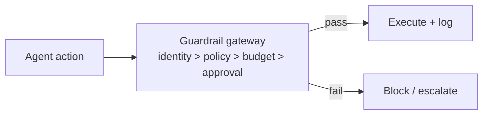

# Chapter 72: Output / Content Shielding

**Part VII — Safety, Security & Governance**

## Output / Content Shielding Pattern Overview

Screen agent outputs before they leave the system: PII, secrets, toxic/brand-damaging content, compliance violations.

**Output / Content Shielding** is catalogued in the **Safety, Security & Governance** part of the catalog (id `content-shielding`). It is tagged for support, healthcare, general and is assembled from 3 components.

Classify output (PII/PHI/secrets/toxicity/compliance); redact, rewrite, or block; log redactions for tuning. The output boundary is the last checkpoint — and the worst place to rely on alone: evasion by encoding (PII split across fields or turns beats per-message filters), and over-reliance (upstream leaks treated as safe because "the shield will catch it"). Session-level scanning plus upstream minimization plus a redaction feedback loop are what make the shield a layer instead of alibi.

**Definition 1 (Session-scoped shield).** Output shielding is *session-scoped* iff (i) scanning covers the session, not just the message (cross-turn exfiltration visible), (ii) upstream minimization keeps PII/secrets out of context in the first place (the shield verifies absence, not just redacts presence), and (iii) every redaction feeds back into prompt tuning (the shield teaches the upstream).

**Theorem 1 (Shields don't absolve upstreams).** A message-level shield with dirty upstream context leaks by construction: split the secret across turns (evasion by encoding) or rely on the shield to catch it (over-reliance), and either the filter misses or the source keeps producing — the shield holds only what upstream minimization sends it.

*Proof.* Per-message scanning is blind across turns: PII split across fields or messages never trips any single check — only session-level scanning sees the assembled secret. Upstream minimization removes the source: data that never enters context cannot leak through any output path, which is observable (context audit) in a way output rewriting is not. The redaction feedback loop closes the cycle: each redaction tunes the prompt to stop producing what the shield must catch, converting repeat interceptions into fixes. Without (i), encoding evades; without (ii), the shield is the only defense (single point of failure); without (iii), the same leaks recur forever. Compose with DLP and PII redaction — the shield is one layer, and over-reliance on it is itself the catalogued high-severity failure. ∎

## Practical Applications & Use Cases

Domains the catalog tags this pattern for:

- support
- healthcare
- general

3 documented failure scenarios exercise it:

| Scenario | Severity | Likelihood | Domain |
|---|---|---|---|
| Autonomous social agent posts offensive thread from poisoned reply | High | Medium | marketing |
| Content agent ships undisclosed affiliate claims into published articles | High | High | content |
| Support agent emails a full card number to the wrong thread | High | Medium | support |

It also appears in 9 composition cascades — the 6 most impactful of 9:

| Cascade | Class | Blast radius | Impact |
|---|---|---|---|
| Data-exfiltration via composed capabilities | Cascading | org | Critical |
| Input Sanitization & Prompt-Injection Shield — injection inside tool output | Inherent | single-agent | Critical |
| PII Detection & Redaction — vault becomes honeypot | Inherent | service | Critical |
| Autonomous social agent posts offensive thread from poisoned reply | Derived | service | High |
| Content agent ships undisclosed affiliate claims into published articles | Derived | service | High |
| Customer Support Agent Playbook — social-engineered refunds | Inherent | single-agent | High |

## How It Works

1. Classify output (PII/PHI/secrets/toxicity/compliance).
2. Redact, rewrite, or block.
3. Log redactions for tuning.

## Components

- Output classifier
- Redactor
- Block/notify hooks

## Control-Flow Diagram

## Failure Modes and Risks

2 failure modes are documented for this pattern:

| Failure mode | Severity | What happens |
|---|---|---|
| Evasion via encoding | Medium | PII split across fields/turns evades per-message filters. |
| Over-reliance | High | Upstream leaks treated as safe because 'the shield will catch it'. |

## Protections

1. Session-level (not just message-level) scanning.
2. Upstream minimization: don't let PII into context in the first place.
3. Redaction feedback loop to prompt tuning.

## At a Glance

| Field | Value |
|---|---|
| Catalog id | `content-shielding` |
| Part | VII — Safety, Security & Governance |
| Domains | support, healthcare, general |
| Components | Output classifier, Redactor, Block/notify hooks |
| Failure modes | 2 |
| Protections | 3 |
| Related patterns | Data Loss Prevention, PII Detection & Redaction |
| Linked scenarios | 3 |
| Linked cascades | 9 |

## Key Takeaways

- Screen agent outputs before they leave the system: PII, secrets, toxic/brand-damaging content, compliance violations.
- Session-level (not just message-level) scanning.
- Upstream minimization: don't let PII into context in the first place.
- Redaction feedback loop to prompt tuning.
- Know its failure modes: Evasion via encoding (medium); Over-reliance (high).

## References and Related Patterns

| Related pattern | Part | Summary |
|---|---|---|
| Data Loss Prevention | Safety, Security & Governance | Control what data may cross system boundaries: egress allowlists, secret scanning, destination reputation. |
| PII Detection & Redaction | Safety, Security & Governance | Detect and redact personal data at ingress, in transit through context, and at egress. |

## Council deliberation

- **Safety researcher:** Output and Content Shielding screens agent outputs before they leave the system for personal data, secrets, toxic or brand-damaging content and compliance violations, using a classifier with redact, rewrite or block paths plus logging of redactions for tuning. Failures are evasion via encoding with personal data split across fields or turns, and over-reliance where upstream leaks are excused because the shield will catch them. Protections call for session-level rather than message-level scanning, upstream minimization so sensitive data never enters context, and a redaction feedback loop into prompt tuning.
- **Evaluation methodologist:** I would sharpen the measurement point: per-message pass rates can look clean while a session leaks across turns, which is why session-level scanning is the load-bearing protection here. Upstream minimization is the evaluator-friendly claim too, since preventing sensitive data from entering context is observable in a way that output rewriting is not. The links to data loss prevention and PII redaction show this shield as one layer rather than the whole story.

## Council reading

- **Red team:** Start with Over-reliance (high): Upstream leaks treated as safe because 'the shield will catch it'. Content agent ships undisclosed affiliate claims into published articles is the catalogued proof — high severity, content domain — so rehearse that exact chain before any other.
- **Blue team:** Hold with Session-level (not just message-level) scanning; Upstream minimization: don't let PII into context in the first place. Then layer the remaining 1: defence here is the list, not any single item. Compose with Data Loss Prevention, PII Detection & Redaction so a failure in one pattern meets a control in another.
- **Operator:** Deploy where it is tagged (support, healthcare, general), and watch the 9 linked cascades — Data-exfiltration via composed capabilities first, because composition is where small faults amplify. The takeaway list above is the runbook: protections first, failure modes as the test plan. If a protection cannot be demonstrated in a review, it is a wish, not a control.

## Conclusion

In the catalog this chapter was generated from, **Output / Content Shielding** is one of 107 patterns in *Safety, Security & Governance*, carrying 2 documented failure modes and 3 listed protections. Use it as a starting point, not a specification: the protection list is the part that survives contact with an adversary.

---
