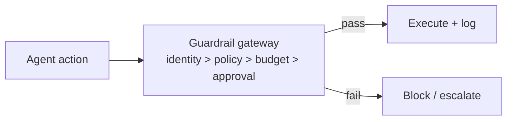

# Chapter 73: PII Detection & Redaction

**Part VII — Safety, Security & Governance**

## PII Detection & Redaction Pattern Overview

Detect and redact personal data at ingress, in transit through context, and at egress.

**PII Detection & Redaction** is catalogued in the **Safety, Security & Governance** part of the catalog (id `output-filtering-pii`). It is tagged for healthcare, support, finance, legal and is assembled from 3 components.

Detectors (patterns for PAN/SSN plus NER models); tokenize or mask before the LLM call; re-identify only in approved downstream systems. Three checkpoints — ingress, context, egress — because each catches what the others miss: patterns catch the formatted, ML catches the free-text, the vault centralizes the sensitive, and DLP egress scanning catches the rest. The two failures name the design's own risks: detector gaps (free-text PII evades pattern matchers) and the vault-as-honeypot (all PII concentrated in one breachable store).

**Definition 1 (Three-point PII control).** PII is *controlled* iff (i) layered detection (patterns plus ML with per-domain dictionaries) covers ingress, context-transit, and egress, (ii) the vault tokenizes with hardening (encryption, access audit, split knowledge) and re-identification restricted to approved downstream systems, and (iii) DLP egress scanning stands as the last line.

**Theorem 1 (Centralize carefully or not at all).** A vault without hardening, audit, and split knowledge converts distributed PII risk into concentrated PII risk — strictly worse: one breach yields everything. The vault is justified only with all three hardening properties, because it becomes the highest-value target by construction.

*Proof.* Without a vault, PII scatters across systems (broad attack surface, shallow depth per store). A vault concentrates it (narrow surface, maximum depth): the attacker's optimal target shifts from opportunistic reads to the vault itself. Hardening (encryption at rest, access audit, split knowledge — no single holder of the full mapping) raises the vault's breach cost above the distributed alternative; without it, the vault lowers the attacker's cost (one store instead of many). Layered detection (i) keeps the vault honest about what enters it (free-text PII caught by ML, not just patterns); DLP egress (iii) catches what leaves despite it. Re-identification discipline closes the loop: masking before the call holds only if approved systems alone can reverse it. The catalogued proof (cross-tenant SDR leak) is vault-adjacent failure — verify hardening, audit access, split the knowledge. ∎

## Practical Applications & Use Cases

Domains the catalog tags this pattern for:

- healthcare
- support
- finance
- legal

3 documented failure scenarios exercise it:

| Scenario | Severity | Likelihood | Domain |
|---|---|---|---|
| Memory-armed SDR agent leaks a competitor's account history across tenants | High | Medium | sales |
| Support agent emails a full card number to the wrong thread | High | Medium | support |
| Tutoring agent leaks the answer key and teaches to the test | Medium | High | education |

It also appears in 10 composition cascades — the 6 most impactful of 10:

| Cascade | Class | Blast radius | Impact |
|---|---|---|---|
| Clinical Triage Agent Playbook — autonomous clinical action | Inherent | single-agent | Critical |
| Data-exfiltration via composed capabilities | Cascading | org | Critical |
| PII Detection & Redaction — vault becomes honeypot | Inherent | service | Critical |
| Data Loss Prevention — new destination trust | Inherent | service | High |
| Memory self-reinforcement | Emergent | service | High |
| Memory-armed SDR agent leaks a competitor's account history across tenants | Derived | service | High |

## How It Works

1. Detectors: patterns (PAN/SSN) + NER models.
2. Tokenize or mask before LLM call.
3. Re-identify only in approved downstream systems.

## Components

- Detectors
- Vault/tokenizer
- Re-identification service

## Control-Flow Diagram

## Failure Modes and Risks

2 failure modes are documented for this pattern:

| Failure mode | Severity | What happens |
|---|---|---|
| Detector gaps | High | Free-text PII (address in a note) evades pattern matchers. |
| Vault becomes honeypot | Critical | All PII concentrated in one breachable store. |

## Protections

1. Layered pattern + ML detection with per-domain dictionaries.
2. Vault hardening: encryption, access audit, split knowledge.
3. DLP egress scanning as last line.

## At a Glance

| Field | Value |
|---|---|
| Catalog id | `output-filtering-pii` |
| Part | VII — Safety, Security & Governance |
| Domains | healthcare, support, finance, legal |
| Components | Detectors, Vault/tokenizer, Re-identification service |
| Failure modes | 2 |
| Protections | 3 |
| Related patterns | Output / Content Shielding, Data Loss Prevention |
| Linked scenarios | 3 |
| Linked cascades | 10 |

## Key Takeaways

- Detect and redact personal data at ingress, in transit through context, and at egress.
- Layered pattern + ML detection with per-domain dictionaries.
- Vault hardening: encryption, access audit, split knowledge.
- DLP egress scanning as last line.
- Know its failure modes: Detector gaps (high); Vault becomes honeypot (critical).

## References and Related Patterns

| Related pattern | Part | Summary |
|---|---|---|
| Output / Content Shielding | Safety, Security & Governance | Screen agent outputs before they leave the system: PII, secrets, toxic/brand-damaging content, compliance violations. |
| Data Loss Prevention | Safety, Security & Governance | Control what data may cross system boundaries: egress allowlists, secret scanning, destination reputation. |

## Council deliberation

- **Memory-systems researcher:** PII Detection and Redaction works at ingress, inside context and at egress, combining pattern detectors with entity recognition, masking or tokenizing before the model call, and re-identifying only inside approved downstream systems through a vault. Detector gaps on free-text personal data and the vault becoming a concentrated honeypot are the named failures. Layered pattern plus model detection with per-domain dictionaries, vault hardening with encryption, access audit and split knowledge, and egress scanning as a final line form the recorded defense across healthcare, support, finance and legal settings.
- **Safety researcher:** I agree with the vault caution most: centralizing personal data to protect it creates exactly the store an attacker wants. Encryption, auditing and split knowledge are therefore not optional extras in this record. The other point I would stress is re-identification discipline, since masking before the call only holds if only approved systems can reverse it, with content shielding and data loss prevention sitting alongside as companion layers.

## Council reading

- **Red team:** Start with Vault becomes honeypot (critical): All PII concentrated in one breachable store. Memory-armed SDR agent leaks a competitor's account history across tenants is the catalogued proof — high severity, sales domain — so rehearse that exact chain before any other.
- **Blue team:** Hold with Layered pattern + ML detection with per-domain dictionaries; Vault hardening: encryption, access audit, split knowledge. Then layer the remaining 1: defence here is the list, not any single item. Compose with Output / Content Shielding, Data Loss Prevention so a failure in one pattern meets a control in another.
- **Operator:** Deploy where it is tagged (healthcare, support, finance, legal), and watch the 10 linked cascades — Clinical Triage Agent Playbook — autonomous clinical action first, because composition is where small faults amplify. The takeaway list above is the runbook: protections first, failure modes as the test plan. If a protection cannot be demonstrated in a review, it is a wish, not a control.

## Conclusion

In the catalog this chapter was generated from, **PII Detection & Redaction** is one of 107 patterns in *Safety, Security & Governance*, carrying 2 documented failure modes and 3 listed protections. Use it as a starting point, not a specification: the protection list is the part that survives contact with an adversary.

---
