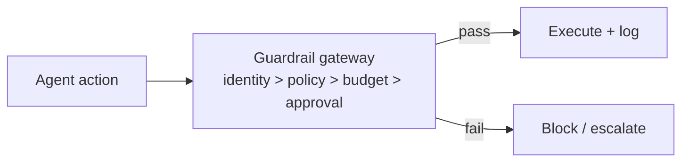

# Chapter 74: Provenance & Citation Enforcement

**Part VII — Safety, Security & Governance**

## Provenance & Citation Enforcement Pattern Overview

Every claim and action must carry a verifiable provenance chain: which input, which tool, which policy version.

**Provenance & Citation Enforcement** is catalogued in the **Safety, Security & Governance** part of the catalog (id `provenance-citation`). It is tagged for legal, research, finance, healthcare and is assembled from 3 components.

Tag all context items with source IDs; the model must cite a source ID per claim; the verifier checks that the citation supports the claim before any action. The failure is decorative citations — real-looking source IDs that don't support the claim (the strategy report's 14 phantom papers, the hallucinated dosage). The fix is entailment, not existence: resolve the citation and check that it supports the claim, and block actions with incomplete provenance rather than warning about them.

**Definition 1 (Entailed provenance).** A claim $c$ citing source $s$ is *provenanced* iff (i) $s$ resolves to a logged, retrievable record (not merely a well-formed ID), (ii) $s$ entails $c$ (the verifier checks support, not existence), and (iii) the full chain (input, tool, policy version) is chained into the tamper-evident log.

**Theorem 1 (Existence is not evidence).** A verifier that checks citation existence without entailment passes decorative citations by construction: well-formed IDs that support nothing. Entailed provenance is the minimum that distinguishes evidence from formatting.

*Proof.* Decorative citations are well-formed but unsupporting: they pass existence checks (the ID resolves, or looks like it does) while carrying zero evidential content. Entailment checking compares claim against source content — the 14 phantom papers fail because no such papers exist to entail anything; the hallucinated dosage fails because no source states it. Blocking (not warning) on incomplete provenance converts the check from advisory to control: warnings under pressure become click-through, while blocks hold regardless of urgency. The catalogued quartet (hallucinated dosage, self-editing safety instructions, rubber-stamped workers, phantom citations) spans what unprovenanced claims enable: clinical harm, control erosion, false oversight, fabricated belief. Verify entailment, not existence; block, don't warn; chain every claim to its input, tool, and policy version. ∎

## Practical Applications & Use Cases

Domains the catalog tags this pattern for:

- legal
- research
- finance
- healthcare

4 documented failure scenarios exercise it:

| Scenario | Severity | Likelihood | Domain |
|---|---|---|---|
| Clinical agent hallucinates a drug dosage | Critical | Medium | healthcare |
| Agent tasked with self-optimization gradually edits its own safety instructions away | High | High | general |
| Supervisor agent rubber-stamps compromised workers | High | Low | enterprise |
| Strategy report cites 14 papers that don't exist | Medium | High | research |

It also appears in 13 composition cascades — the 6 most impactful of 13:

| Cascade | Class | Blast radius | Impact |
|---|---|---|---|
| Clinical agent hallucinates a drug dosage | Derived | service | Critical |
| Cross-scenario cascade in enterprise | Cascading | fleet | Critical |
| Poisoned shared knowledge index | Cascading | fleet | Critical |
| RAG-Augmented Agent — poisoned corpus | Inherent | service | Critical |
| Shared model version regression across the fleet | Cascading | fleet | Critical |
| Agent tasked with self-optimization gradually edits its own safety instructions away | Derived | service | High |

## How It Works

1. Tag all context items with source IDs.
2. Model must cite source ID per claim.
3. Verifier checks citation supports claim before action.

## Components

- Provenance tags
- Citation verifier
- Chain-of-custody log

## Control-Flow Diagram

## Failure Modes and Risks

1 failure mode is documented for this pattern:

| Failure mode | Severity | What happens |
|---|---|---|
| Decorative citations | High | Real-looking source IDs that don't support the claim. |

## Protections

1. Verifier resolves citation and checks entailment, not existence.
2. Actions without complete provenance are blocked, not warned.

## At a Glance

| Field | Value |
|---|---|
| Catalog id | `provenance-citation` |
| Part | VII — Safety, Security & Governance |
| Domains | legal, research, finance, healthcare |
| Components | Provenance tags, Citation verifier, Chain-of-custody log |
| Failure modes | 1 |
| Protections | 2 |
| Related patterns | Immutable Audit Trail, RAG-Augmented Agent |
| Linked scenarios | 4 |
| Linked cascades | 13 |

## Key Takeaways

- Every claim and action must carry a verifiable provenance chain: which input, which tool, which policy version.
- Verifier resolves citation and checks entailment, not existence.
- Actions without complete provenance are blocked, not warned.
- Know its failure modes: Decorative citations (high).

## References and Related Patterns

| Related pattern | Part | Summary |
|---|---|---|
| Immutable Audit Trail | Safety, Security & Governance | Append-only, tamper-evident log of every prompt, tool call, policy decision, approval, and outcome. |
| RAG-Augmented Agent | Memory & Knowledge | Ground every answer/action in retrieved documents; cite sources; abstain when retrieval is empty. |

## Council deliberation

- **Evaluation methodologist:** Provenance and Citation Enforcement requires every claim and action to carry a verifiable chain of which input, tool and policy version produced it, with source tags on context items, cited source identifiers per claim, and a verifier checking support before action. The named failure is decorative citations that look real but do not support the claim. The protections resolve each citation and check entailment rather than existence, and block actions with incomplete provenance instead of warning, which makes this pattern testable rather than stylistic across legal, research, finance and healthcare work.
- **Safety researcher:** Blocking rather than warning is the decision I would defend, since warnings on missing provenance degrade into click-through under pressure. The chain-of-custody log plus citation verifier gives reviewers something concrete to audit, and the ties to audit trails and retrieval-grounded answering place provenance at the boundary between evidence and action, where it can actually stop an unsupported move.

## Council reading

- **Red team:** Start with Decorative citations (high): Real-looking source IDs that don't support the claim. Clinical agent hallucinates a drug dosage is the catalogued proof — critical severity, healthcare domain — so rehearse that exact chain before any other.
- **Blue team:** Hold with Verifier resolves citation and checks entailment, not existence; Actions without complete provenance are blocked, not warned. Compose with Immutable Audit Trail, RAG-Augmented Agent so a failure in one pattern meets a control in another.
- **Operator:** Deploy where it is tagged (legal, research, finance, healthcare), and watch the 13 linked cascades — Clinical agent hallucinates a drug dosage first, because composition is where small faults amplify. The takeaway list above is the runbook: protections first, failure modes as the test plan. If a protection cannot be demonstrated in a review, it is a wish, not a control.

## Conclusion

In the catalog this chapter was generated from, **Provenance & Citation Enforcement** is one of 107 patterns in *Safety, Security & Governance*, carrying 1 documented failure mode and 2 listed protections. Use it as a starting point, not a specification: the protection list is the part that survives contact with an adversary.

---
