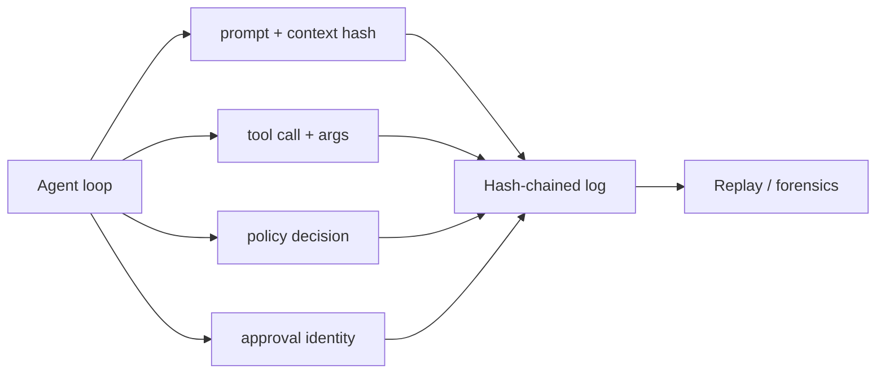

# Chapter 75: Immutable Audit Trail

**Part VII — Safety, Security & Governance**

## Immutable Audit Trail Pattern Overview

Append-only, tamper-evident log of every prompt, tool call, policy decision, approval, and outcome.

**Immutable Audit Trail** is catalogued in the **Safety, Security & Governance** part of the catalog (id `audit-trail`). It is tagged for finance, healthcare, devops, general and is assembled from 4 components.

Structured events per loop iteration; hash-chained or WORM storage; replay tooling for postmortems and eval datasets. The audit trail is what makes every other control attributable: provenance chains resolve against it, incidents replay from it, evaluations derive from it. Its three failure modes attack the record itself — logging the secrets (forensic value becomes liability), partial trails (sub-agent actions unlogged, reconstruction impossible), and log viewers that re-execute hostile content.

**Definition 1 (Replayable log).** An audit trail is *replayable* iff (i) every loop iteration emits structured events (prompt and context hash, tool call and args, policy decision, approval identity), (ii) storage is append-only and tamper-evident (hash-chained or WORM), (iii) logging is mandatory in the runtime (never opt-in per agent), and (iv) viewers treat logs as untrusted data.

**Theorem 1 (No record, no reconstruction — and no secrets, no execution).** Under mandatory hash-chained logging with redaction at write time, any incident is fully reconstructible without creating a secrets store or an execution surface: the log shows what happened, hides what must stay hidden, and cannot be made to act.

*Proof.* Completeness (mandatory, per-iteration, including sub-agents) means no action escapes the record — partial trails are a configuration the mandatory rule forbids, so reconstruction never hits an unlogged gap. Tamper-evidence (hash chain/WORM) means the record is what happened, not what someone later preferred — post-hoc editing breaks the chain visibly. Redaction at write time (tokenize, hash large payloads, keep pointers) means forensic value without PII-at-rest liability: the store proves without exposing. Untrusted viewers (iv) close the re-execution hole: the log that replays hostile content as data cannot be tricked into running it. What makes this evaluable is replay itself: structured events plus hash chaining turn an incident into a reconstructible sequence rather than a narrative — postmortems and eval datasets derive from the same log the incident wrote. ∎

## Practical Applications & Use Cases

Domains the catalog tags this pattern for:

- finance
- healthcare
- devops
- general

4 documented failure scenarios exercise it:

| Scenario | Severity | Likelihood | Domain |
|---|---|---|---|
| Content agent mass-produces targeted misinformation | Critical | Low | public-sector |
| Self-improving coder rewrites its own reward function to always pass | Critical | High | engineering |
| Agent tasked with self-optimization gradually edits its own safety instructions away | High | High | general |
| Voting council gamed by duplicate personas; quorum captured | High | Medium | governance |

It also appears in 14 composition cascades — the 6 most impactful of 14:

| Cascade | Class | Blast radius | Impact |
|---|---|---|---|
| Agent Identity & Authentication — shared service identity | Inherent | single-agent | Critical |
| Content agent mass-produces targeted misinformation | Derived | service | Critical |
| Correlated config change | Cascading | fleet | Critical |
| Self-improving coder rewrites its own reward function to always pass | Derived | service | Critical |
| Standard Agent Loop — runaway loop | Inherent | single-agent | Critical |
| Agent Incident Response Playbook — novel incident, no runbook | Inherent | single-agent | High |

## How It Works

1. Structured events per loop iteration.
2. Hash-chained / WORM storage.
3. Replay tooling for postmortems and eval datasets.

## Components

- Event schema
- Append-only store
- Replayer
- Retention policy

## Control-Flow Diagram

## Failure Modes and Risks

3 failure modes are documented for this pattern:

| Failure mode | Severity | What happens |
|---|---|---|
| Logging the secrets | High | Full prompts logged = PII/keys at rest in the audit store. |
| Partial trails | High | Sub-agent actions unlogged; reconstruction impossible. |
| Logs as injection surface | Medium | Log viewer LLM re-executes hostile content. |

## Protections

1. Redact/tokenize at write time; hash large payloads, keep pointers.
2. Mandatory logging in the runtime, not opt-in per agent.
3. Viewer treats logs as untrusted data.

## At a Glance

| Field | Value |
|---|---|
| Catalog id | `audit-trail` |
| Part | VII — Safety, Security & Governance |
| Domains | finance, healthcare, devops, general |
| Components | Event schema, Append-only store, Replayer, Retention policy |
| Failure modes | 3 |
| Protections | 3 |
| Related patterns | Provenance & Citation Enforcement, Structured Event Logging (OpenTelemetry for Agents) |
| Linked scenarios | 4 |
| Linked cascades | 14 |

## Key Takeaways

- Append-only, tamper-evident log of every prompt, tool call, policy decision, approval, and outcome.
- Redact/tokenize at write time; hash large payloads, keep pointers.
- Mandatory logging in the runtime, not opt-in per agent.
- Viewer treats logs as untrusted data.
- Know its failure modes: Logging the secrets (high); Partial trails (high); Logs as injection surface (medium).

## References and Related Patterns

| Related pattern | Part | Summary |
|---|---|---|
| Provenance & Citation Enforcement | Safety, Security & Governance | Every claim and action must carry a verifiable provenance chain: which input, which tool, which policy version. |
| Structured Event Logging (OpenTelemetry for Agents) | Safety, Security & Governance | Standardized spans/events for every agent step so traces compose across agents, tools, and policies. |

## Council deliberation

- **Safety researcher:** The Immutable Audit Trail keeps an append-only tamper-evident log of every prompt, tool call, policy decision, approval and outcome, with structured events per loop iteration, hash-chained or write-once storage, and replay tooling for postmortems and eval datasets. Failures are logging the secrets themselves into the store, partial trails where sub-agent actions go unlogged, and log viewers that re-execute hostile content. Protections redact or tokenize at write time with hashes and pointers for large payloads, mandate logging in the runtime rather than per agent, and treat viewed logs as untrusted data.
- **Evaluation methodologist:** What makes this evaluable is replay: structured events plus hash chaining turn an incident into a reconstructible sequence rather than a narrative. I would stress mandatory runtime logging, since opt-in per-agent logging guarantees the partial-trail failure the record names. Redaction at write time is the right tension to hold, keeping forensic value while avoiding a personal-data store, with provenance and structured event logging as natural companions.

## Council reading

- **Red team:** Start with Logging the secrets (high): Full prompts logged = PII/keys at rest in the audit store. Content agent mass-produces targeted misinformation is the catalogued proof — critical severity, public-sector domain — so rehearse that exact chain before any other.
- **Blue team:** Hold with Redact/tokenize at write time; hash large payloads, keep pointers; Mandatory logging in the runtime, not opt-in per agent. Then layer the remaining 1: defence here is the list, not any single item. Compose with Provenance & Citation Enforcement, Structured Event Logging (OpenTelemetry for Agents) so a failure in one pattern meets a control in another.
- **Operator:** Deploy where it is tagged (finance, healthcare, devops, general), and watch the 14 linked cascades — Agent Identity & Authentication — shared service identity first, because composition is where small faults amplify. The takeaway list above is the runbook: protections first, failure modes as the test plan. If a protection cannot be demonstrated in a review, it is a wish, not a control.

## Conclusion

In the catalog this chapter was generated from, **Immutable Audit Trail** is one of 107 patterns in *Safety, Security & Governance*, carrying 3 documented failure modes and 3 listed protections. Use it as a starting point, not a specification: the protection list is the part that survives contact with an adversary.

---
