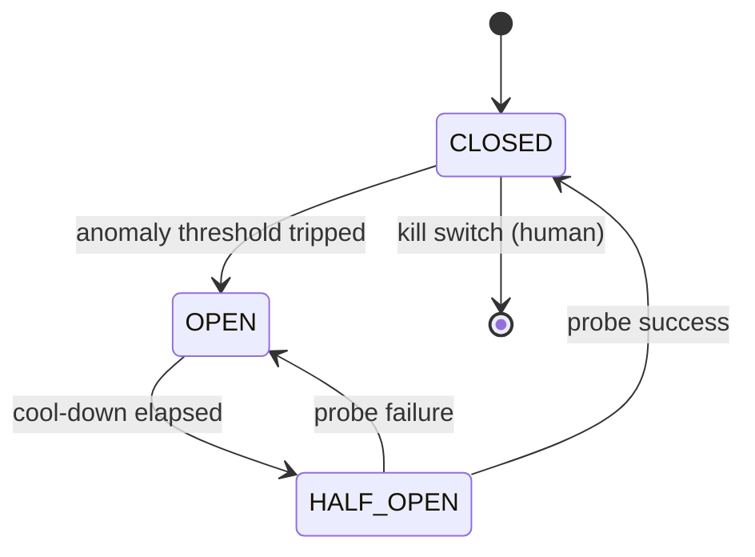

# Chapter 76: Circuit Breaker & Kill Switch

**Part VII — Safety, Security & Governance**

## Circuit Breaker & Kill Switch Pattern Overview

Automatic trip on anomaly (looping, error rate, spend, output class) plus a human-operable global kill switch.

**Circuit Breaker & Kill Switch** is catalogued in the **Safety, Security & Governance** part of the catalog (id `circuit-breaker`). It is tagged for general, devops, finance and is assembled from 3 components.

Monitors on loop signals; trip freezes the agent, checkpoints state, and alerts; manual reset after review with auto half-open probes. The breaker is the automatic half (machine-speed response to machine-speed failure: flash crashes, retry storms, overnight token burns), the kill switch is the human half (global halt no agent can prevent or reverse). Three failure modes, each fatal to the device if unaddressed: agent-owned breaker (the protected controls the protector), false-trip fatigue (operators disable it), trip without containment (the loop stops but in-flight side effects land anyway).

**Definition 1 (Runtime-owned breaker).** A breaker is *runtime-owned* iff (i) its state lives outside agent reach (agents cannot reset, disable, or read-then-game it), (ii) every trip triggers containment (cancel in-flight calls, revoke tokens — stopping the loop AND its launched effects), and (iii) thresholds are tuned on shadow data with false-trip rate reviewed (sensitive enough to catch, specific enough to stay armed).

**Theorem 1 (Trip must contain, not just stop).** A breaker that stops loops without cancelling in-flight effects bounds future harm while abandoning present harm — and present harm (the retry storm's in-flight orders, the loop's launched calls) is what the breaker exists to stop.

*Proof.* Trip-without-containment freezes the agent but not its launched calls: 14,000 duplicate orders already sent still execute; the overnight loop's queued spend still lands. Containment-on-trip (cancel in-flight, revoke tokens) bounds total harm to pre-trip effects plus cancellation latency. Agent-owned state inverts the whole device (the rogue resets its own breaker — protection controlled by the protected). False-trip fatigue disables it from the other side (operators switch off what cries wolf). Tune on shadow data so thresholds separate anomaly from workload; review false-trip rates so the breaker stays armed; verify containment actually cancels. The catalogued quartet (flash crash, wrong-fleet restart, retry storm, overnight burn) is exactly the machine-speed failure class no human catches in time — the breaker exists because humans cannot. ∎

## Practical Applications & Use Cases

Domains the catalog tags this pattern for:

- general
- devops
- finance

4 documented failure scenarios exercise it:

| Scenario | Severity | Likelihood | Domain |
|---|---|---|---|
| Momentum agents' feedback loop amplifies a flash crash | Critical | Medium | trading |
| Self-healing agent restarts the wrong fleet during an incident | Critical | Medium | operations |
| Trading agent retry storm places 14,000 duplicate orders | Critical | Medium | finance |
| Unbounded agent loop burns \$8,400 in tokens overnight | High | High | general |

It also appears in 17 composition cascades — the 6 most impactful of 17:

| Cascade | Class | Blast radius | Impact |
|---|---|---|---|
| Autonomous Trading Agent Playbook — runaway loop ordering | Inherent | single-agent | Critical |
| Circuit Breaker & Kill Switch — breaker owned by the agent | Inherent | service | Critical |
| Cross-scenario cascade in finance | Cascading | fleet | Critical |
| Cross-scenario cascade in general | Cascading | fleet | Critical |
| Momentum agents' feedback loop amplifies a flash crash | Derived | service | Critical |
| Provider outage → retry storm → cost halt | Cascading | fleet | Critical |

## How It Works

1. Monitors on loop signals.
2. Trip → freeze agent, checkpoint state, alert.
3. Manual reset with review; auto half-open probes.

## Components

- Anomaly monitors
- Breaker state machine
- Kill switch (human UI + API)

## Control-Flow Diagram

## Failure Modes and Risks

3 failure modes are documented for this pattern:

| Failure mode | Severity | What happens |
|---|---|---|
| Breaker owned by the agent | Critical | Agent can reset its own breaker. |
| False-trip fatigue | Medium | Operators disable the breaker. |
| Trip without containment | High | Breaker stops the loop but side effects already in flight. |

## Protections

1. Breaker state controlled by runtime only; agents cannot reset.
2. Trip triggers containment: cancel in-flight calls, revoke tokens.
3. Tune thresholds on shadow data; review false-trip rate.

## At a Glance

| Field | Value |
|---|---|
| Catalog id | `circuit-breaker` |
| Part | VII — Safety, Security & Governance |
| Domains | general, devops, finance |
| Components | Anomaly monitors, Breaker state machine, Kill switch (human UI + API) |
| Failure modes | 3 |
| Protections | 3 |
| Related patterns | Budget-Bounded Execution, Agent Incident Response Playbook, Loop / Stall Detection |
| Linked scenarios | 4 |
| Linked cascades | 17 |

## Key Takeaways

- Automatic trip on anomaly (looping, error rate, spend, output class) plus a human-operable global kill switch.
- Breaker state controlled by runtime only; agents cannot reset.
- Trip triggers containment: cancel in-flight calls, revoke tokens.
- Tune thresholds on shadow data; review false-trip rate.
- Know its failure modes: Breaker owned by the agent (critical); False-trip fatigue (medium); Trip without containment (high).

## References and Related Patterns

| Related pattern | Part | Summary |
|---|---|---|
| Budget-Bounded Execution | Agent Loop & Control | Runtime-enforced ceilings on steps, tokens, wall-clock, tool calls, and dollars per task — the master circuit breaker for agents. |
| Agent Incident Response Playbook | Safety, Security & Governance | Pre-rehearsed steps when an agent misbehaves: contain, revoke, assess blast radius, notify, recover, learn. |
| Loop / Stall Detection | Resilience & Reliability | Detect repeated identical or non-progressing actions and stop before cost/side effects compound. |

## Council deliberation

- **Safety researcher:** The Circuit Breaker trips automatically on anomaly across looping, error rate, spend and output class, freezing the agent, checkpointing state and alerting, with half-open probes and manual reset after review plus a human-operable global kill switch. Failures are the breaker owned by the agent that resets itself, false-trip fatigue that gets the breaker disabled, and trips without containment where in-flight side effects continue. Protections keep breaker state in the runtime only, pair trips with containment that cancels calls and revokes tokens, and tune thresholds on shadow data while watching false-trip rates.
- **Continual-learning researcher:** My addition is that tuning is continual work, not a one-time threshold. Thresholds learned on shadow data and reviewed against false-trip rates let the breaker adapt as agent behavior shifts. Containment is the part I would refuse to soften: stopping the loop while payments or tool calls already in flight still land is not containment, so cancelling calls and revoking tokens on trip, with ties to bounded execution and incident playbooks, carries the pattern.

## Council reading

- **Red team:** Start with Breaker owned by the agent (critical): Agent can reset its own breaker. Trading agent retry storm places 14,000 duplicate orders is the catalogued proof — critical severity, finance domain — so rehearse that exact chain before any other.
- **Blue team:** Hold with Breaker state controlled by runtime only; agents cannot reset; Trip triggers containment: cancel in-flight calls, revoke tokens. Then layer the remaining 1: defence here is the list, not any single item. Compose with Budget-Bounded Execution, Agent Incident Response Playbook so a failure in one pattern meets a control in another.
- **Operator:** Deploy where it is tagged (general, devops, finance), and watch the 17 linked cascades — Autonomous Trading Agent Playbook — runaway loop ordering first, because composition is where small faults amplify. The takeaway list above is the runbook: protections first, failure modes as the test plan. If a protection cannot be demonstrated in a review, it is a wish, not a control.

## Conclusion

In the catalog this chapter was generated from, **Circuit Breaker & Kill Switch** is one of 107 patterns in *Safety, Security & Governance*, carrying 3 documented failure modes and 3 listed protections. Use it as a starting point, not a specification: the protection list is the part that survives contact with an adversary.

---
