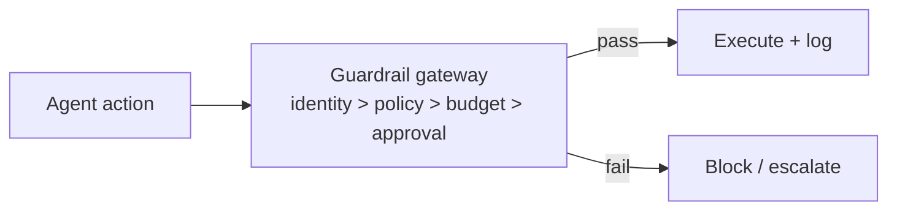

# Chapter 77: Structured Output (Constrained Decoding)

**Part VII — Safety, Security & Governance**

## Structured Output (Constrained Decoding) Pattern Overview

Force actions/answers into schemas via constrained decoding or strict validation; no free-form side channels.

**Structured Output (Constrained Decoding)** is catalogued in the **Safety, Security & Governance** part of the catalog (id `structured-output`). It is tagged for general and is assembled from 2 components.

Grammar- or schema-constrained generation for actions; validate and reject non-conforming outputs; free text confined to designated fields. Constraining the shape removes the free-form side channel — but shape is not meaning: valid JSON with absurd values passes (schema without semantics, medium). Semantic validators (ranges, allowlists, cross-field rules) plus reject-don't-repair close the gap the decoder leaves.

**Definition 1 (Semantic schema).** A schema is *semantic* iff (i) syntax is constrained at generation (constrained decoding) or validated at receipt, (ii) values face semantic rules (ranges, allowlists, cross-field consistency), and (iii) non-conforming outputs are rejected rather than repaired.

**Theorem 1 (Syntax constrains form, not content).** Constrained decoding without semantic validation produces well-formed nonsense: the schema guarantees parseability, never sensibility — and repairing hostile input risks preserving its intent, while rejecting it is safe by construction.

*Proof.* A schema-valid absurdity (valid JSON, absurd values) passes syntax checks by definition — the decoder did its job and the wrongness sailed through. Semantic rules check content against expectations: ranges bound numbers, allowlists bound enums, cross-field rules bind consistency (the absurd combination fails even when each field passes alone). Reject-don't-repair avoids the repair trap: "fixing" a hostile or malformed output into a valid one preserves the attacker's intent inside compliant formatting — rejection drops it instead. Compose with function calling (backbone) and validation loops (executable checks): schemas at generation, executable checks before acceptance, semantic rules throughout — leaving minimal room for free-text smuggling. ∎

## Practical Applications & Use Cases

Domains the catalog tags this pattern for:

- general

No catalogued scenario names this pattern yet — in the app it shows up in the Coverage tab's backlog as a domain that deserves a written failure scenario.

It also appears in 3 composition cascades:

| Cascade | Class | Blast radius | Impact |
|---|---|---|---|
| Structured Function Calling — result re-interpretation | Inherent | single-agent | High |
| Structured Output (Constrained Decoding) — schema without semantics | Inherent | single-agent | Medium |
| Validation Loop — validators too weak | Inherent | single-agent | Medium |

## How It Works

1. Grammar/schema-constrained generation for actions.
2. Validate; reject non-conforming.
3. Free text confined to designated fields.

## Components

- Schema
- Constrained decoder / validator

## Control-Flow Diagram

## Failure Modes and Risks

1 failure mode is documented for this pattern:

| Failure mode | Severity | What happens |
|---|---|---|
| Schema without semantics | Medium | Valid JSON with absurd values passes. |

## Protections

1. Semantic validators (ranges, allowlists, cross-field rules).
2. Reject rather than repair when possible.

## At a Glance

| Field | Value |
|---|---|
| Catalog id | `structured-output` |
| Part | VII — Safety, Security & Governance |
| Domains | general |
| Components | Schema, Constrained decoder / validator |
| Failure modes | 1 |
| Protections | 2 |
| Related patterns | Structured Function Calling, Validation Loop |
| Linked scenarios | 0 |
| Linked cascades | 3 |

## Key Takeaways

- Force actions/answers into schemas via constrained decoding or strict validation; no free-form side channels.
- Semantic validators (ranges, allowlists, cross-field rules).
- Reject rather than repair when possible.
- Know its failure modes: Schema without semantics (medium).

## References and Related Patterns

| Related pattern | Part | Summary |
|---|---|---|
| Structured Function Calling | Tools & Environment | JSON-schema-constrained tool calls with runtime validation; the mechanical backbone of every action an agent takes. |
| Validation Loop | Resilience & Reliability | Machine-check outputs against executable criteria (tests, schemas, lint) before accepting them. |

## Council deliberation

- **Evaluation methodologist:** Structured Output forces actions and answers into schemas through constrained decoding or strict validation, with grammar or schema-constrained generation, rejection of non-conforming outputs, and free text confined to designated fields. The named failure is schema without semantics, where valid JSON carries absurd values. The recorded answer is semantic validation with ranges, allowlists and cross-field rules, plus rejection rather than repair where possible, which keeps malformed or smuggled instructions from sliding through on syntactic correctness alone.
- **Safety researcher:** I agree that rejection beats repair for high-stakes actions, since repairing a hostile payload risks preserving its intent. Constrained decoding plus a validator narrows the side channel that free-form text provides, and the links to function calling and validation loops show where structure meets execution: schemas at generation time, executable checks before acceptance, which together leave less room for free-text smuggling.

## Council reading

- **Red team:** Start with Schema without semantics (medium): Valid JSON with absurd values passes. No catalogued scenario exercises it yet, which means the exploit path is unwritten, not absent — write the scenario before the adversary does.
- **Blue team:** Hold with Semantic validators (ranges, allowlists, cross-field rules); Reject rather than repair when possible. Compose with Structured Function Calling, Validation Loop so a failure in one pattern meets a control in another.
- **Operator:** Deploy where it is tagged (general), and watch the 3 linked cascades — Structured Function Calling — result re-interpretation first, because composition is where small faults amplify. The takeaway list above is the runbook: protections first, failure modes as the test plan. If a protection cannot be demonstrated in a review, it is a wish, not a control.

## Conclusion

In the catalog this chapter was generated from, **Structured Output (Constrained Decoding)** is one of 107 patterns in *Safety, Security & Governance*, carrying 1 documented failure mode and 2 listed protections. Use it as a starting point, not a specification: the protection list is the part that survives contact with an adversary.

---
