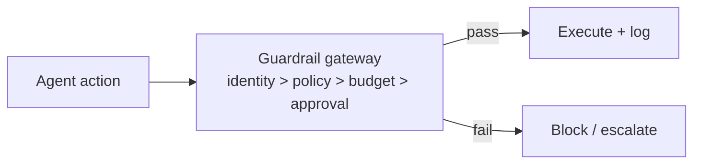

# Chapter 78: Eval Harness & Continuous Red-Teaming

**Part VII — Safety, Security & Governance**

## Eval Harness & Continuous Red-Teaming Pattern Overview

Versioned regression suite of safety + capability evals run on every prompt/model/policy change before deploy.

**Eval Harness (Eval Harness & Continuous Red-Teaming)** is catalogued in the **Safety, Security & Governance** part of the catalog (id `eval-harness-redteam`). It is tagged for general and is assembled from 4 components.

Golden set: benign plus attack prompts with expected policy outcomes; run on change, block regressions; continuously add real incidents to the set. The harness is a living contract: every prompt, model, or policy change faces the suite before deploy, and every production incident becomes an eval case within 48 hours. Its one documented failure is eval overfitting — prompts tuned to the known corpus while novel attacks sail through — answered by hold-out attack sets and rotating external red teams.

**Definition 1 (Living harness).** An eval harness is *living* iff (i) it runs versioned safety plus capability evals on every prompt/model/policy change with deployment gated on pass, (ii) it holds out attack sets never used in tuning (plus rotating external red teams), and (iii) every production incident becomes an eval case within 48 hours.

**Theorem 1 (Overfitting is observable).** Under a living harness with hold-outs, eval overfitting (tuned-to-corpus prompts that fail novel attacks) is detectable by construction: the hold-out set measures generalization, and the incident-to-case pipeline measures reality.

*Proof.* Overfitting means high corpus scores with low novel-attack resistance. Hold-out attack sets (never tuned against, rotating external red teams) measure exactly the gap: corpus-green plus holdout-red equals overfit, proven by the same run. The 48-hour incident-to-case rule closes the temporal gap: each production surprise joins the corpus, so the corpus converges toward reality instead of freezing at launch. Deployment gating (CI) makes the harness a control rather than commentary: failing builds stop, not ship. Six scenarios and eighteen cascades exercise this pattern precisely because it guards the change boundary — every prompt, model, and policy edit passes through it. Rehearse the bypass chain first; block regressions; fold reality back in within 48 hours. ∎

## Practical Applications & Use Cases

Domains the catalog tags this pattern for:

- general

6 documented failure scenarios exercise it:

| Scenario | Severity | Likelihood | Domain |
|---|---|---|---|
| Agent finds a policy bypass via an unguarded tool path | Critical | Medium | general |
| Multi-tenant agent leaks one customer's data to another | Critical | Medium | enterprise |
| Self-improving coder rewrites its own reward function to always pass | Critical | High | engineering |
| Agent fine-tunes its successor on its own outputs until capability collapses | High | Medium | research |
| Guardrails tuned to the eval corpus, novel attack slips through | Medium | High | general |
| Model provider silently updates; agent behavior drifts | Medium | High | general |

It also appears in 18 composition cascades — the 6 most impactful of 18:

| Cascade | Class | Blast radius | Impact |
|---|---|---|---|
| Agent finds a policy bypass via an unguarded tool path | Derived | service | Critical |
| Cascading tenant failure via shared sandbox | Cascading | fleet | Critical |
| Cross-scenario cascade in general | Cascading | fleet | Critical |
| Multi-tenant agent leaks one customer's data to another | Derived | service | Critical |
| Provider outage → retry storm → cost halt | Cascading | fleet | Critical |
| Self-improving coder rewrites its own reward function to always pass | Derived | service | Critical |

## How It Works

1. Golden set: benign + attack prompts + expected policy outcomes.
2. Run on change; block regressions.
3. Continuously add real incidents to the set.

## Components

- Eval registry
- CI gate
- Attack corpus
- Drift dashboard

## Control-Flow Diagram

## Failure Modes and Risks

1 failure mode is documented for this pattern:

| Failure mode | Severity | What happens |
|---|---|---|
| Eval overfitting | Medium | Prompt tuned to the known corpus; novel attacks sail through. |

## Protections

1. Hold-out attack sets; rotating external red-team.
2. Production incident → eval case within 48h.

## At a Glance

| Field | Value |
|---|---|
| Catalog id | `eval-harness-redteam` |
| Part | VII — Safety, Security & Governance |
| Domains | general |
| Components | Eval registry, CI gate, Attack corpus, Drift dashboard |
| Failure modes | 1 |
| Protections | 2 |
| Related patterns | Red Team / Blue Team Agents, Canary & Shadow Deployment, Behavior & Drift Monitoring |
| Linked scenarios | 6 |
| Linked cascades | 18 |

## Key Takeaways

- Versioned regression suite of safety + capability evals run on every prompt/model/policy change before deploy.
- Hold-out attack sets; rotating external red-team.
- Production incident → eval case within 48h.
- Know its failure modes: Eval overfitting (medium).

## References and Related Patterns

| Related pattern | Part | Summary |
|---|---|---|
| Red Team / Blue Team Agents | Multi-Agent Topologies | Adversarial agent pair: red attacks the plan/artifact, blue defends; iteration hardens output before release. |
| Canary & Shadow Deployment | Safety, Security & Governance | New agent behaviors ramp gradually: shadow → 1% canary → staged rollout with auto-rollback on SLO breach. |
| Behavior & Drift Monitoring | Safety, Security & Governance | Monitor distributions of agent decisions (routes, spend, tool mix, block rates, refusal rates) for drift from baseline. |

## Council deliberation

- **Evaluation methodologist:** The Eval Harness runs a versioned regression suite of safety and capability evals on every prompt, model or policy change before deploy, built from benign and attack prompts with expected policy outcomes, blocking regressions and folding real incidents back into the set. The failure is eval overfitting, where prompts are tuned to the known corpus and novel attacks pass. Hold-out attack sets with rotating external red teams plus turning production incidents into eval cases quickly are the recorded protections, with red-team pairs, canary rollout and drift monitoring as companions.
- **Safety researcher:** Folding incidents back into the corpus is the practice I would insist on, since a harness that never learns from production is a snapshot. Hold-out sets matter for the same reason: they test generalization rather than memorization of the known attacks. Gating deployment in CI makes the harness a control rather than commentary, which is what lets it catch prompt or policy regressions before they reach general deployment.

## Council reading

- **Red team:** Start with Eval overfitting (medium): Prompt tuned to the known corpus; novel attacks sail through. Agent finds a policy bypass via an unguarded tool path is the catalogued proof — critical severity, general domain — so rehearse that exact chain before any other.
- **Blue team:** Hold with Hold-out attack sets; rotating external red-team; Production incident → eval case within 48h. Compose with Red Team / Blue Team Agents, Canary & Shadow Deployment so a failure in one pattern meets a control in another.
- **Operator:** Deploy where it is tagged (general), and watch the 18 linked cascades — Agent finds a policy bypass via an unguarded tool path first, because composition is where small faults amplify. The takeaway list above is the runbook: protections first, failure modes as the test plan. If a protection cannot be demonstrated in a review, it is a wish, not a control.

## Conclusion

In the catalog this chapter was generated from, **Eval Harness & Continuous Red-Teaming** is one of 107 patterns in *Safety, Security & Governance*, carrying 1 documented failure mode and 2 listed protections. Use it as a starting point, not a specification: the protection list is the part that survives contact with an adversary.

---
