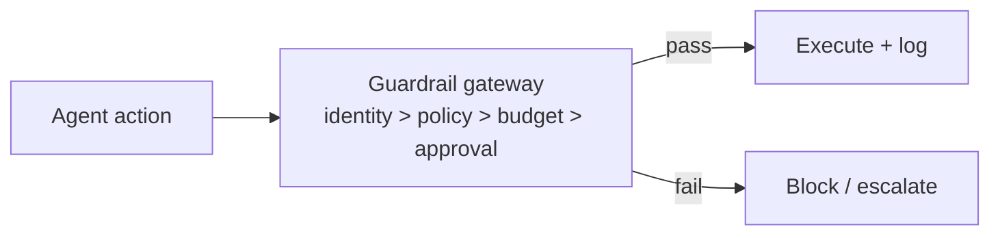

# Chapter 79: Canary & Shadow Deployment

**Part VII — Safety, Security & Governance**

## Canary & Shadow Deployment Pattern Overview

New agent behaviors ramp gradually: shadow → 1% canary → staged rollout with auto-rollback on SLO breach.

**Canary & Shadow Deployment** is catalogued in the **Safety, Security & Governance** part of the catalog (id `canary-shadow`). It is tagged for general, devops and is assembled from 3 components.

Shadow first (no side effects); canary 1% with full guardrails; ramp on metrics; auto-rollback on breach. The ramp's honesty depends on two numbers the percentage hides: absolute canary volume (1% of 10M actions/day is still 100k harmful actions) and containment (a canary without sandboxing is a small production, not a test). Read-only first exposure plus absolute side-effect caps plus rehearsed automatic rollback are what make gradual actually safe.

**Definition 1 (Contained ramp).** A rollout ramp is *contained* iff (i) it begins in shadow (zero side effects) then read-only canary tasks, (ii) canary volume carries absolute side-effect caps (not just percentages), and (iii) rollback is rehearsed and automatic on SLO breach — defined before rollout, not improvised during it.

**Theorem 1 (Percentages hide scale).** A percentage-based canary without absolute caps exposes $p \times V$ actions where $V$ is fleet volume: at large $V$, small $p$ is still mass exposure — containment requires absolute bounds, and rollback requires rehearsal.

*Proof.* 1% of 10M actions/day is 100k potentially harmful actions: the percentage sounds cautious while the absolute number is an incident. Absolute side-effect caps bound the canary by count, not share — exposure stays fixed as the fleet grows. Read-only first tasks bound the kind: observation before action, even in miniature. Rehearsed automatic rollback bounds the duration: breach triggers reversion without a human composing the runbook mid-incident. Shadow comparison before any live traffic gives the baseline the canary is measured against. Deploy the pattern as measurement discipline applied to deployment: shadow, read-only 1%, absolute-capped ramp, auto-rollback — and rehearse the successor-collapse chain first, since it is the catalogued proof that un-contained ramps compound. ∎

## Practical Applications & Use Cases

Domains the catalog tags this pattern for:

- general
- devops

1 documented failure scenario exercises it:

| Scenario | Severity | Likelihood | Domain |
|---|---|---|---|
| Agent fine-tunes its successor on its own outputs until capability collapses | High | Medium | research |

It also appears in 9 composition cascades — the 6 most impactful of 9:

| Cascade | Class | Blast radius | Impact |
|---|---|---|---|
| Agent fine-tunes its successor on its own outputs until capability collapses | Derived | service | High |
| Batch Agent Processing — duplicate side effects | Inherent | service | High |
| Canary & Shadow Deployment — canary without containment | Inherent | single-agent | High |
| Cascading hallucination across a pipeline | Emergent | service | High |
| Feedback-loop cost runaway | Emergent | service | High |
| Simulation / Digital Twin — sim-to-real gap | Inherent | service | High |

## How It Works

1. Shadow first (no side effects).
2. Canary 1% with full guardrails.
3. Ramp on metrics; auto-rollback on breach.

## Components

- Traffic splitter
- SLO monitor
- Auto-rollback

## Control-Flow Diagram

## Failure Modes and Risks

1 failure mode is documented for this pattern:

| Failure mode | Severity | What happens |
|---|---|---|
| Canary without containment | High | 1% of 10M actions/day is still 100k harmful actions. |

## Protections

1. Canary starts on read-only tasks.
2. Absolute caps on canary side-effect volume, not just percentage.
3. Rollback rehearsed and automatic.

## At a Glance

| Field | Value |
|---|---|
| Catalog id | `canary-shadow` |
| Part | VII — Safety, Security & Governance |
| Domains | general, devops |
| Components | Traffic splitter, SLO monitor, Auto-rollback |
| Failure modes | 1 |
| Protections | 3 |
| Related patterns | Shadow Agents (Dry-Run Parity), Eval Harness & Continuous Red-Teaming |
| Linked scenarios | 1 |
| Linked cascades | 9 |

## Key Takeaways

- New agent behaviors ramp gradually: shadow → 1% canary → staged rollout with auto-rollback on SLO breach.
- Canary starts on read-only tasks.
- Absolute caps on canary side-effect volume, not just percentage.
- Rollback rehearsed and automatic.
- Know its failure modes: Canary without containment (high).

## References and Related Patterns

| Related pattern | Part | Summary |
|---|---|---|
| Shadow Agents (Dry-Run Parity) | Multi-Agent Topologies | A silent twin agent runs alongside production decisions to compare outcomes before trusting new prompts/models. |
| Eval Harness & Continuous Red-Teaming | Safety, Security & Governance | Versioned regression suite of safety + capability evals run on every prompt/model/policy change before deploy. |

## Council deliberation

- **Safety researcher:** Canary and Shadow Deployment ramps new agent behaviors gradually from shadow with no side effects to a small canary with full guardrails, then staged rollout with auto-rollback on service-objective breach, using a traffic splitter, objective monitor and rollback automation. The failure is canary without containment, where a small percentage still means a large absolute volume of harmful actions. Protections start the canary on read-only tasks, cap absolute canary side-effect volume rather than percentage alone, and rehearse automatic rollback, with shadow agents and red-team evals alongside.
- **Evaluation methodologist:** The absolute-cap point deserves emphasis: percentages hide scale, so a small share of a large system can still cause wide harm. Read-only first exposure plus automatic rehearsed rollback makes the ramp falsifiable, since breach behavior is defined before rollout. Shadow comparison before any live traffic gives a baseline, which is why I read this pattern as measurement discipline applied to deployment across general and devops settings.

## Council reading

- **Red team:** Start with Canary without containment (high): 1% of 10M actions/day is still 100k harmful actions. Agent fine-tunes its successor on its own outputs until capability collapses is the catalogued proof — high severity, research domain — so rehearse that exact chain before any other.
- **Blue team:** Hold with Canary starts on read-only tasks; Absolute caps on canary side-effect volume, not just percentage. Then layer the remaining 1: defence here is the list, not any single item. Compose with Shadow Agents (Dry-Run Parity), Eval Harness & Continuous Red-Teaming so a failure in one pattern meets a control in another.
- **Operator:** Deploy where it is tagged (general, devops), and watch the 9 linked cascades — Agent fine-tunes its successor on its own outputs until capability collapses first, because composition is where small faults amplify. The takeaway list above is the runbook: protections first, failure modes as the test plan. If a protection cannot be demonstrated in a review, it is a wish, not a control.

## Conclusion

In the catalog this chapter was generated from, **Canary & Shadow Deployment** is one of 107 patterns in *Safety, Security & Governance*, carrying 1 documented failure mode and 3 listed protections. Use it as a starting point, not a specification: the protection list is the part that survives contact with an adversary.

---
