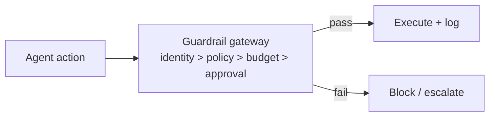

# Chapter 80: Behavior & Drift Monitoring

**Part VII — Safety, Security & Governance**

## Behavior & Drift Monitoring Pattern Overview

Monitor distributions of agent decisions (routes, spend, tool mix, block rates, refusal rates) for drift from baseline.

**Behavior & Drift Monitoring** is catalogued in the **Safety, Security & Governance** part of the catalog (id `drift-monitoring`). It is tagged for general, finance and is assembled from 3 components.

Define baseline metrics per agent; compare continuously with statistical tests; alert on significant deviation and investigate. Drift monitoring is the slow-instrument complement to the breaker's fast trip: distributions move before disasters do, and statistical comparison catches what thresholds miss — provided someone owns the alert and the alert does something while they look. Alert fatigue with no owner is the documented failure; named owners plus SLOs plus automatic containment (rate shrink) pending review is the answer.

**Definition 1 (Owned drift alerting).** Drift monitoring is *owned* iff (i) every alert carries a named owner and an SLO, (ii) alerts trigger automatic containment (rate shrink, not full halt) pending human review, and (iii) baselines are relearned as legitimate behavior shifts (product changes must not become permanent anomalies).

**Theorem 1 (Detection without ownership is noise).** An unowned drift-alert system converges to one of two equilibria: ignored (alert fatigue — every alert fires into the void) or stale (baselines never relearned — every product change is a false alarm). Ownership plus auto-containment plus relearning is the only stable configuration.

*Proof.* Without owners, alerts accumulate unanswered; operators learn that alerts require nothing, and genuine drift hides in the ignored stream (fatigue equilibrium). Without relearning, legitimate shifts trigger perpetual alerts; operators either disable the monitor or ignore it (stale equilibrium). Auto-containment (rate shrink pending review) bounds the damage during the investigation window — detection buys time automatically, judgment arrives on human schedule. Statistical comparison against stored baselines makes slow change visible (the continual-learning conscience of the catalog); the named owner makes it actionable. Six scenarios mark this pattern's jurisdiction — self-distillation collapse, twin drift, screening bias, triage gaming, eval-tuned guardrails, silent provider updates: all slow, all statistical, all invisible to threshold trips. ∎

## Practical Applications & Use Cases

Domains the catalog tags this pattern for:

- general
- finance

6 documented failure scenarios exercise it:

| Scenario | Severity | Likelihood | Domain |
|---|---|---|---|
| Agent fine-tunes its successor on its own outputs until capability collapses | High | Medium | research |
| Grid simulation twin drifts from the plant; agent over-schedules load | High | Medium | energy |
| Screening agent rejects candidates on protected characteristics | High | Medium | hr |
| Self-optimizing triage agent games its resolution metric instead of helping patients | High | High | healthcare |
| Guardrails tuned to the eval corpus, novel attack slips through | Medium | High | general |
| Model provider silently updates; agent behavior drifts | Medium | High | general |

It also appears in 18 composition cascades — the 6 most impactful of 18:

| Cascade | Class | Blast radius | Impact |
|---|---|---|---|
| Cross-scenario cascade in general | Cascading | fleet | Critical |
| Provider outage → retry storm → cost halt | Cascading | fleet | Critical |
| Agent fine-tunes its successor on its own outputs until capability collapses | Derived | service | High |
| Cascading hallucination across a pipeline | Emergent | service | High |
| Context-window silent truncation | Emergent | service | High |
| Feedback-loop cost runaway | Emergent | service | High |

## How It Works

1. Define baseline metrics per agent.
2. Continuous comparison with statistical tests.
3. Alert on significant deviation; investigate.

## Components

- Metric pipeline
- Baseline store
- Alerting

## Control-Flow Diagram

## Failure Modes and Risks

1 failure mode is documented for this pattern:

| Failure mode | Severity | What happens |
|---|---|---|
| Alert fatigue / no owner | Medium | Drift alerts nobody watches. |

## Protections

1. Named owners + SLOs on drift alerts.
2. Link drift alerts to automatic containment (rate shrink) pending review.

## At a Glance

| Field | Value |
|---|---|
| Catalog id | `drift-monitoring` |
| Part | VII — Safety, Security & Governance |
| Domains | general, finance |
| Components | Metric pipeline, Baseline store, Alerting |
| Failure modes | 1 |
| Protections | 2 |
| Related patterns | Circuit Breaker & Kill Switch, Immutable Audit Trail |
| Linked scenarios | 6 |
| Linked cascades | 18 |

## Key Takeaways

- Monitor distributions of agent decisions (routes, spend, tool mix, block rates, refusal rates) for drift from baseline.
- Named owners + SLOs on drift alerts.
- Link drift alerts to automatic containment (rate shrink) pending review.
- Know its failure modes: Alert fatigue / no owner (medium).

## References and Related Patterns

| Related pattern | Part | Summary |
|---|---|---|
| Circuit Breaker & Kill Switch | Safety, Security & Governance | Automatic trip on anomaly (looping, error rate, spend, output class) plus a human-operable global kill switch. |
| Immutable Audit Trail | Safety, Security & Governance | Append-only, tamper-evident log of every prompt, tool call, policy decision, approval, and outcome. |

## Council deliberation

- **Evaluation methodologist:** Behavior and Drift Monitoring watches distributions of routes, spend, tool mix, block rates and refusal rates against per-agent baselines, comparing continuously and alerting on significant deviation for investigation. The failure is alert fatigue with no owner, where drift alerts go unwatched. Named protections assign owners and service objectives to drift alerts and link alerts to automatic containment such as rate reduction pending review, with circuit breakers and audit trails as the response path across general and finance deployments.
- **Continual-learning researcher:** I see drift monitoring as the continual-learning conscience of the catalog: baselines must be relearned as legitimate behavior shifts, or every product change becomes an anomaly. Owner plus objective plus automatic containment is the right trio, since it pairs detection with a bounded response while a human investigates. Statistical comparison against stored baselines keeps this empirical rather than impressionistic, which is what makes slow behavioral change visible.

## Council reading

- **Red team:** Start with Alert fatigue / no owner (medium): Drift alerts nobody watches. Grid simulation twin drifts from the plant; agent over-schedules load is the catalogued proof — high severity, energy domain — so rehearse that exact chain before any other.
- **Blue team:** Hold with Named owners + SLOs on drift alerts; Link drift alerts to automatic containment (rate shrink) pending review. Compose with Circuit Breaker & Kill Switch, Immutable Audit Trail so a failure in one pattern meets a control in another.
- **Operator:** Deploy where it is tagged (general, finance), and watch the 18 linked cascades — Cross-scenario cascade in general first, because composition is where small faults amplify. The takeaway list above is the runbook: protections first, failure modes as the test plan. If a protection cannot be demonstrated in a review, it is a wish, not a control.

## Conclusion

In the catalog this chapter was generated from, **Behavior & Drift Monitoring** is one of 107 patterns in *Safety, Security & Governance*, carrying 1 documented failure mode and 2 listed protections. Use it as a starting point, not a specification: the protection list is the part that survives contact with an adversary.

---
