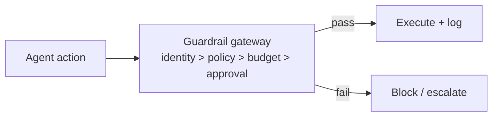

# Chapter 81: Agent Incident Response Playbook

**Part VII — Safety, Security & Governance**

## Agent Incident Response Playbook Pattern Overview

Pre-rehearsed steps when an agent misbehaves: contain, revoke, assess blast radius, notify, recover, learn.

**Agent Incident Response Playbook** is catalogued in the **Safety, Security & Governance** part of the catalog (id `incident-playbook`). It is tagged for general, devops and is assembled from 3 components.

Kill switch plus token revocation in runbook step one; blast-radius query from the audit trail; postmortem that becomes an eval case plus a policy fix. The playbook's enemy is novelty: the incident with no runbook forces improv during active harm. Quarterly tabletops with agent-specific scenarios plus automated containment playbooks tested like production code are what keep the playbook ahead of the incident it will meet.

**Definition 1 (Rehearsed playbook).** A playbook is *rehearsed* iff (i) containment automation is tested like production code (not documented and hoped), (ii) quarterly tabletops with agent-specific scenarios have exercised it since the last material change, and (iii) every postmortem produces an eval case plus a policy fix (the loop closes back into the harness).

**Theorem 1 (Untested runbooks are documents).** A playbook never exercised against its scenarios fails at the step it never ran: kill switches untested stick, revocation untested lags, blast-radius queries unbuilt guess — and the novel incident arrives exactly where rehearsal stopped.

*Proof.* Each playbook step is a claim about behavior under incident conditions (kill works, tokens die, radius is queryable). Untested claims are ungrounded: the kill switch that never fired may be miswired, revocation automation that never ran may race the incident, blast-radius tooling built during the incident arrives after the decisions it should inform. Tabletops surface the missing tooling before the incident (rehearse the gap, not just the script); testing containment like production code proves the machinery under load; postmortem-to-eval-case conversion ensures each incident permanently extends the rehearsed set. The novel incident then meets a playbook whose tested core (contain, revoke, assess) holds regardless of novelty, with only the diagnosis genuinely new. ∎

## Practical Applications & Use Cases

Domains the catalog tags this pattern for:

- general
- devops

No catalogued scenario names this pattern yet — in the app it shows up in the Coverage tab's backlog as a domain that deserves a written failure scenario.

It also appears in 3 composition cascades:

| Cascade | Class | Blast radius | Impact |
|---|---|---|---|
| Circuit Breaker & Kill Switch — breaker owned by the agent | Inherent | service | Critical |
| Self-Healing Replan — runaway remediation | Inherent | single-agent | Critical |
| Agent Incident Response Playbook — novel incident, no runbook | Inherent | single-agent | High |

## How It Works

1. Kill switch + token revocation in runbook #1.
2. Blast-radius query from audit trail.
3. Postmortem → eval case + policy fix.

## Components

- Runbook
- Revocation automation
- Blast-radius tooling

## Control-Flow Diagram

## Failure Modes and Risks

1 failure mode is documented for this pattern:

| Failure mode | Severity | What happens |
|---|---|---|
| Novel incident, no runbook | High | Improv during active harm. |

## Protections

1. Tabletop exercises quarterly with agent-specific scenarios.
2. Automated containment playbooks tested like production code.

## At a Glance

| Field | Value |
|---|---|
| Catalog id | `incident-playbook` |
| Part | VII — Safety, Security & Governance |
| Domains | general, devops |
| Components | Runbook, Revocation automation, Blast-radius tooling |
| Failure modes | 1 |
| Protections | 2 |
| Related patterns | Circuit Breaker & Kill Switch, Immutable Audit Trail |
| Linked scenarios | 0 |
| Linked cascades | 3 |

## Key Takeaways

- Pre-rehearsed steps when an agent misbehaves: contain, revoke, assess blast radius, notify, recover, learn.
- Tabletop exercises quarterly with agent-specific scenarios.
- Automated containment playbooks tested like production code.
- Know its failure modes: Novel incident, no runbook (high).

## References and Related Patterns

| Related pattern | Part | Summary |
|---|---|---|
| Circuit Breaker & Kill Switch | Safety, Security & Governance | Automatic trip on anomaly (looping, error rate, spend, output class) plus a human-operable global kill switch. |
| Immutable Audit Trail | Safety, Security & Governance | Append-only, tamper-evident log of every prompt, tool call, policy decision, approval, and outcome. |

## Council deliberation

- **Safety researcher:** The Incident Response Playbook pre-rehearses containment, revocation, blast-radius assessment, notification, recovery and learning, starting the runbook with kill switch and token revocation, querying blast radius from the audit trail, and ending with postmortem-driven eval and policy fixes. The failure is a novel incident with no runbook, forcing improvisation during active harm. Protections are quarterly tabletop exercises with agent-specific scenarios and automated containment playbooks tested like production code, tied to circuit breakers and audit trails across general and devops operations.
- **Evaluation methodologist:** Tested like production code is the phrase I would hold onto, since an untested runbook is only a document. Tabletops surface the missing blast-radius tooling before an incident does, and converting postmortems into eval cases plus policy fixes closes the loop back into the harness. Blast-radius queries grounded in the audit trail make scope assessment reconstructable rather than guessed, which is what lets notification and recovery proceed with confidence.

## Council reading

- **Red team:** Start with Novel incident, no runbook (high): Improv during active harm. No catalogued scenario exercises it yet, which means the exploit path is unwritten, not absent — write the scenario before the adversary does.
- **Blue team:** Hold with Tabletop exercises quarterly with agent-specific scenarios; Automated containment playbooks tested like production code. Compose with Circuit Breaker & Kill Switch, Immutable Audit Trail so a failure in one pattern meets a control in another.
- **Operator:** Deploy where it is tagged (general, devops), and watch the 3 linked cascades — Circuit Breaker & Kill Switch — breaker owned by the agent first, because composition is where small faults amplify. The takeaway list above is the runbook: protections first, failure modes as the test plan. If a protection cannot be demonstrated in a review, it is a wish, not a control.

## Conclusion

In the catalog this chapter was generated from, **Agent Incident Response Playbook** is one of 107 patterns in *Safety, Security & Governance*, carrying 1 documented failure mode and 2 listed protections. Use it as a starting point, not a specification: the protection list is the part that survives contact with an adversary.

---
