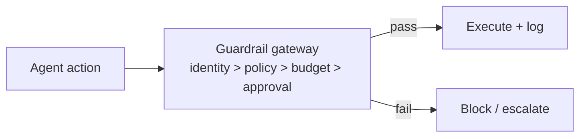

# Chapter 82: Data Loss Prevention

**Part VII — Safety, Security & Governance**

## Data Loss Prevention Pattern Overview

Control what data may cross system boundaries: egress allowlists, secret scanning, destination reputation.

**Data Loss Prevention** is catalogued in the **Safety, Security & Governance** part of the catalog (id `dlp`). It is tagged for enterprise, healthcare, finance and is assembled from 3 components.

Classify data at source; policy on (data class → destination class); scan outbound payloads, block and alert. DLP is the boundary answer to exfiltration: steganographic exfil (secrets encoded into innocuous fields) meets entropy and encoding detectors alongside pattern matching, and new-destination trust (the agent registering an unreviewed webhook) meets default-deny destinations with review. Canary secrets in context detect leakage early — the tripwire that reveals the path before real data follows it.

**Definition 1 (Boundary-complete DLP).** DLP is *complete* iff (i) classification happens at source (not at the exit — by then it is too late to know what the data was), (ii) destinations default to deny with review for new endpoints, (iii) detection combines patterns, entropy/encoding analysis, and canary secrets, and (iv) every block alerts with the payload class that triggered it.

**Theorem 1 (Unknown destinations are guilty until reviewed).** Under default-deny destinations with review, a new endpoint cannot receive anything until a human approves it — which converts the new-destination attack (register a webhook, exfiltrate through it) into a reviewable request that arrives before any data flows.

*Proof.* The attack needs an unreviewed path out: register endpoint, send data. Default-deny blocks the send before review (ii) — the endpoint exists but receives nothing. The review examines the destination's class against the data classes allowed to reach it; approval creates an explicit, audited exception. Steganographic exfil through approved destinations faces the entropy/encoding detectors (iii): encoded secrets differ statistically from innocuous fields, and canary secrets trip first — planted markers whose appearance outside proves the path leaks. Without classification at source (i), the boundary does not know what it guards; without alerting (iv), blocks are silent and untestable. Verify canary coverage; audit the egress and PII linkages; treat every new endpoint as hostile until reviewed. ∎

## Practical Applications & Use Cases

Domains the catalog tags this pattern for:

- enterprise
- healthcare
- finance

4 documented failure scenarios exercise it:

| Scenario | Severity | Likelihood | Domain |
|---|---|---|---|
| Agent commits secrets and pastes them into a public gist | High | Medium | engineering |
| Memory-armed SDR agent leaks a competitor's account history across tenants | High | Medium | sales |
| Support agent emails a full card number to the wrong thread | High | Medium | support |
| Secrets exfiltrated through telemetry and debug logs | Medium | Medium | enterprise |

It also appears in 18 composition cascades — the 6 most impactful of 18:

| Cascade | Class | Blast radius | Impact |
|---|---|---|---|
| Code-as-Action — sandbox escape | Inherent | service | Critical |
| Credential compromise across tenants | Cascading | org | Critical |
| Cross-scenario cascade in engineering | Cascading | fleet | Critical |
| Cross-scenario cascade in enterprise | Cascading | fleet | Critical |
| Data-exfiltration via composed capabilities | Cascading | org | Critical |
| PII Detection & Redaction — vault becomes honeypot | Inherent | service | Critical |

## How It Works

1. Classify data at source.
2. Policy on (data class → destination class).
3. Scan outbound payloads; block + alert.

## Components

- Classifiers
- Egress proxy
- Secret scanners

## Control-Flow Diagram

## Failure Modes and Risks

2 failure modes are documented for this pattern:

| Failure mode | Severity | What happens |
|---|---|---|
| Steganographic exfil | Medium | Secrets encoded into innocuous fields. |
| New destination trust | High | Agent registers a new webhook nobody reviewed. |

## Protections

1. Default-deny destinations; review for new endpoints.
2. Entropy/encoding detectors alongside pattern matching.
3. Canary secrets in context to detect leakage early.

## At a Glance

| Field | Value |
|---|---|
| Catalog id | `dlp` |
| Part | VII — Safety, Security & Governance |
| Domains | enterprise, healthcare, finance |
| Components | Classifiers, Egress proxy, Secret scanners |
| Failure modes | 2 |
| Protections | 3 |
| Related patterns | Network Egress Control, Sandboxed Execution, PII Detection & Redaction |
| Linked scenarios | 4 |
| Linked cascades | 18 |

## Key Takeaways

- Control what data may cross system boundaries: egress allowlists, secret scanning, destination reputation.
- Default-deny destinations; review for new endpoints.
- Entropy/encoding detectors alongside pattern matching.
- Canary secrets in context to detect leakage early.
- Know its failure modes: Steganographic exfil (medium); New destination trust (high).

## References and Related Patterns

| Related pattern | Part | Summary |
|---|---|---|
| Network Egress Control | Safety, Security & Governance | Agent runtimes can only talk to explicitly allowlisted endpoints; DNS and IP ranges controlled. |
| Sandboxed Execution | Tools & Environment | Every untrusted computation runs in a disposable, capability-limited environment. |
| PII Detection & Redaction | Safety, Security & Governance | Detect and redact personal data at ingress, in transit through context, and at egress. |

## Council deliberation

- **Safety researcher:** Data Loss Prevention controls what may cross system boundaries through data classification at source, policy over data-class to destination-class pairs, and scanning of outbound payloads with block and alert, using classifiers, an egress proxy and secret scanners. Failures are steganographic exfiltration with secrets encoded into innocuous fields, and new-destination trust where the agent registers an unreviewed webhook. Protections default-deny destinations with review for new endpoints, add entropy and encoding detectors beside pattern matching, and plant canary secrets in context to detect leakage early across enterprise, healthcare and finance boundaries.
- **Memory-systems researcher:** Classification at source is the memory-relevant move, since boundary controls fail when they first meet sensitive data at the exit. Canary secrets give the system a tripwire: leaked markers reveal a path before real data follows. Default-deny on destinations keeps the burden of proof on the new endpoint, and the ties to egress control, sandboxed execution and PII filtering show boundary defense as a stack rather than a single scanner.

## Council reading

- **Red team:** Start with New destination trust (high): Agent registers a new webhook nobody reviewed. Agent commits secrets and pastes them into a public gist is the catalogued proof — high severity, engineering domain — so rehearse that exact chain before any other.
- **Blue team:** Hold with Default-deny destinations; review for new endpoints; Entropy/encoding detectors alongside pattern matching. Then layer the remaining 1: defence here is the list, not any single item. Compose with Network Egress Control, Sandboxed Execution so a failure in one pattern meets a control in another.
- **Operator:** Deploy where it is tagged (enterprise, healthcare, finance), and watch the 18 linked cascades — Code-as-Action — sandbox escape first, because composition is where small faults amplify. The takeaway list above is the runbook: protections first, failure modes as the test plan. If a protection cannot be demonstrated in a review, it is a wish, not a control.

## Conclusion

In the catalog this chapter was generated from, **Data Loss Prevention** is one of 107 patterns in *Safety, Security & Governance*, carrying 2 documented failure modes and 3 listed protections. Use it as a starting point, not a specification: the protection list is the part that survives contact with an adversary.

---
