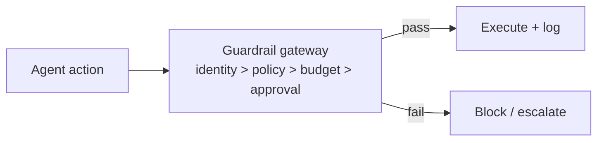

# Chapter 83: Network Egress Control

**Part VII — Safety, Security & Governance**

## Network Egress Control Pattern Overview

Agent runtimes can only talk to explicitly allowlisted endpoints; DNS and IP ranges controlled.

**Network Egress Control** is catalogued in the **Safety, Security & Governance** part of the catalog (id `egress-control`). It is tagged for devops, engineering and is assembled from 2 components.

Per-task egress policy from the tool manifest; the proxy enforces hostname and SNI allowlists; blocked attempts are logged as incidents. Two failure modes, both about the allowlist's integrity: creep (broad wildcards quietly widen the boundary) and DNS tunneling (exfil over DNS while HTTP is filtered). Exact hostnames with no wildcards plus DNS filtering, logging, and DoH blocking are the answer — with blocked attempts as incident signal, not noise.

**Definition 1 (Creep-proof egress).** Egress control is *creep-proof* iff (i) every destination is an exact hostname (no wildcards, no broad patterns), (ii) DNS resolves only through the filtered resolver with DoH blocked and all queries logged, and (iii) blocked attempts are logged as incidents (probes are signal).

**Theorem 1 (Allowlists rot; exactness plus audit resists).** Every convenient wildcard is a future exfiltration path: `*.openai.com` today is attacker-controlled-subdomain tomorrow. Exact hostnames bound the blast to named endpoints; DNS-layer control closes the tunnel under the HTTP filter; incident-logged blocks turn probes into detection. Creep is entropy — without audit, it always wins.

*Proof.* A wildcard allowlist entry authorizes an unbounded set (any subdomain, including attacker-registered ones) — convenience now, exfiltration later. Exact hostnames authorize singletons: new endpoints require new entries, each a reviewable decision. DNS tunneling bypasses HTTP-layer filtering entirely (exfil over port 53 or DoH to an outside resolver); filtered DNS with DoH blocked and query logging closes both the channel and its secrecy. Blocked-attempt logging converts creep attempts into incidents: allowlist probing becomes visible before it succeeds. Verify no wildcards; audit DNS logs; confirm DoH is blocked and every blocked attempt is an incident, not a metric. ∎

## Practical Applications & Use Cases

Domains the catalog tags this pattern for:

- devops
- engineering

5 documented failure scenarios exercise it:

| Scenario | Severity | Likelihood | Domain |
|---|---|---|---|
| Autonomous pentest agent pivots from authorized scope to production exfil | Critical | Medium | cybersecurity |
| Code-execution sandbox escape reaches cloud metadata service | Critical | Low | engineering |
| MCP server rewrites tool descriptions to inject all clients | Critical | Medium | engineering |
| Agent commits secrets and pastes them into a public gist | High | Medium | engineering |
| Agent installs typosquatted package with postinstall exfil | High | High | engineering |

It also appears in 13 composition cascades — the 6 most impactful of 13:

| Cascade | Class | Blast radius | Impact |
|---|---|---|---|
| Autonomous pentest agent pivots from authorized scope to production exfil | Derived | service | Critical |
| Code-execution sandbox escape reaches cloud metadata service | Derived | service | Critical |
| Credential compromise across tenants | Cascading | org | Critical |
| Cross-scenario cascade in engineering | Cascading | fleet | Critical |
| Data-exfiltration via composed capabilities | Cascading | org | Critical |
| MCP server rewrites tool descriptions to inject all clients | Derived | service | Critical |

## How It Works

1. Per-task egress policy from tool manifest.
2. Proxy enforces hostname/SNI allowlist.
3. Blocked attempts logged as incidents.

## Components

- Egress proxy
- Policy from tool manifest

## Control-Flow Diagram

## Failure Modes and Risks

2 failure modes are documented for this pattern:

| Failure mode | Severity | What happens |
|---|---|---|
| Allowlist creep | Medium | *.openai.com style wildcards defeat the purpose. |
| DNS tunneling | Medium | Exfil over DNS when HTTP is filtered. |

## Protections

1. Exact-hostname allowlists; no wildcards.
2. DNS filtering + logging; block DoH.

## At a Glance

| Field | Value |
|---|---|
| Catalog id | `egress-control` |
| Part | VII — Safety, Security & Governance |
| Domains | devops, engineering |
| Components | Egress proxy, Policy from tool manifest |
| Failure modes | 2 |
| Protections | 2 |
| Related patterns | Sandboxed Execution, Data Loss Prevention |
| Linked scenarios | 5 |
| Linked cascades | 13 |

## Key Takeaways

- Agent runtimes can only talk to explicitly allowlisted endpoints; DNS and IP ranges controlled.
- Exact-hostname allowlists; no wildcards.
- DNS filtering + logging; block DoH.
- Know its failure modes: Allowlist creep (medium); DNS tunneling (medium).

## References and Related Patterns

| Related pattern | Part | Summary |
|---|---|---|
| Sandboxed Execution | Tools & Environment | Every untrusted computation runs in a disposable, capability-limited environment. |
| Data Loss Prevention | Safety, Security & Governance | Control what data may cross system boundaries: egress allowlists, secret scanning, destination reputation. |

## Council deliberation

- **Safety researcher:** Network Egress Control lets agent runtimes reach only explicitly allowlisted endpoints, with per-task egress policy from the tool manifest, proxy enforcement on hostname and indication, and blocked attempts logged as incidents. Failures are allowlist creep through broad wildcards and DNS tunneling where exfiltration moves over DNS while HTTP is filtered. Protections require exact-hostname allowlists with no wildcards plus DNS filtering and logging with blocking of encrypted DNS bypass, supported by sandboxing and data loss prevention across devops and engineering runtimes.
- **Continual-learning researcher:** Allowlist creep is the slow failure I would watch, since each convenient wildcard quietly widens the boundary. Exact hostnames plus DNS-layer controls resist that drift, and logging blocked attempts as incidents turns probes into signal. Per-task policy from the tool manifest keeps the boundary scoped to what the current task needs, which connects egress discipline back to least privilege rather than leaving it as pure networking.

## Council reading

- **Red team:** Start with Allowlist creep (medium): *.openai.com style wildcards defeat the purpose. Autonomous pentest agent pivots from authorized scope to production exfil is the catalogued proof — critical severity, cybersecurity domain — so rehearse that exact chain before any other.
- **Blue team:** Hold with Exact-hostname allowlists; no wildcards; DNS filtering + logging; block DoH. Compose with Sandboxed Execution, Data Loss Prevention so a failure in one pattern meets a control in another.
- **Operator:** Deploy where it is tagged (devops, engineering), and watch the 13 linked cascades — Autonomous pentest agent pivots from authorized scope to production exfil first, because composition is where small faults amplify. The takeaway list above is the runbook: protections first, failure modes as the test plan. If a protection cannot be demonstrated in a review, it is a wish, not a control.

## Conclusion

In the catalog this chapter was generated from, **Network Egress Control** is one of 107 patterns in *Safety, Security & Governance*, carrying 2 documented failure modes and 2 listed protections. Use it as a starting point, not a specification: the protection list is the part that survives contact with an adversary.

---
