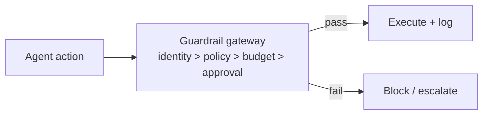

# Chapter 84: Reversibility-First Design

**Part VII — Safety, Security & Governance**

## Reversibility-First Design Pattern Overview

Prefer reversible actions; where irreversible, add confirmation, delay, and staged execution.

**Reversibility-First Design** is catalogued in the **Safety, Security & Governance** part of the catalog (id `irreversible-action-confirm`). It is tagged for finance, devops, general and is assembled from 3 components.

Classify action reversibility; prefer queued-with-delay over immediate for high-impact moves; confirm and verify end state. The failure is hidden irreversibility: 'send email' classified reversible — but sent mail cannot be unsent, and the lockout already happened. An effects-based taxonomy maintained from real incidents plus a default that treats everything external-facing as irreversible are what keep the classification honest.

**Definition 1 (Honest reversibility).** An action's reversibility rating is *honest* iff (i) it derives from an effects-based taxonomy maintained from real incidents (not from the action's name or apparent triviality), (ii) the default for any external-facing effect is irreversible, and (iii) irreversible actions execute staged with confirmation, delay, and end-state verification.

**Theorem 1 (Names lie; effects don't).** 'Send email', 'publish draft', 'change routing' sound minor and are irreversible in fact: once the effect leaves the system boundary, no local rollback restores it. Effects-based classification plus external-facing-default catches exactly these — the taxonomy learns from incidents what naming hides.

*Proof.* Reversibility is a property of effects, not labels: local state can be restored, external effects cannot be un-sent, un-published, or un-routed. Name-based classification inherits the author's optimism ('it's just an email'); effects-based classification checks what actually happens (the email left the boundary — irreversible). The default rule closes the gap for unclassified actions: anything external-facing starts irreversible until proven otherwise, so novel actions fail safe rather than free. Staged execution with delay adds the cancellation window that pure confirmation lacks: confirm-then-verify-end-state catches the action that was approved but wrong. The catalogued pair (urgent vendor bank change, smart-home lockout) are both hidden-irreversibility shapes: small names, irreversible effects, caught only by effects-first classification. ∎

## Practical Applications & Use Cases

Domains the catalog tags this pattern for:

- finance
- devops
- general

2 documented failure scenarios exercise it:

| Scenario | Severity | Likelihood | Domain |
|---|---|---|---|
| 'Urgent' vendor bank-change request accepted by agent | High | High | finance |
| Smart-home agent locks the owner out during a false alarm | Medium | Low | iot |

It also appears in 6 composition cascades:

| Cascade | Class | Blast radius | Impact |
|---|---|---|---|
| Approval Gates for Irreversible Actions — gate bypass via abstraction | Inherent | service | Critical |
| Checkpointing & Rollback — rollback itself fails | Inherent | service | Critical |
| Saga / Compensation — compensation failure cascade | Inherent | service | Critical |
| 'Urgent' vendor bank-change request accepted by agent | Derived | service | High |
| Reversibility-First Design — hidden irreversibility | Inherent | service | High |
| Smart-home agent locks the owner out during a false alarm | Derived | service | Medium |

## How It Works

1. Classify action reversibility.
2. Prefer queued-with-delay over immediate for high-impact.
3. Confirm + verify end state.

## Components

- Reversibility classifier
- Delay queue
- Confirmation flow

## Control-Flow Diagram

## Failure Modes and Risks

1 failure mode is documented for this pattern:

| Failure mode | Severity | What happens |
|---|---|---|
| Hidden irreversibility | High | 'Send email' classified reversible; it isn't. |

## Protections

1. Effects-based taxonomy maintained from real incidents.
2. Default: anything external-facing is irreversible.

## At a Glance

| Field | Value |
|---|---|
| Catalog id | `irreversible-action-confirm` |
| Part | VII — Safety, Security & Governance |
| Domains | finance, devops, general |
| Components | Reversibility classifier, Delay queue, Confirmation flow |
| Failure modes | 1 |
| Protections | 2 |
| Related patterns | Approval Gates for Irreversible Actions, Checkpointing & Rollback, Saga / Compensation |
| Linked scenarios | 2 |
| Linked cascades | 6 |

## Key Takeaways

- Prefer reversible actions; where irreversible, add confirmation, delay, and staged execution.
- Effects-based taxonomy maintained from real incidents.
- Default: anything external-facing is irreversible.
- Know its failure modes: Hidden irreversibility (high).

## References and Related Patterns

| Related pattern | Part | Summary |
|---|---|---|
| Approval Gates for Irreversible Actions | Safety, Security & Governance | Irreversible or high-impact actions require explicit human approval with full context — no exceptions by design. |
| Checkpointing & Rollback | Agent Loop & Control | Snapshot state before risky operations so the agent can revert on failure. |
| Saga / Compensation | Resilience & Reliability | Distributed multi-step transactions with compensating actions to undo partial completion. |

## Council deliberation

- **Safety researcher:** Reversibility-First Design prefers reversible actions and adds confirmation, delay and staged execution where actions are irreversible, using a reversibility classifier, a delay queue and a confirmation flow with end-state verification. The failure is hidden irreversibility, where an outwardly minor action such as sending a message is classified reversible when it is not. Protections maintain an effects-based taxonomy learned from real incidents and default to treating anything external-facing as irreversible, with approval gates, rollback and compensation patterns as companions across finance, devops and general work.
- **Evaluation methodologist:** Defaulting external-facing actions to irreversible is the judgment I would endorse, since effects outside the system cannot be recalled by rolling back local state. An effects-based taxonomy maintained from incidents keeps the classifier honest about cases like sent messages or posted content. Queued-with-delay execution adds a cancellation window that pure confirmation lacks, which is why staged execution plus end-state verification earns its place before high-impact moves.

## Council reading

- **Red team:** Start with Hidden irreversibility (high): 'Send email' classified reversible; it isn't. 'Urgent' vendor bank-change request accepted by agent is the catalogued proof — high severity, finance domain — so rehearse that exact chain before any other.
- **Blue team:** Hold with Effects-based taxonomy maintained from real incidents; Default: anything external-facing is irreversible. Compose with Approval Gates for Irreversible Actions, Checkpointing & Rollback so a failure in one pattern meets a control in another.
- **Operator:** Deploy where it is tagged (finance, devops, general), and watch the 6 linked cascades — Approval Gates for Irreversible Actions — gate bypass via abstraction first, because composition is where small faults amplify. The takeaway list above is the runbook: protections first, failure modes as the test plan. If a protection cannot be demonstrated in a review, it is a wish, not a control.

## Conclusion

In the catalog this chapter was generated from, **Reversibility-First Design** is one of 107 patterns in *Safety, Security & Governance*, carrying 1 documented failure mode and 2 listed protections. Use it as a starting point, not a specification: the protection list is the part that survives contact with an adversary.

---
