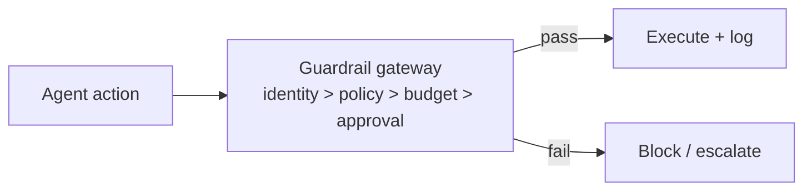

# Chapter 85: Idempotency Keys

**Part VII — Safety, Security & Governance**

## Idempotency Keys Pattern Overview

Every side-effecting call carries a key so retries/duplicates can't double-charge or double-deploy.

**Idempotency Keys** is catalogued in the **Safety, Security & Governance** part of the catalog (id `idempotency-keys`). It is tagged for finance, devops and is assembled from 2 components.

Runtime generates a key per intended effect; the server dedupes on the key; resume after crash or approval is replay-safe. Without server-side deduplication, every retry policy is a double-spend policy — and the catalogued proof is the 14,000-duplicate-order retry storm. The two rules that make keys work: derive them per effect (agent, task, action class, args, plus per-effect salt — or distinct intentions collide), and retain them longer than the retry window (approvals and checkpoints resume work long after the original attempt).

**Definition 1 (Effect-keyed idempotency).** A key scheme is *effect-keyed* iff (i) each key derives from $(\mathrm{agent}, \mathrm{task}, \mathrm{action\_class}, \mathrm{args})$ plus a per-effect salt (distinct intended effects never share a key), and (ii) keys persist in the server-side dedupe store beyond the longest retry/approval/checkpoint horizon.

**Theorem 1 (Retries without doubles).** Under effect-keyed idempotency with durable server-side dedupe, any number of retries, duplicates, resumes, or replays of a side-effecting call produces exactly one effect — and distinct intended effects are never merged.

*Proof.* Duplicates of the same intended effect carry the same key and hit the dedupe store: first execution applies, all repeats return the cached result (the 14,000-order storm becomes 1 execution plus 13,999 cache hits). Distinct effects carry distinct keys (per-effect salt), so key reuse cannot merge them — the failure mode (same key, different intentions, legitimate retries blocked) is structurally excluded by construction of the key. Durability beyond the retry window covers the slow paths: approval-gated and checkpoint-resumed work that replays long after the original attempt still hits a live key. Without server-side dedupe, the key is decoration; with it, every retry policy is safe by default. ∎

## Practical Applications & Use Cases

Domains the catalog tags this pattern for:

- finance
- devops

1 documented failure scenario exercises it:

| Scenario | Severity | Likelihood | Domain |
|---|---|---|---|
| Trading agent retry storm places 14,000 duplicate orders | Critical | Medium | finance |

It also appears in 8 composition cascades — the 6 most impactful of 8:

| Cascade | Class | Blast radius | Impact |
|---|---|---|---|
| Autonomous Trading Agent Playbook — runaway loop ordering | Inherent | single-agent | Critical |
| Cross-scenario cascade in finance | Cascading | fleet | Critical |
| Retry with Exponential Backoff + Jitter — retrying non-idempotent actions | Inherent | single-agent | Critical |
| Trading agent retry storm places 14,000 duplicate orders | Derived | service | Critical |
| Batch Agent Processing — duplicate side effects | Inherent | service | High |
| Interrupt & Resume (Checkpointed HITL) — toctou staleness | Inherent | service | High |

## How It Works

1. Runtime generates key per intended effect.
2. Server dedupes on key.
3. Replay-safe resume after crash/approval.

## Components

- Key generator
- Server-side dedupe store

## Control-Flow Diagram

## Failure Modes and Risks

1 failure mode is documented for this pattern:

| Failure mode | Severity | What happens |
|---|---|---|
| Key reuse across effects | Medium | Same key for different intended actions blocks legitimate retries. |

## Protections

1. Key = hash(agent, task, action-class, args) with per-effect salt.
2. Keys retained longer than retry window.

## At a Glance

| Field | Value |
|---|---|
| Catalog id | `idempotency-keys` |
| Part | VII — Safety, Security & Governance |
| Domains | finance, devops |
| Components | Key generator, Server-side dedupe store |
| Failure modes | 1 |
| Protections | 2 |
| Related patterns | Interrupt & Resume (Checkpointed HITL), Batch Agent Processing |
| Linked scenarios | 1 |
| Linked cascades | 8 |

## Key Takeaways

- Every side-effecting call carries a key so retries/duplicates can't double-charge or double-deploy.
- Key = hash(agent, task, action-class, args) with per-effect salt.
- Keys retained longer than retry window.
- Know its failure modes: Key reuse across effects (medium).

## References and Related Patterns

| Related pattern | Part | Summary |
|---|---|---|
| Interrupt & Resume (Checkpointed HITL) | Agent Loop & Control | Agent serializes its state, requests permission, and can be resumed days later by a different operator without redoing work. |
| Batch Agent Processing | Workflow Orchestration | Queue-driven bulk agent runs with dedupe, rate shaping, and per-item idempotency. |

## Council deliberation

- **Evaluation methodologist:** Idempotency Keys attach a key to every side-effecting call so retries, resumes and replays cannot double-charge or double-deploy, with runtime key generation, server-side deduplication and replay-safe resume after crash or approval. The failure is key reuse across distinct effects, where one key for different intended actions blocks legitimate retries. Protections derive keys from agent, task, action class and arguments with per-effect salt and retain keys beyond the retry window, which keeps finance and devops retries safe alongside interrupt-resume and batch processing patterns.
- **Safety researcher:** I read this as the companion that makes retry and resume honest: without server-side deduplication, every retry policy is a double-spend policy. Per-effect salting is the detail that prevents a well-meaning key scheme from merging distinct intentions. Retention beyond the retry window matters equally, since approvals and checkpoints can resume work long after the original attempt, and only a durable dedupe store catches those duplicates.

## Council reading

- **Red team:** Start with Key reuse across effects (medium): Same key for different intended actions blocks legitimate retries. Trading agent retry storm places 14,000 duplicate orders is the catalogued proof — critical severity, finance domain — so rehearse that exact chain before any other.
- **Blue team:** Hold with Key = hash(agent, task, action-class, args) with per-effect salt; Keys retained longer than retry window. Compose with Interrupt & Resume (Checkpointed HITL), Batch Agent Processing so a failure in one pattern meets a control in another.
- **Operator:** Deploy where it is tagged (finance, devops), and watch the 8 linked cascades — Autonomous Trading Agent Playbook — runaway loop ordering first, because composition is where small faults amplify. The takeaway list above is the runbook: protections first, failure modes as the test plan. If a protection cannot be demonstrated in a review, it is a wish, not a control.

## Conclusion

In the catalog this chapter was generated from, **Idempotency Keys** is one of 107 patterns in *Safety, Security & Governance*, carrying 1 documented failure mode and 2 listed protections. Use it as a starting point, not a specification: the protection list is the part that survives contact with an adversary.

---
