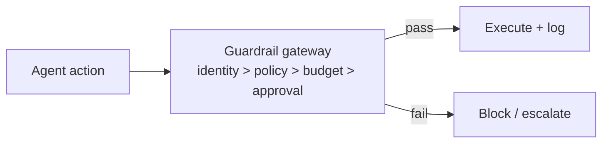

# Chapter 86: Agent Identity & Authentication

**Part VII — Safety, Security & Governance**

## Agent Identity & Authentication Pattern Overview

Every agent has a distinct, verifiable identity; actions are attributable; requester identity travels with the task (avoid confused deputy).

**Agent Identity & Authentication** is catalogued in the **Safety, Security & Governance** part of the catalog (id `agent-identity`). It is tagged for enterprise and is assembled from 3 components.

Issue per-agent credentials (SPIFFE-style); propagate end-user identity to downstream authz; log every action under that identity. Without identity, there is no attribution — and without attribution, least privilege and audit trails refer to no one. Shared service identities collapse both (everyone is the same agent), and model-stated identities collapse them differently (the model claims to be whoever the prompt says).

**Definition 1 (Infrastructure-held identity).** An agent's identity is *infrastructure-held* iff (i) credentials are issued by infrastructure (never asserted by the model), (ii) downstream systems authorize on the human-plus-agent pair (not the agent alone), and (iii) every action is logged under the verified identity (attribution, not assertion).

**Theorem 1 (No identity, no accountability).** Shared or model-stated identities make authorization and audit undecidable: a shared key cannot distinguish agents, and a model claim cannot authenticate anything. Infrastructure-held distinct identities with propagated requester context make every action attributable to exactly one agent acting for exactly one requester.

*Proof.* Shared service identity: all agents present the same credential, so no downstream decision or log entry can distinguish them — attribution and per-agent authz collapse into one principal (the catalogued critical failure). Model-stated identity ("I am agent X"): unverified by construction, spoofable by prompt injection — accepting it outsources authentication to the attacker. Infrastructure issuance (i) binds identity to runtime attestation, not to claims; pair-based authz (ii) prevents confused-deputy laundering (the agent cannot spend broader rights than the requester holds); per-identity logging (iii) makes misuse reconstructable. A stored transcript claiming an identity must never override the credential the runtime holds. Verify identity is infrastructure-held; audit the least-privilege and audit-trail linkages; confirm downstream authz sees human-plus-agent, never agent-alone. ∎

## Practical Applications & Use Cases

Domains the catalog tags this pattern for:

- enterprise

5 documented failure scenarios exercise it:

| Scenario | Severity | Likelihood | Domain |
|---|---|---|---|
| Autonomous pentest agent pivots from authorized scope to production exfil | Critical | Medium | cybersecurity |
| Content agent mass-produces targeted misinformation | Critical | Low | public-sector |
| Deepfaked executive voice approves a wire transfer | Critical | Low | finance |
| Attacker impersonates the agent to other systems | High | Low | enterprise |
| Voting council gamed by duplicate personas; quorum captured | High | Medium | governance |

It also appears in 11 composition cascades — the 6 most impactful of 11:

| Cascade | Class | Blast radius | Impact |
|---|---|---|---|
| Agent Identity & Authentication — shared service identity | Inherent | single-agent | Critical |
| Autonomous pentest agent pivots from authorized scope to production exfil | Derived | service | Critical |
| Confused-Deputy Defense — agent-ambient authority | Inherent | single-agent | Critical |
| Content agent mass-produces targeted misinformation | Derived | service | Critical |
| Correlated config change | Cascading | fleet | Critical |
| Deepfaked executive voice approves a wire transfer | Derived | service | Critical |

## How It Works

1. Issue per-agent credentials (SPIFFE-style).
2. Propagate end-user identity to downstream authz.
3. Every action logged under that identity.

## Components

- Identity issuer
- Authz propagation
- Attribution log

## Control-Flow Diagram

## Failure Modes and Risks

2 failure modes are documented for this pattern:

| Failure mode | Severity | What happens |
|---|---|---|
| Shared service identity | Critical | All agents share one key; attribution and authz collapse. |
| Identity spoofing via prompt | High | Model claims to be another agent; nothing checks. |

## Protections

1. Identity is infrastructure-held, never model-stated.
2. Downstream systems authorize on the human+agent pair, not the agent alone.

## At a Glance

| Field | Value |
|---|---|
| Catalog id | `agent-identity` |
| Part | VII — Safety, Security & Governance |
| Domains | enterprise |
| Components | Identity issuer, Authz propagation, Attribution log |
| Failure modes | 2 |
| Protections | 2 |
| Related patterns | Least Privilege Scoping, Immutable Audit Trail |
| Linked scenarios | 5 |
| Linked cascades | 11 |

## Key Takeaways

- Every agent has a distinct, verifiable identity; actions are attributable; requester identity travels with the task (avoid confused deputy).
- Identity is infrastructure-held, never model-stated.
- Downstream systems authorize on the human+agent pair, not the agent alone.
- Know its failure modes: Shared service identity (critical); Identity spoofing via prompt (high).

## References and Related Patterns

| Related pattern | Part | Summary |
|---|---|---|
| Least Privilege Scoping | Safety, Security & Governance | The agent holds the minimum credentials and data access needed for the current task — nothing ambient, nothing standing. |
| Immutable Audit Trail | Safety, Security & Governance | Append-only, tamper-evident log of every prompt, tool call, policy decision, approval, and outcome. |

## Council deliberation

- **Safety researcher:** Agent Identity gives every agent a distinct verifiable identity so actions are attributable and requester identity travels with the task, using infrastructure-issued credentials, propagation of end-user identity into downstream authorization, and logging of every action under that identity. Failures are a shared service identity collapsing attribution and authorization, and identity spoofing where the model merely claims to be another agent. Protections hold identity in infrastructure rather than model statements and authorize on the human-plus-agent pair rather than the agent alone, with least privilege and audit trails alongside in enterprise settings.
- **Memory-systems researcher:** The infrastructure-held point is decisive for memory too: a stored transcript claiming an identity must never override the credential the runtime holds. Propagating end-user identity downstream prevents the agent from laundering a low-privilege request through its own broader rights. Attribution logging closes the loop, since per-identity action histories make misuse reconstructable, which is what lets least privilege and audit actually refer to someone rather than to the system in general.

## Council reading

- **Red team:** Start with Shared service identity (critical): All agents share one key; attribution and authz collapse. Autonomous pentest agent pivots from authorized scope to production exfil is the catalogued proof — critical severity, cybersecurity domain — so rehearse that exact chain before any other.
- **Blue team:** Hold with Identity is infrastructure-held, never model-stated; Downstream systems authorize on the human+agent pair, not the agent alone. Compose with Least Privilege Scoping, Immutable Audit Trail so a failure in one pattern meets a control in another.
- **Operator:** Deploy where it is tagged (enterprise), and watch the 11 linked cascades — Agent Identity & Authentication — shared service identity first, because composition is where small faults amplify. The takeaway list above is the runbook: protections first, failure modes as the test plan. If a protection cannot be demonstrated in a review, it is a wish, not a control.

## Conclusion

In the catalog this chapter was generated from, **Agent Identity & Authentication** is one of 107 patterns in *Safety, Security & Governance*, carrying 2 documented failure modes and 2 listed protections. Use it as a starting point, not a specification: the protection list is the part that survives contact with an adversary.

---
