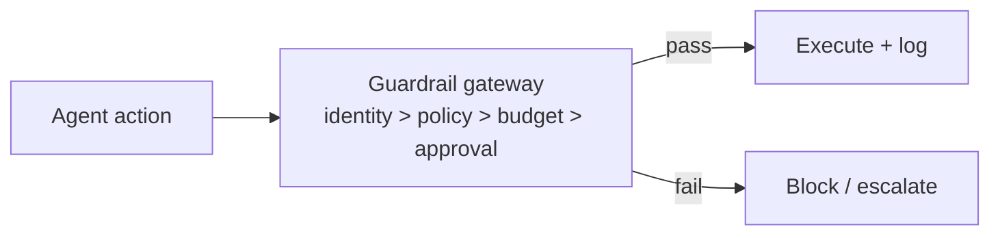

# Chapter 87: Abstention & Graceful Refusal

**Part VII — Safety, Security & Governance**

## Abstention & Graceful Refusal Pattern Overview

Agent is designed to say 'I don't know / I won't' with a defined escalation path — refusal is a first-class successful outcome.

**Abstention & Graceful Refusal** is catalogued in the **Safety, Security & Governance** part of the catalog (id `uncertainty-abstention`). It is tagged for healthcare, finance, legal and is assembled from 3 components.

Define abstain triggers (low confidence, policy conflict, missing evidence); abstain with a structured reason code; route to a staffed human queue. Refusal is a first-class successful outcome — but only with somewhere honest to go: an unstaffed queue turns refusal into a dead end, refusal theater (refusing trivia while acting on real risk) turns it into camouflage, and blanket offloading turns it into abdication. Monitored abstain rates plus genuinely staffed escalation paths are what separate real abstention from performance.

**Definition 1 (Honest abstention).** Abstention is *honest* iff (i) triggers are defined (low confidence, policy conflict, missing evidence — not vibes), (ii) every abstention carries a structured reason code routed to a staffed human queue, and (iii) abstain rates are monitored per action class with spikes (theater) and lulls (offloading) both investigated.

**Theorem 1 (Refusal without routing is a dead end).** An abstention that routes nowhere changes nothing: the task stalls, the risk persists, and the requester retries until something — possibly less safe — answers. Staffed escalation is what converts refusal from abandonment into handoff.

*Proof.* The value of abstention is transferring a decision the agent should not make to someone who should: low confidence to a human, policy conflict to review, missing evidence to collection. An unstaffed queue breaks the transfer — the decision waits for no one, the task times out or the requester re-asks (possibly with a more permissive framing). Refusal theater (refusing trivia while acting on real risk) exploits unmonitored rates: selective refusal looks safe in aggregate while the dangerous actions proceed unrefused. Per-action-class monitoring detects both failure modes statistically (too little refusal on risky classes, too much anywhere), and structured reason codes make the rates analyzable rather than anecdotal. Staff the escalation path; monitor the rates; treat abstention telemetry as a safety metric, not a support statistic. ∎

## Practical Applications & Use Cases

Domains the catalog tags this pattern for:

- healthcare
- finance
- legal

3 documented failure scenarios exercise it:

| Scenario | Severity | Likelihood | Domain |
|---|---|---|---|
| Clinical agent hallucinates a drug dosage | Critical | Medium | healthcare |
| Smart-home agent locks the owner out during a false alarm | Medium | Low | iot |
| Tutoring agent leaks the answer key and teaches to the test | Medium | High | education |

It also appears in 6 composition cascades:

| Cascade | Class | Blast radius | Impact |
|---|---|---|---|
| Clinical agent hallucinates a drug dosage | Derived | service | Critical |
| Shared model version regression across the fleet | Cascading | fleet | Critical |
| Confidence Gating (Metacognition) — overconfident calibration | Inherent | service | High |
| Abstention & Graceful Refusal — refusal theater | Inherent | service | Medium |
| Smart-home agent locks the owner out during a false alarm | Derived | single-agent | Medium |
| Tutoring agent leaks the answer key and teaches to the test | Derived | single-agent | Medium |

## How It Works

1. Define abstain triggers (low confidence, policy conflict, missing evidence).
2. Abstain with structured reason code.
3. Route to human queue.

## Components

- Trigger table
- Refusal response schema
- Escalation router

## Control-Flow Diagram

## Failure Modes and Risks

2 failure modes are documented for this pattern:

| Failure mode | Severity | What happens |
|---|---|---|
| Refusal theater | Medium | Agent refuses trivial things to look safe while acting on real risk. |
| Abuse of abstention | Low | Agent offloads everything to humans. |

## Protections

1. Abstain rates monitored per action class; investigate spikes and lulls.
2. Escalation paths staffed so abstention is genuinely useful.

## At a Glance

| Field | Value |
|---|---|
| Catalog id | `uncertainty-abstention` |
| Part | VII — Safety, Security & Governance |
| Domains | healthcare, finance, legal |
| Components | Trigger table, Refusal response schema, Escalation router |
| Failure modes | 2 |
| Protections | 2 |
| Related patterns | Confidence Gating (Metacognition), Human-in-the-Loop (HITL) |
| Linked scenarios | 3 |
| Linked cascades | 6 |

## Key Takeaways

- Agent is designed to say 'I don't know / I won't' with a defined escalation path — refusal is a first-class successful outcome.
- Abstain rates monitored per action class; investigate spikes and lulls.
- Escalation paths staffed so abstention is genuinely useful.
- Know its failure modes: Refusal theater (medium); Abuse of abstention (low).

## References and Related Patterns

| Related pattern | Part | Summary |
|---|---|---|
| Confidence Gating (Metacognition) | Planning & Reasoning | Agent estimates its own confidence per decision and only auto-acts above threshold; otherwise defers, asks, or abstains. |
| Human-in-the-Loop (HITL) | Agent Loop & Control | Route high-risk or low-confidence decisions to humans for review/approval before execution. |

## Council deliberation

- **Evaluation methodologist:** Abstention and Graceful Refusal designs refusal as a first-class successful outcome, with defined triggers for low confidence, policy conflict and missing evidence, structured reason codes on abstain, and routing to a staffed human queue. Failures are refusal theater where trivial refusals mask real risk-taking, and abuse of abstention that offloads everything to humans. Protections monitor abstain rates per action class to catch spikes and lulls and keep escalation paths genuinely staffed, with confidence gating and human-in-the-loop as companions across healthcare, finance and legal deployments.
- **Safety researcher:** Staffed escalation is what separates real abstention from a decorated error message, since an unstaffed queue turns refusal into a dead end. Per-class abstain-rate monitoring gives both failure modes an observable signature: too little refusal suggests theater, too much suggests offloading. Structured reason codes make those rates analyzable, which is why I would treat abstention telemetry as a safety metric rather than a support statistic.

## Council reading

- **Red team:** Start with Refusal theater (medium): Agent refuses trivial things to look safe while acting on real risk. Clinical agent hallucinates a drug dosage is the catalogued proof — critical severity, healthcare domain — so rehearse that exact chain before any other.
- **Blue team:** Hold with Abstain rates monitored per action class; investigate spikes and lulls; Escalation paths staffed so abstention is genuinely useful. Compose with Confidence Gating (Metacognition), Human-in-the-Loop (HITL) so a failure in one pattern meets a control in another.
- **Operator:** Deploy where it is tagged (healthcare, finance, legal), and watch the 6 linked cascades — Clinical agent hallucinates a drug dosage first, because composition is where small faults amplify. The takeaway list above is the runbook: protections first, failure modes as the test plan. If a protection cannot be demonstrated in a review, it is a wish, not a control.

## Conclusion

In the catalog this chapter was generated from, **Abstention & Graceful Refusal** is one of 107 patterns in *Safety, Security & Governance*, carrying 2 documented failure modes and 2 listed protections. Use it as a starting point, not a specification: the protection list is the part that survives contact with an adversary.

---
