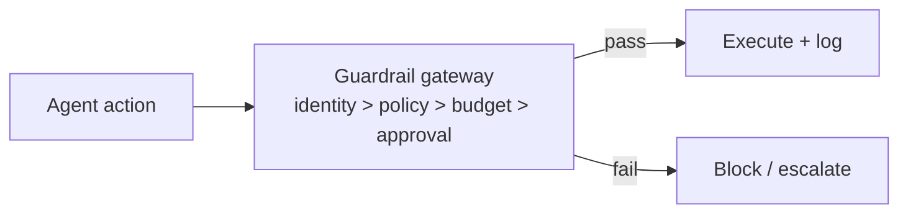

# Chapter 89: Structured Event Logging (OpenTelemetry for Agents)

**Part VII — Safety, Security & Governance**

## Structured Event Logging (OpenTelemetry for Agents) Pattern Overview

Standardized spans/events for every agent step so traces compose across agents, tools, and policies.

**Structured Event Logging (OpenTelemetry for Agents)** is catalogued in the **Safety, Security & Governance** part of the catalog (id `audit-logging-pattern`). It is tagged for enterprise, devops and is assembled from 3 components.

Emit spans (llm.call, tool.call, policy.check, approval); correlate by task and trace ID across sub-agents; export to the observability stack with a retention policy. Standardized spans turn scattered logs into a reconstructable system story: cross-agent, cross-tool, cross-policy analysis becomes possible because every event shares the schema and the trace identity. The failure is PII in spans — full prompts exported to a third-party observability vendor — which is why redaction happens at the instrumentation layer, before anything leaves.

**Definition 1 (Composable traces).** Tracing is *composable* iff (i) every agent step emits a standardized span (model, tool, policy, approval) with shared task/trace IDs across sub-agents, (ii) PII is redacted at the instrumentation layer (never exported raw), and (iii) large payloads are hashed with pointers retained (verifiable without being readable).

**Theorem 1 (Reconstruction requires shared identity).** Without shared task and trace IDs, sub-agent activity fragments into unrelated events and no cross-agent story is reconstructable; with them, the whole task replays from the trace store regardless of how many agents, tools, and policies participated.

*Proof.* Correlation needs a join key: task/trace IDs carried by every span provide it, so events from different agents, tools, and policy checks assemble into one timeline. Without shared IDs, each span is an orphan — the system story exists nowhere, and postmortems become archaeology across disconnected logs. PII redaction at instrumentation (not export) guarantees the assembled story is safe to keep: full prompts never leave for the vendor (the catalogued telemetry-exfil proof), large payloads are proven by hash rather than exposed in full. Verify redaction happens at instrumentation; confirm correlation IDs span sub-agents; audit retention against the immutable-trail and drift-monitoring consumers. ∎

## Practical Applications & Use Cases

Domains the catalog tags this pattern for:

- enterprise
- devops

1 documented failure scenario exercises it:

| Scenario | Severity | Likelihood | Domain |
|---|---|---|---|
| Secrets exfiltrated through telemetry and debug logs | Medium | Medium | enterprise |

It also appears in 4 composition cascades:

| Cascade | Class | Blast radius | Impact |
|---|---|---|---|
| Cross-scenario cascade in enterprise | Cascading | fleet | Critical |
| Immutable Audit Trail — logging the secrets | Inherent | service | High |
| Structured Event Logging (OpenTelemetry for Agents) — pii in spans | Inherent | single-agent | High |
| Secrets exfiltrated through telemetry and debug logs | Derived | single-agent | Medium |

## How It Works

1. Emit spans: llm.call, tool.call, policy.check, approval.
2. Correlate by task/trace ID across sub-agents.
3. Export to observability stack with retention policy.

## Components

- Instrumented runtime
- Trace store
- Dashboards

## Control-Flow Diagram

## Failure Modes and Risks

1 failure mode is documented for this pattern:

| Failure mode | Severity | What happens |
|---|---|---|
| PII in spans | High | Full prompts exported to third-party observability vendor. |

## Protections

1. Redaction at the instrumentation layer.
2. Hash large payloads; store pointers.

## At a Glance

| Field | Value |
|---|---|
| Catalog id | `audit-logging-pattern` |
| Part | VII — Safety, Security & Governance |
| Domains | enterprise, devops |
| Components | Instrumented runtime, Trace store, Dashboards |
| Failure modes | 1 |
| Protections | 2 |
| Related patterns | Immutable Audit Trail, Behavior & Drift Monitoring |
| Linked scenarios | 1 |
| Linked cascades | 4 |

## Key Takeaways

- Standardized spans/events for every agent step so traces compose across agents, tools, and policies.
- Redaction at the instrumentation layer.
- Hash large payloads; store pointers.
- Know its failure modes: PII in spans (high).

## References and Related Patterns

| Related pattern | Part | Summary |
|---|---|---|
| Immutable Audit Trail | Safety, Security & Governance | Append-only, tamper-evident log of every prompt, tool call, policy decision, approval, and outcome. |
| Behavior & Drift Monitoring | Safety, Security & Governance | Monitor distributions of agent decisions (routes, spend, tool mix, block rates, refusal rates) for drift from baseline. |

## Council deliberation

- **Evaluation methodologist:** Structured Event Logging standardizes spans and events for every agent step so traces compose across agents, tools and policies, emitting spans for model calls, tool calls, policy checks and approvals, correlating by task and trace identifiers across sub-agents, and exporting to the observability stack under a retention policy. The failure is personal data inside spans exported to third-party observability vendors. Protections redact at the instrumentation layer and hash large payloads while storing pointers, with immutable audit trails and drift monitoring as consumers of the resulting traces across enterprise and devops estates.
- **Safety researcher:** Redaction at instrumentation rather than at export is the safeguard I would keep, since once full prompts leave for a vendor the boundary has already failed. Correlation identifiers are the quiet value here: without shared task and trace identity, sub-agent activity fragments into unrelated events. Standardized spans make cross-agent, cross-tool and cross-policy analysis possible, which is what turns scattered logs into a reconstructable system story.

## Council reading

- **Red team:** Start with PII in spans (high): Full prompts exported to third-party observability vendor. Secrets exfiltrated through telemetry and debug logs is the catalogued proof — medium severity, enterprise domain — so rehearse that exact chain before any other.
- **Blue team:** Hold with Redaction at the instrumentation layer; Hash large payloads; store pointers. Compose with Immutable Audit Trail, Behavior & Drift Monitoring so a failure in one pattern meets a control in another.
- **Operator:** Deploy where it is tagged (enterprise, devops), and watch the 4 linked cascades — Cross-scenario cascade in enterprise first, because composition is where small faults amplify. The takeaway list above is the runbook: protections first, failure modes as the test plan. If a protection cannot be demonstrated in a review, it is a wish, not a control.

## Conclusion

In the catalog this chapter was generated from, **Structured Event Logging (OpenTelemetry for Agents)** is one of 107 patterns in *Safety, Security & Governance*, carrying 1 documented failure mode and 2 listed protections. Use it as a starting point, not a specification: the protection list is the part that survives contact with an adversary.

---
