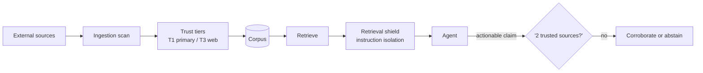

# Chapter 90: RAG Poisoning Defense

**Part VII — Safety, Security & Governance**

## RAG Poisoning Defense Pattern Overview

Protect the retrieval corpus: ingestion scanning, source trust tiers, anomaly detection on retrieved content, and instruction isolation.

**RAG Poisoning Defense** is catalogued in the **Safety, Security & Governance** part of the catalog (id `rag-poison-defense`). It is tagged for enterprise, research and is assembled from 4 components.

Scan at ingestion (injection patterns, hidden text, provenance); trust-tier sources (T1 primary through T3 open web); detect injected instructions at retrieval and quarantine; require corroboration across two or more independent trusted sources before action. The three poisoning shapes escalate in sophistication — single SEO page, compromised insider document, bulk-consistent fakes that outvote truth — and the defense answers each at its own layer: tiers at ingest, quarantine at retrieval, corroboration at action.

**Definition 1 (Tiered-corroborated retrieval).** Retrieval is *tiered-corroborated* iff (i) every source carries a trust tier (T1 primary / T3 open web), with T3 able to inform but never trigger action alone, (ii) every action requires corroboration across $\geq 2$ independent trusted sources, (iii) ingestion runs review queues with anomaly alerts on sudden corpus shifts, and (iv) all retrieved text is wrapped as untrusted data, never spliced into instruction position.

**Theorem 1 (Volume cannot manufacture consensus).** Under tiered corroboration with instruction isolation, bulk poisoning (hundreds of consistent fakes) cannot trigger action: volume without tier diversity fails corroboration, and untrusted wrapping prevents every retrieved text — real or fake — from becoming an instruction.

*Proof.* Corroboration requires two *independent trusted* sources: a hundred T3 fakes are one tier, not two sources — coordinated bulk content shares provenance (same campaign, same timing), which corpus-shift anomaly detection flags. The SEO-poisoned page (single authoritative-looking fake) fails corroboration for lack of a second independent source. The compromised-insider document (trusted tier, poisoned content) faces retrieval-time injection detection plus the same corroboration bar. Instruction isolation (iv) is the final backstop: even retrieved poison is data, never spliced into instruction position — including through memory (ties to vector-store hygiene) and through tool output (ties to input sanitization). Inform, never trigger, on T3 alone; corroborate or abstain; review the queues; watch the corpus-shift alerts. ∎

## Practical Applications & Use Cases

Domains the catalog tags this pattern for:

- enterprise
- research

3 documented failure scenarios exercise it:

| Scenario | Severity | Likelihood | Domain |
|---|---|---|---|
| Hidden instructions in a scraped page steer a research agent | Critical | High | general |
| Poisoned document in the vector store steers decisions for months | High | Medium | enterprise |
| Vendor selection steered by attacker SEO content | Medium | High | procurement |

It also appears in 12 composition cascades — the 6 most impactful of 12:

| Cascade | Class | Blast radius | Impact |
|---|---|---|---|
| Cross-scenario cascade in enterprise | Cascading | fleet | Critical |
| Cross-scenario cascade in general | Cascading | fleet | Critical |
| Hidden instructions in a scraped page steer a research agent | Derived | service | Critical |
| Input Sanitization & Prompt-Injection Shield — injection inside tool output | Inherent | single-agent | Critical |
| Long-Term Memory (Vector Store) — memory poisoning | Inherent | service | Critical |
| Poisoned shared knowledge index | Cascading | fleet | Critical |

## How It Works

1. Scan at ingestion (injection patterns, hidden text, provenance).
2. Trust tiers per source; untrusted sources can't drive actions.
3. At retrieval: detect injected instructions inside passages; quarantine.
4. Actions require corroboration across ≥2 trusted sources.

## Components

- Ingestion scanner
- Trust tier registry
- Retrieval shield
- Corroboration checker

## Control-Flow Diagram

## Failure Modes and Risks

3 failure modes are documented for this pattern:

| Failure mode | Severity | What happens |
|---|---|---|
| Poisoned SEO content | Critical | Attacker publishes 'authoritative' page that gets retrieved and steers purchases/research. |
| Poisoned internal doc | High | Compromised employee account plants instructions in a wiki page. |
| Bulk poisoning at scale | Critical | Hundreds of consistent fake sources outvote the truth. |

## Protections

1. Trust-tiered retrieval: T3 (open web) can inform but never trigger actions alone.
2. Corroboration requirement across independent trusted sources.
3. Ingestion pipeline with review queues; anomaly alerts on sudden corpus shifts.
4. Retrieved text is always wrapped as untrusted data — never spliced into instruction position.

## At a Glance

| Field | Value |
|---|---|
| Catalog id | `rag-poison-defense` |
| Part | VII — Safety, Security & Governance |
| Domains | enterprise, research |
| Components | Ingestion scanner, Trust tier registry, Retrieval shield, Corroboration checker |
| Failure modes | 3 |
| Protections | 4 |
| Related patterns | RAG-Augmented Agent, Input Sanitization & Prompt-Injection Shield, Long-Term Memory (Vector Store) |
| Linked scenarios | 3 |
| Linked cascades | 12 |

## Key Takeaways

- Protect the retrieval corpus: ingestion scanning, source trust tiers, anomaly detection on retrieved content, and instruction isolation.
- Trust-tiered retrieval: T3 (open web) can inform but never trigger actions alone.
- Corroboration requirement across independent trusted sources.
- Ingestion pipeline with review queues; anomaly alerts on sudden corpus shifts.
- Retrieved text is always wrapped as untrusted data — never spliced into instruction position.
- Know its failure modes: Poisoned SEO content (critical); Poisoned internal doc (high); Bulk poisoning at scale (critical).

## References and Related Patterns

| Related pattern | Part | Summary |
|---|---|---|
| RAG-Augmented Agent | Memory & Knowledge | Ground every answer/action in retrieved documents; cite sources; abstain when retrieval is empty. |
| Input Sanitization & Prompt-Injection Shield | Safety, Security & Governance | Screen everything entering the context — user input, tool output, retrieved docs, web pages — for injection patterns; quarantine and strip. |
| Long-Term Memory (Vector Store) | Memory & Knowledge | Persist embeddings of past interactions/facts; retrieve top-k similar at task time. |

## Council deliberation

- **Safety researcher:** RAG Poisoning Defense protects the retrieval corpus through ingestion scanning for injection patterns, hidden text and provenance, trust tiers per source, anomaly detection on retrieved content with instruction isolation, and corroboration before action. Failures are poisoned SEO content steering purchases or research, poisoned internal documents planted through compromised accounts, and bulk poisoning where many consistent fakes outvote truth. Protections tier retrieval so open-web sources inform but never trigger actions alone, require corroboration across independent trusted sources, review ingestion queues with corpus-shift alerts, and wrap retrieved text as untrusted data.
- **Memory-systems researcher:** The corroboration requirement is the memory-systems lesson: a single retrieved passage should never become a standing instruction for action. Trust tiers plus quarantine at retrieval keep untrusted sources informative without letting them drive effects, and corpus-shift alerts catch the bulk-poisoning case where volume simulates consensus. Instruction isolation on retrieved text, with ties to retrieval-grounded answering, input sanitization and vector-memory hygiene, keeps long-lived corpora from becoming long-lived compromises.

## Council reading

- **Red team:** Start with Poisoned SEO content (critical): Attacker publishes 'authoritative' page that gets retrieved and steers purchases/research. Hidden instructions in a scraped page steer a research agent is the catalogued proof — critical severity, general domain — so rehearse that exact chain before any other.
- **Blue team:** Hold with Trust-tiered retrieval: T3 (open web) can inform but never trigger actions alone; Corroboration requirement across independent trusted sources. Then layer the remaining 2: defence here is the list, not any single item. Compose with RAG-Augmented Agent, Input Sanitization & Prompt-Injection Shield so a failure in one pattern meets a control in another.
- **Operator:** Deploy where it is tagged (enterprise, research), and watch the 12 linked cascades — Cross-scenario cascade in enterprise first, because composition is where small faults amplify. The takeaway list above is the runbook: protections first, failure modes as the test plan. If a protection cannot be demonstrated in a review, it is a wish, not a control.

## Conclusion

In the catalog this chapter was generated from, **RAG Poisoning Defense** is one of 107 patterns in *Safety, Security & Governance*, carrying 3 documented failure modes and 4 listed protections. Use it as a starting point, not a specification: the protection list is the part that survives contact with an adversary.

---
