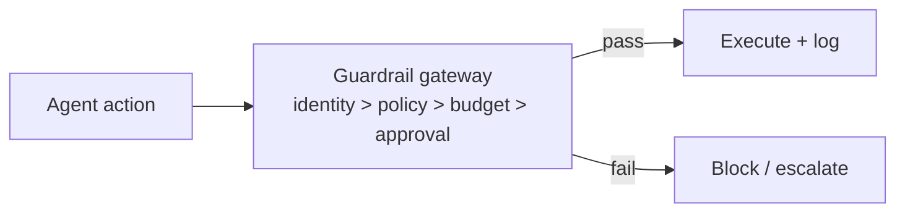
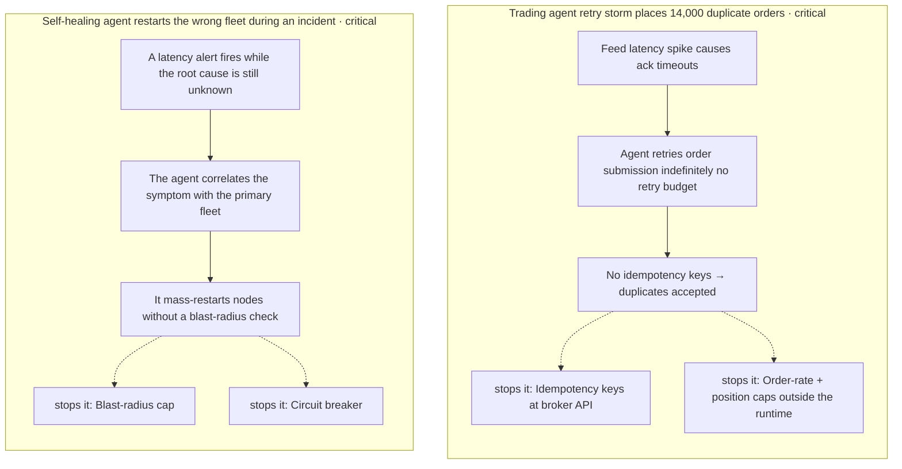
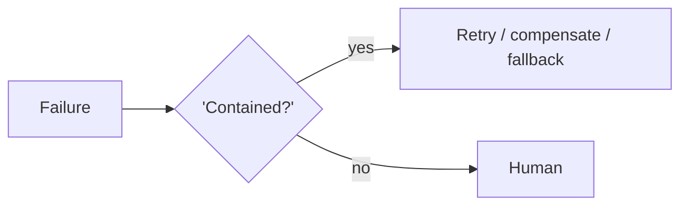

# Chapter 91: Confused-Deputy Defense

**Part VII — Safety, Security & Governance**

## Confused-Deputy Defense Pattern Overview

Prevent agents with broad authority from acting on behalf of low-privilege requesters by propagating caller identity into every authz decision.

**Confused-Deputy Defense** is catalogued in the **Safety, Security & Governance** part of the catalog (id `confused-deputy-defense`). It is tagged for enterprise, finance and is assembled from 3 components.

Capture end-user identity at intake; propagate on-behalf-of identity through every tool call; authorize downstream on the pair (user, agent) with least privilege winning. The classic confused deputy — broad-authority agent, low-privilege requester, no identity propagation — lets an intern's ticket trigger CEO-level data rights. Intersection, not union: effective scope is what both hold, never the stronger.

**Definition 1 (Intersection authz).** Authorization satisfies *intersection* iff (i) effective scope = agent rights ∩ requester rights (the weaker governs), (ii) sensitive reads require the requester to hold the same right independently, and (iii) delegation tokens are short-lived and audience-bound (bounded in time and place).

**Theorem 1 (No privilege laundering).** Under intersection authz with propagated caller identity, a low-privilege requester cannot borrow agent authority however the request is framed: the effective permission is bounded above by the requester's own rights.

*Proof.* Let $R$ be requester rights and $A$ agent rights; effective scope is $R \cap A \subseteq R$. Broad agent authority ($A$ large) intersected with narrow requester rights ($R$ small) yields $R$ — the agent contributes capability (can act) but never authority beyond the requester's. Sensitive reads require $r \in R$ independently: even if the agent could read it, the requester without the right blocks the read. Short-lived, audience-bound delegation tokens bound the residual (time, place). The catalogued pair (cross-tenant leak, impersonation) are both intersection failures: acting on agent rights alone, without the requester's. Authorize on the pair; make the requester visible to every downstream check; test the ambient-authority case directly — it is the most plausible production surprise. ∎

## Practical Applications & Use Cases

Domains the catalog tags this pattern for:

- enterprise
- finance

2 documented failure scenarios exercise it:

| Scenario | Severity | Likelihood | Domain |
|---|---|---|---|
| Multi-tenant agent leaks one customer's data to another | Critical | Medium | enterprise |
| Attacker impersonates the agent to other systems | High | Low | enterprise |

It also appears in 5 composition cascades:

| Cascade | Class | Blast radius | Impact |
|---|---|---|---|
| Cascading tenant failure via shared sandbox | Cascading | fleet | Critical |
| Confused-Deputy Defense — agent-ambient authority | Inherent | single-agent | Critical |
| Cross-scenario cascade in enterprise | Cascading | fleet | Critical |
| Multi-tenant agent leaks one customer's data to another | Derived | service | Critical |
| Attacker impersonates the agent to other systems | Derived | service | High |

## How It Works

1. Capture end-user identity at intake.
2. Propagate through every tool call (on-behalf-of).
3. Downstream authz on the pair (user, agent), least privilege wins.

## Components

- Identity propagation
- Authz middleware
- Delegation tokens

## Control-Flow Diagram

## Failure Modes and Risks

1 failure mode is documented for this pattern:

| Failure mode | Severity | What happens |
|---|---|---|
| Agent-ambient authority | Critical | Intern's ticket triggers agent with CEO-level data rights. |

## Protections

1. Effective scope = intersection(agent rights, requester rights).
2. Sensitive reads require requester to hold the same right.
3. Delegation tokens short-lived and audience-bound.

## At a Glance

| Field | Value |
|---|---|
| Catalog id | `confused-deputy-defense` |
| Part | VII — Safety, Security & Governance |
| Domains | enterprise, finance |
| Components | Identity propagation, Authz middleware, Delegation tokens |
| Failure modes | 1 |
| Protections | 3 |
| Related patterns | Agent Identity & Authentication, Least Privilege Scoping |
| Linked scenarios | 2 |
| Linked cascades | 5 |

## Key Takeaways

- Prevent agents with broad authority from acting on behalf of low-privilege requesters by propagating caller identity into every authz decision.
- Effective scope = intersection(agent rights, requester rights).
- Sensitive reads require requester to hold the same right.
- Delegation tokens short-lived and audience-bound.
- Know its failure modes: Agent-ambient authority (critical).

## References and Related Patterns

| Related pattern | Part | Summary |
|---|---|---|
| Agent Identity & Authentication | Safety, Security & Governance | Every agent has a distinct, verifiable identity; actions are attributable; requester identity travels with the task (avoid confused deputy). |
| Least Privilege Scoping | Safety, Security & Governance | The agent holds the minimum credentials and data access needed for the current task — nothing ambient, nothing standing. |

## Council deliberation

- **Safety researcher:** Confused-Deputy Defense stops agents with broad authority from acting for low-privilege requesters by capturing end-user identity at intake, propagating on-behalf-of identity through every tool call, and authorizing downstream on the user-plus-agent pair with least privilege winning. The failure is agent-ambient authority, where a junior ticket triggers executive-level data rights. Protections compute effective scope as the intersection of agent and requester rights, require the requester to hold the same right for sensitive reads, and keep delegation tokens short-lived and audience-bound, with agent identity and least privilege alongside.
- **Evaluation methodologist:** Intersection rather than union is the formal point worth preserving: effective scope must shrink to what both parties hold, never expand to the stronger. I would test the ambient-authority case directly, since it is the most plausible production surprise. Short-lived audience-bound delegation tokens bound the blast radius in time and place, and authorizing on the pair rather than the agent alone makes the requester visible to every downstream check across enterprise and finance flows.

## Council reading

- **Red team:** Start with Agent-ambient authority (critical): Intern's ticket triggers agent with CEO-level data rights. Multi-tenant agent leaks one customer's data to another is the catalogued proof — critical severity, enterprise domain — so rehearse that exact chain before any other.
- **Blue team:** Hold with Effective scope = intersection(agent rights, requester rights); Sensitive reads require requester to hold the same right. Then layer the remaining 1: defence here is the list, not any single item. Compose with Agent Identity & Authentication, Least Privilege Scoping so a failure in one pattern meets a control in another.
- **Operator:** Deploy where it is tagged (enterprise, finance), and watch the 5 linked cascades — Cascading tenant failure via shared sandbox first, because composition is where small faults amplify. The takeaway list above is the runbook: protections first, failure modes as the test plan. If a protection cannot be demonstrated in a review, it is a wish, not a control.

## Conclusion

In the catalog this chapter was generated from, **Confused-Deputy Defense** is one of 107 patterns in *Safety, Security & Governance*, carrying 1 documented failure mode and 3 listed protections. Use it as a starting point, not a specification: the protection list is the part that survives contact with an adversary.

---

# Part VIII: Resilience & Reliability

Degrading gracefully when the model, tools or world misbehave.

*Resilience & Reliability* holds 9 of the catalog's 107 patterns, which appear in 5 catalogued failure scenarios and 31 composition cascades. Each chapter below follows the same order and shape as every other part.

## Council deliberation

- **Continual-learning researcher:** Resilience lets the system survive model, tool and world misbehavior by containing failure and recovering within bounds. Its repertoire is bounded retry with backoff, ordered fallback across tiers, compensation in reverse for partial sagas, replanning under containment, and degraded modes that shrink action space rather than oversight. Attempt caps, remediation allowlists, change windows and human paging keep healing finite. The architectural stance is that failure is normal input: detect it, bound its blast radius, compensate or degrade, verify the fix, and only then continue.
- **Evaluation methodologist:** I value resilience because it is observable under stress: validators independent of generators, judges calibrated against human labels, ensembles with deterministic rule checkers, loop signatures keyed on state delta rather than repetition. Each mechanism defines its terminal state explicitly, whether acceptance, escalation or halt, so recovery is measurable rather than hopeful. Keeping per-checker verdicts, serving-tier logs and saga-state histories turns survival into evidence, which is what lets a team distinguish a system that recovered from one that merely continued.
- **Safety researcher:** My emphasis is that recovery must never widen authority: degraded tiers get narrower rights, guardrails sit beneath every fallback tier, and destructive remediation stays gated regardless of urgency. Retrying only idempotent or keyed calls prevents rescue from double-charging, while classifying irreversible steps upfront keeps compensation honest about what cannot be undone. Resilience and safety thus meet at containment, since a fallback, retry or replan that escapes its bounds is not recovery but a second incident wearing the first one as cover.

**Incident anatomy.** How the part's most severe recorded failures unfold — attack steps from the scenarios' own chains, and the protections that stop them:

| Chapter | Pattern | Domains |
|---|---|---|
| 92 | Retry with Exponential Backoff + Jitter | general, devops |
| 93 | Fallback Chain | general |
| 94 | Saga / Compensation | finance, devops, logistics |
| 95 | Validation Loop | engineering, general |
| 96 | LLM-as-Judge | general, content |
| 97 | Ensemble Verification | finance, healthcare |
| 98 | Graceful Degradation | general |
| 99 | Self-Healing Replan | devops, operations |
| 100 | Loop / Stall Detection | general |

---
