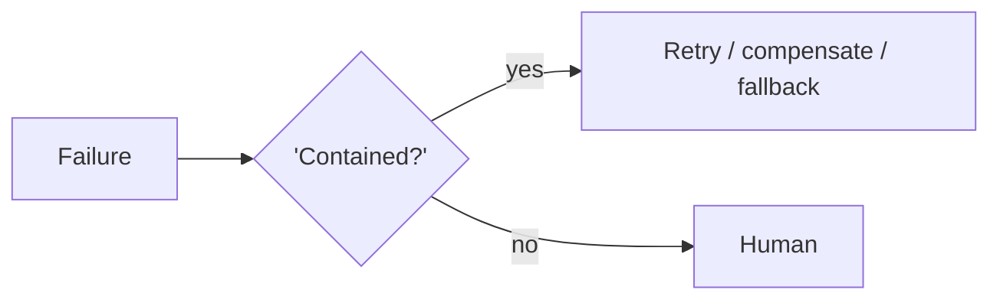

# Chapter 92: Retry with Exponential Backoff + Jitter

**Part VIII — Resilience & Reliability**

## Retry with Exponential Backoff + Jitter Pattern Overview

Bounded retries on transient failures with backoff; distinguish retryable from terminal errors.

**Retry with Exponential Backoff + Jitter** is catalogued in the **Resilience & Reliability** part of the catalog (id `retry-backoff`). It is tagged for general, devops and is assembled from 2 components.

Classify the error (transient vs terminal); retry $n$ times with backoff plus jitter; terminal means escalate, never retry. Two failure modes bound the design: retrying non-idempotent actions (retry of 'send payment' charges twice — the 14,000-duplicate-order proof), and synchronized retry storms (coordinated retries overloading downstream). Idempotency keys plus a global retry budget are what make retry safe: the first makes repeats harmless, the second bounds the fleet-wide total.

**Definition 1 (Honest retry).** A retry policy is *honest* iff (i) errors are classified transient vs terminal (terminal escalates, never retries), (ii) every retried side effect carries an idempotency key, and (iii) a global retry budget caps total attempts fleet-wide (not per-agent).

**Theorem 1 (Retry without doubles or storms).** Under honest retry with idempotent keys and a global budget, transient failures are retried to success, terminal failures escalate once, and synchronized fleets cannot storm: the worst case is bounded attempts, each idempotent.

*Proof.* Non-idempotent retry is the double-charge: without keys, each retry is a new execution (the catalogued 14,000 duplicates). Keys make repeats idempotent — the same effect, however many attempts. Terminal classification stops the futile loop: retrying a terminal refusal repeats the harm (or the waste) with zero chance of success, so escalate instead. The global budget bounds the fleet: per-agent budgets sum to a storm under synchronized failure (every agent retrying the same outage), while a shared budget caps the total regardless of coordination — plus jitter desynchronizes the attempts that remain. Classify first, key everything, budget globally: transient errors get patience with a ceiling, terminal errors get escalation, storms get neither the volume nor the synchronization to form. ∎

## Practical Applications & Use Cases

Domains the catalog tags this pattern for:

- general
- devops

1 documented failure scenario exercises it:

| Scenario | Severity | Likelihood | Domain |
|---|---|---|---|
| Trading agent retry storm places 14,000 duplicate orders | Critical | Medium | finance |

It also appears in 4 composition cascades:

| Cascade | Class | Blast radius | Impact |
|---|---|---|---|
| Cross-scenario cascade in finance | Cascading | fleet | Critical |
| Retry with Exponential Backoff + Jitter — retrying non-idempotent actions | Inherent | single-agent | Critical |
| Trading agent retry storm places 14,000 duplicate orders | Derived | service | Critical |
| Retry amplification storm | Emergent | service | High |

## How It Works

1. Classify error (transient vs terminal).
2. Retry n times with backoff+jitter.
3. Terminal → escalate, never retry.

## Components

- Error classifier
- Backoff scheduler

## Control-Flow Diagram

## Failure Modes and Risks

2 failure modes are documented for this pattern:

| Failure mode | Severity | What happens |
|---|---|---|
| Retrying non-idempotent actions | Critical | Retry of 'send payment' charges twice. |
| Retry storms | Medium | Synchronized retries overload downstream. |

## Protections

1. Retry only idempotent calls or with idempotency keys.
2. Global retry budget across all agents.

## At a Glance

| Field | Value |
|---|---|
| Catalog id | `retry-backoff` |
| Part | VIII — Resilience & Reliability |
| Domains | general, devops |
| Components | Error classifier, Backoff scheduler |
| Failure modes | 2 |
| Protections | 2 |
| Related patterns | Idempotency Keys, Fallback Chain |
| Linked scenarios | 1 |
| Linked cascades | 4 |

## Key Takeaways

- Bounded retries on transient failures with backoff; distinguish retryable from terminal errors.
- Retry only idempotent calls or with idempotency keys.
- Global retry budget across all agents.
- Know its failure modes: Retrying non-idempotent actions (critical); Retry storms (medium).

## References and Related Patterns

| Related pattern | Part | Summary |
|---|---|---|
| Idempotency Keys | Safety, Security & Governance | Every side-effecting call carries a key so retries/duplicates can't double-charge or double-deploy. |
| Fallback Chain | Resilience & Reliability | Ordered degradation: primary model → smaller model → deterministic heuristic → human. |

## Council deliberation

- **Evaluation methodologist:** Retry with Exponential Backoff and Jitter bounds retries on transient failures with growing delays plus randomization, built from an error classifier and a backoff scheduler that escalates terminal errors instead of retrying them. Failures are retrying non-idempotent actions so a payment charges twice, and retry storms where synchronized retries overload the downstream. Protections retry only idempotent calls or calls carrying idempotency keys and hold a global retry budget across agents, with idempotency keys and fallback chains as companions across general and devops operations.
- **Safety researcher:** Distinguishing retryable from terminal errors is the safety core here, since retrying a terminal refusal just repeats the harm. Pairing every retried side effect with an idempotency key turns the classifier from advice into enforcement. A global retry budget matters at fleet scale, where per-agent limits still sum to a storm, so jitter plus a shared ceiling keeps transient-error handling from becoming a self-inflicted overload.

## Council reading

- **Red team:** Start with Retrying non-idempotent actions (critical): Retry of 'send payment' charges twice. Trading agent retry storm places 14,000 duplicate orders is the catalogued proof — critical severity, finance domain — so rehearse that exact chain before any other.
- **Blue team:** Hold with Retry only idempotent calls or with idempotency keys; Global retry budget across all agents. Compose with Idempotency Keys, Fallback Chain so a failure in one pattern meets a control in another.
- **Operator:** Deploy where it is tagged (general, devops), and watch the 4 linked cascades — Cross-scenario cascade in finance first, because composition is where small faults amplify. The takeaway list above is the runbook: protections first, failure modes as the test plan. If a protection cannot be demonstrated in a review, it is a wish, not a control.

## Conclusion

In the catalog this chapter was generated from, **Retry with Exponential Backoff + Jitter** is one of 107 patterns in *Resilience & Reliability*, carrying 2 documented failure modes and 2 listed protections. Use it as a starting point, not a specification: the protection list is the part that survives contact with an adversary.

---
