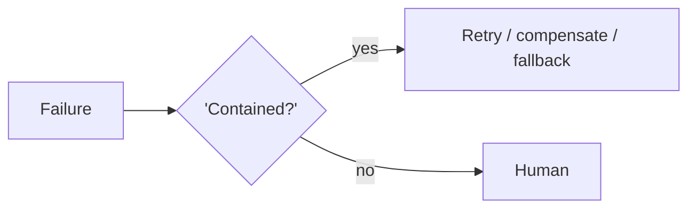

# Chapter 93: Fallback Chain

**Part VIII — Resilience & Reliability**

## Fallback Chain Pattern Overview

Ordered degradation: primary model → smaller model → deterministic heuristic → human.

**Fallback Chain** is catalogued in the **Resilience & Reliability** part of the catalog (id `fallback-chain`). It is tagged for general and is assembled from 2 components.

Chain ordered by capability and cost; health-gated selection; log which tier served. The chain degrades capability in order — but the failure is degrading the guardrails along with it: the 'simplest fallback' (deterministic heuristic, human) must carry equal or stronger controls, because the fallback path runs exactly when the primary is already failing. Guardrails below all tiers in a shared gateway, plus narrower action rights for degraded tiers, keep degradation from becoming deregulation.

**Definition 1 (Guarded degradation).** A fallback chain is *guarded* iff (i) guardrails live below all tiers in a shared gateway (same policy engine regardless of tier), (ii) degraded tiers get narrower action rights, never wider, and (iii) health-gated selection logs which tier served (observable degradation, not silent).

**Theorem 1 (Capability down, never protection).** Under guarded degradation, falling back reduces what the system *can* do while preserving what it *may* do: the heuristic tier is dumber but equally governed — its smaller brain operates inside the same or tighter guardrails.

*Proof.* Un-guarded fallback inverts the safety ordering: the weakest reasoner gets the widest latitude (no guardrails on the heuristic tier "for simplicity"), exactly when oversight matters most (the primary already failed). Shared-gateway guardrails (i) remove the inversion: every tier passes the same policy gate, so capability degrades while authorization stays constant. Narrower rights for degraded tiers (ii) go further: the fallback can do strictly less damage than the primary by construction. Health-gated selection with serving-tier logs (iii) makes degradation observable and reversible — reviewers see which tier served, and the chain can climb back up. Compose with pipeline fallback and graceful degradation: degrade capability, never oversight. ∎

## Practical Applications & Use Cases

Domains the catalog tags this pattern for:

- general

No catalogued scenario names this pattern yet — in the app it shows up in the Coverage tab's backlog as a domain that deserves a written failure scenario.

It also appears in 4 composition cascades:

| Cascade | Class | Blast radius | Impact |
|---|---|---|---|
| Retry with Exponential Backoff + Jitter — retrying non-idempotent actions | Inherent | single-agent | Critical |
| Fallback Chain — unsafe heuristic tier | Inherent | single-agent | High |
| Graceful Degradation — degraded mode still dangerous | Inherent | single-agent | High |
| Pipeline with Fallback — silent quality drop | Inherent | single-agent | Medium |

## How It Works

1. Chain ordered by capability/cost.
2. Health-gated selection.
3. Log which tier served.

## Components

- Tier registry
- Health checks

## Control-Flow Diagram

## Failure Modes and Risks

1 failure mode is documented for this pattern:

| Failure mode | Severity | What happens |
|---|---|---|
| Unsafe heuristic tier | High | The 'simplest fallback' skips guardrails. |

## Protections

1. Guardrails live below all tiers (shared gateway).
2. Degraded tiers get narrower action rights, not wider.

## At a Glance

| Field | Value |
|---|---|
| Catalog id | `fallback-chain` |
| Part | VIII — Resilience & Reliability |
| Domains | general |
| Components | Tier registry, Health checks |
| Failure modes | 1 |
| Protections | 2 |
| Related patterns | Pipeline with Fallback, Graceful Degradation |
| Linked scenarios | 0 |
| Linked cascades | 4 |

## Key Takeaways

- Ordered degradation: primary model → smaller model → deterministic heuristic → human.
- Guardrails live below all tiers (shared gateway).
- Degraded tiers get narrower action rights, not wider.
- Know its failure modes: Unsafe heuristic tier (high).

## References and Related Patterns

| Related pattern | Part | Summary |
|---|---|---|
| Pipeline with Fallback | Workflow Orchestration | Primary path with automatic fallback to cheaper/safer path on failure or degradation. |
| Graceful Degradation | Resilience & Reliability | When confidence or capability drops, shrink the action space rather than the safety envelope. |

## Council deliberation

- **Safety researcher:** The Fallback Chain degrades in order from primary model to smaller model to deterministic heuristic to human, using a tier registry with health-gated selection and logging of which tier served. The failure is an unsafe heuristic tier that skips guardrails in the name of simplicity. Protections place guardrails below all tiers in a shared gateway and give degraded tiers narrower action rights rather than wider ones, with pipeline fallback and graceful degradation alongside, so reduced capability never means reduced oversight in general deployments.
- **Continual-learning researcher:** Narrower rights in degraded mode is the insight I would underline: a weaker model should be allowed to do less, not more. Health-gated selection plus logging of the serving tier makes degradation observable, so reviewers can see how often the system runs diminished. Keeping guardrails beneath every tier means fallback changes capability without renegotiating safety, which is what lets ordered degradation stay ordered rather than sliding into an unguarded heuristic.

## Council reading

- **Red team:** Start with Unsafe heuristic tier (high): The 'simplest fallback' skips guardrails. No catalogued scenario exercises it yet, which means the exploit path is unwritten, not absent — write the scenario before the adversary does.
- **Blue team:** Hold with Guardrails live below all tiers (shared gateway); Degraded tiers get narrower action rights, not wider. Compose with Pipeline with Fallback, Graceful Degradation so a failure in one pattern meets a control in another.
- **Operator:** Deploy where it is tagged (general), and watch the 4 linked cascades — Retry with Exponential Backoff + Jitter — retrying non-idempotent actions first, because composition is where small faults amplify. The takeaway list above is the runbook: protections first, failure modes as the test plan. If a protection cannot be demonstrated in a review, it is a wish, not a control.

## Conclusion

In the catalog this chapter was generated from, **Fallback Chain** is one of 107 patterns in *Resilience & Reliability*, carrying 1 documented failure mode and 2 listed protections. Use it as a starting point, not a specification: the protection list is the part that survives contact with an adversary.

---
