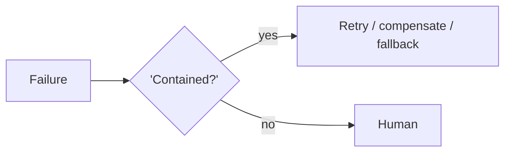

# Chapter 94: Saga / Compensation

**Part VIII — Resilience & Reliability**

## Saga / Compensation Pattern Overview

Distributed multi-step transactions with compensating actions to undo partial completion.

**Saga / Compensation** is catalogued in the **Resilience & Reliability** part of the catalog (id `saga-compensation`). It is tagged for finance, devops, logistics and is assembled from 2 components.

Each step carries a compensating action; on failure, compensations run in reverse; saga state is logged for audit. The two failure modes are the honest core of distributed transactions: missing compensation (some steps, like sent email, have no undo) and compensation failure cascades (the undo itself fails mid-chain). Steps without compensation are classified irreversible up front with an approval gate; compensation paths are rehearsed with alerts on partial-saga states.

**Definition 1 (Compensatable saga).** A saga with steps $s_1, \dots, s_n$ is *compensatable* iff (i) every step has a registered compensating action $c_i$ or is classified irreversible (gated upfront instead), (ii) compensation paths are rehearsed (not merely specified), and (iii) partial-saga states raise alerts (a saga stuck mid-chain is a finding, not a pause).

**Theorem 1 (Undo requires a rehearsed inverse).** A saga without tested compensations is a distributed transaction with no rollback: the first failure strands partial state, and each compensation failure cascades because the chain assumed what it never verified.

*Proof.* Partial completion without compensation leaves effects applied with no path to undo them — the sent email, the charged card, the booked shipment persist while the saga reports failure. Rehearsal converts specified compensations into working ones: untested undo paths fail exactly when needed (the rollback-itself-fails pattern), and mid-chain compensation failure without alerts strands the saga silently. Classification (i) prevents the trap at design time: steps with no undo never enter the saga unguarded — they get the approval gate instead. Alerts on partial states (iii) make stuck sagas visible rather than merely paused. Rehearse the compensation paths; classify the un-compensatable upfront; alert on every partial state. ∎

## Practical Applications & Use Cases

Domains the catalog tags this pattern for:

- finance
- devops
- logistics

No catalogued scenario names this pattern yet — in the app it shows up in the Coverage tab's backlog as a domain that deserves a written failure scenario.

It also appears in 3 composition cascades:

| Cascade | Class | Blast radius | Impact |
|---|---|---|---|
| Checkpointing & Rollback — rollback itself fails | Inherent | service | Critical |
| Saga / Compensation — compensation failure cascade | Inherent | service | Critical |
| Reversibility-First Design — hidden irreversibility | Inherent | service | High |

## How It Works

1. Each step has a compensating action.
2. Failure → run compensations in reverse.
3. Log saga state for audit.

## Components

- Saga orchestrator
- Compensation registry

## Control-Flow Diagram

## Failure Modes and Risks

2 failure modes are documented for this pattern:

| Failure mode | Severity | What happens |
|---|---|---|
| Missing compensation | High | Some steps (email sent) have no undo. |
| Compensation failure cascade | Critical | Undo itself fails mid-chain. |

## Protections

1. Steps without compensation classified irreversible → approval gate upfront.
2. Rehearse compensation paths; alert on partial-saga states.

## At a Glance

| Field | Value |
|---|---|
| Catalog id | `saga-compensation` |
| Part | VIII — Resilience & Reliability |
| Domains | finance, devops, logistics |
| Components | Saga orchestrator, Compensation registry |
| Failure modes | 2 |
| Protections | 2 |
| Related patterns | Checkpointing & Rollback, Reversibility-First Design |
| Linked scenarios | 0 |
| Linked cascades | 3 |

## Key Takeaways

- Distributed multi-step transactions with compensating actions to undo partial completion.
- Steps without compensation classified irreversible → approval gate upfront.
- Rehearse compensation paths; alert on partial-saga states.
- Know its failure modes: Missing compensation (high); Compensation failure cascade (critical).

## References and Related Patterns

| Related pattern | Part | Summary |
|---|---|---|
| Checkpointing & Rollback | Agent Loop & Control | Snapshot state before risky operations so the agent can revert on failure. |
| Reversibility-First Design | Safety, Security & Governance | Prefer reversible actions; where irreversible, add confirmation, delay, and staged execution. |

## Council deliberation

- **Safety researcher:** Saga Compensation handles distributed multi-step transactions by pairing each step with a compensating action, running compensations in reverse on failure, and logging saga state for audit, through an orchestrator and a compensation registry. Failures are missing compensation where steps like sent messages have no undo, and compensation failure cascades where the undo itself fails mid-chain. Protections classify steps without compensation as irreversible with an upfront approval gate, rehearse compensation paths, and alert on partial-saga states, with rollback and reversibility-first design alongside across finance, devops and logistics flows.
- **Memory-systems researcher:** Saga state as durable memory is what makes partial completion recoverable rather than mysterious. I agree that steps without undo must be gated before execution, since no runtime cleverness restores a sent message. Rehearsed compensation paths plus alerts on partial states keep the orchestrator honest about the middle of the chain, where most real sagas actually fail, and the audit log of saga state turns recovery into something reviewable.

## Council reading

- **Red team:** Start with Compensation failure cascade (critical): Undo itself fails mid-chain. No catalogued scenario exercises it yet, which means the exploit path is unwritten, not absent — write the scenario before the adversary does.
- **Blue team:** Hold with Steps without compensation classified irreversible → approval gate upfront; Rehearse compensation paths; alert on partial-saga states. Compose with Checkpointing & Rollback, Reversibility-First Design so a failure in one pattern meets a control in another.
- **Operator:** Deploy where it is tagged (finance, devops, logistics), and watch the 3 linked cascades — Checkpointing & Rollback — rollback itself fails first, because composition is where small faults amplify. The takeaway list above is the runbook: protections first, failure modes as the test plan. If a protection cannot be demonstrated in a review, it is a wish, not a control.

## Conclusion

In the catalog this chapter was generated from, **Saga / Compensation** is one of 107 patterns in *Resilience & Reliability*, carrying 2 documented failure modes and 2 listed protections. Use it as a starting point, not a specification: the protection list is the part that survives contact with an adversary.

---
