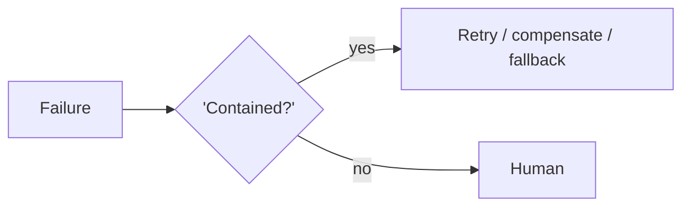

# Chapter 97: Ensemble Verification

**Part VIII — Resilience & Reliability**

## Ensemble Verification Pattern Overview

Multiple heterogeneous verifiers (rules + ML + different models) must concur before high-impact actions.

**Ensemble Verification** is catalogued in the **Resilience & Reliability** part of the catalog (id `ensemble-verify`). It is tagged for finance, healthcare and is assembled from 2 components.

Fan out verification to $n$ diverse checkers; require unanimity or $k$-of-$n$ with human tiebreak; record per-checker verdicts. The failure is homogeneity illusion: $n$ checkers with the same training data share one blind spot, and agreement among them is correlated repetition dressed as independent confirmation. At least one deterministic rule checker plus diverse model families and prompts are what make agreement mean something.

**Definition 1 (Genuine ensemble).** An ensemble is *genuine* iff (i) it includes at least one deterministic rule checker (non-learned ground truth), (ii) model checkers span diverse families and prompts (no shared training monoculture), and (iii) every checker's verdict is recorded separately (auditable agreement, not an averaged score).

**Theorem 1 (Correlated agreement is not confirmation).** If all $n$ checkers share the same training data and failure modes, then $n$-way agreement carries exactly the confidence of one checker: redundancy without diversity multiplies cost, never evidence.

*Proof.* Agreement is evidence only to the extent checkers fail independently: independent checkers err on different inputs, so joint agreement is unlikely unless the answer is right. Same-training-data checkers share blind spots — the homogeneity illusion — so they agree precisely where they are jointly wrong (shared-bias consensus, single-model style; injected-debater capture, multi-agent style). The deterministic rule checker breaks the correlation structurally: rules fail differently from models (brittle but unbiased by training data), so rule-plus-model agreement spans two failure regimes. Per-checker verdicts make the independence auditable: correlated voting patterns reveal shared blind spots instead of hiding them in an average. $k$-of-$n$ with human tiebreak handles disagreement without forcing false unanimity. Diverse families, deterministic anchor, recorded verdicts — agreement worth acting on. ∎

## Practical Applications & Use Cases

Domains the catalog tags this pattern for:

- finance
- healthcare

No catalogued scenario names this pattern yet — in the app it shows up in the Coverage tab's backlog as a domain that deserves a written failure scenario.

It also appears in 4 composition cascades:

| Cascade | Class | Blast radius | Impact |
|---|---|---|---|
| Multi-Agent Debate / Council — injected debater | Inherent | service | High |
| Parallelization (Voting / Best-of-N) — judge capture | Inherent | service | High |
| Ensemble Verification — homogeneity illusion | Inherent | single-agent | Medium |
| Self-Consistency Sampling — shared-blind-spot consensus | Inherent | service | Medium |

## How It Works

1. Fan out verification to n diverse checkers.
2. All must pass (or k-of-n with human tiebreak).
3. Record per-checker verdicts.

## Components

- Checker set
- Tally

## Control-Flow Diagram

## Failure Modes and Risks

1 failure mode is documented for this pattern:

| Failure mode | Severity | What happens |
|---|---|---|
| Homogeneity illusion | Medium | n checkers, same training data → one blind spot. |

## Protections

1. Include at least one deterministic rule checker.
2. Diverse model families and prompts.

## At a Glance

| Field | Value |
|---|---|
| Catalog id | `ensemble-verify` |
| Part | VIII — Resilience & Reliability |
| Domains | finance, healthcare |
| Components | Checker set, Tally |
| Failure modes | 1 |
| Protections | 2 |
| Related patterns | Self-Consistency Sampling, Parallelization (Voting / Best-of-N) |
| Linked scenarios | 0 |
| Linked cascades | 4 |

## Key Takeaways

- Multiple heterogeneous verifiers (rules + ML + different models) must concur before high-impact actions.
- Include at least one deterministic rule checker.
- Diverse model families and prompts.
- Know its failure modes: Homogeneity illusion (medium).

## References and Related Patterns

| Related pattern | Part | Summary |
|---|---|---|
| Self-Consistency Sampling | Planning & Reasoning | Sample N reasoning paths at temperature > 0 and take the majority answer; disagreement signals low confidence. |
| Parallelization (Voting / Best-of-N) | Workflow Orchestration | Run the same task n times and vote/judge to boost reliability on a single decision. |

## Council deliberation

- **Evaluation methodologist:** Ensemble Verification requires multiple heterogeneous verifiers across rules, models and model families to concur before high-impact actions, fanning out to diverse checkers, requiring unanimity or k-of-n with human tiebreak, and recording per-checker verdicts. The failure is homogeneity illusion, where several checkers share training data and one blind spot. Protections include at least one deterministic rule checker plus diverse model families and prompts, with self-consistency and voting parallels as companions across finance and healthcare decisions, so agreement means independent agreement rather than correlated repetition.
- **Safety researcher:** The deterministic checker is the anchor I would keep, since purely model-based ensembles can share blind spots while looking redundant. Recording per-checker verdicts makes agreement auditable instead of a single averaged score. Diversity across families and prompts is a cost worth paying where impact is high, because correlated verifiers manufacture confidence without adding safety, which is exactly the homogeneity illusion this record names.

## Council reading

- **Red team:** Start with Homogeneity illusion (medium): n checkers, same training data → one blind spot. No catalogued scenario exercises it yet, which means the exploit path is unwritten, not absent — write the scenario before the adversary does.
- **Blue team:** Hold with Include at least one deterministic rule checker; Diverse model families and prompts. Compose with Self-Consistency Sampling, Parallelization (Voting / Best-of-N) so a failure in one pattern meets a control in another.
- **Operator:** Deploy where it is tagged (finance, healthcare), and watch the 4 linked cascades — Multi-Agent Debate / Council — injected debater first, because composition is where small faults amplify. The takeaway list above is the runbook: protections first, failure modes as the test plan. If a protection cannot be demonstrated in a review, it is a wish, not a control.

## Conclusion

In the catalog this chapter was generated from, **Ensemble Verification** is one of 107 patterns in *Resilience & Reliability*, carrying 1 documented failure mode and 2 listed protections. Use it as a starting point, not a specification: the protection list is the part that survives contact with an adversary.

---
