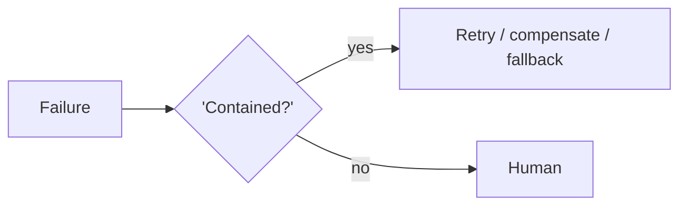

# Chapter 98: Graceful Degradation

**Part VIII — Resilience & Reliability**

## Graceful Degradation Pattern Overview

When confidence or capability drops, shrink the action space rather than the safety envelope.

**Graceful Degradation** is catalogued in the **Resilience & Reliability** part of the catalog (id `graceful-degradation`). It is tagged for general and is assembled from 2 components.

Detect degradation (model error, tool outage); drop to read-only or suggest-only mode; notify users of reduced mode. Degradation shrinks what the agent can do, never what constrains it: degraded modes defined in policy and reviewed like features, data rights never widened in degraded mode. The failure is degraded mode still dangerous — read-only that leaks restricted data — which is why the degraded mode needs the same review discipline as the full one.

**Definition 1 (Envelope-preserving degradation).** Degradation is *envelope-preserving* iff (i) degraded modes are defined in policy and reviewed like features (not improvised), (ii) data rights never widen in degraded mode (read-only means fewer rights, never different ones), and (iii) users are notified of reduced mode (no silent diminution).

**Theorem 1 (Shrink action, not oversight).** Under envelope-preserving degradation, reduced capability cannot produce reduced safety: the degraded mode does less, under the same or tighter constraints, with its limits declared in advance.

*Proof.* The failure mode inverts this: read-only access that still leaks restricted data shrinks capability on paper while preserving the exfiltration path in practice — degradation theater. Policy-defined modes (i) force the review that catches it: each degraded mode is specified, reviewed, and tested like a feature, including its data access. No-widening (ii) closes the hole structurally: degraded means fewer rights, so even a mis-specified mode errs toward less access. Notification (iii) closes the human loop: users who know the system is diminished do not route around limits they cannot see. Compose with fallback chains and circuit breakers: diminished capability inside the same guardrails, verified in advance. ∎

## Practical Applications & Use Cases

Domains the catalog tags this pattern for:

- general

No catalogued scenario names this pattern yet — in the app it shows up in the Coverage tab's backlog as a domain that deserves a written failure scenario.

It also appears in 3 composition cascades:

| Cascade | Class | Blast radius | Impact |
|---|---|---|---|
| Fallback Chain — unsafe heuristic tier | Inherent | single-agent | High |
| Graceful Degradation — degraded mode still dangerous | Inherent | single-agent | High |
| Pipeline with Fallback — silent quality drop | Inherent | single-agent | Medium |

## How It Works

1. Detect degradation (model error, tool outage).
2. Drop to read-only / suggest-only mode.
3. Notify users of reduced mode.

## Components

- Mode controller
- Capability matrix

## Control-Flow Diagram

## Failure Modes and Risks

1 failure mode is documented for this pattern:

| Failure mode | Severity | What happens |
|---|---|---|
| Degraded mode still dangerous | High | Read-only mode leaks restricted data. |

## Protections

1. Degraded modes defined in policy, reviewed like features.
2. Data rights never widen in degraded mode.

## At a Glance

| Field | Value |
|---|---|
| Catalog id | `graceful-degradation` |
| Part | VIII — Resilience & Reliability |
| Domains | general |
| Components | Mode controller, Capability matrix |
| Failure modes | 1 |
| Protections | 2 |
| Related patterns | Fallback Chain, Circuit Breaker & Kill Switch |
| Linked scenarios | 0 |
| Linked cascades | 3 |

## Key Takeaways

- When confidence or capability drops, shrink the action space rather than the safety envelope.
- Degraded modes defined in policy, reviewed like features.
- Data rights never widen in degraded mode.
- Know its failure modes: Degraded mode still dangerous (high).

## References and Related Patterns

| Related pattern | Part | Summary |
|---|---|---|
| Fallback Chain | Resilience & Reliability | Ordered degradation: primary model → smaller model → deterministic heuristic → human. |
| Circuit Breaker & Kill Switch | Safety, Security & Governance | Automatic trip on anomaly (looping, error rate, spend, output class) plus a human-operable global kill switch. |

## Council deliberation

- **Safety researcher:** Graceful Degradation shrinks the action space rather than the safety envelope when confidence or capability drops, detecting model error or tool outage, falling back to read-only or suggest-only modes, and notifying users of reduced mode through a mode controller and capability matrix. The failure is degraded mode still dangerous, where read-only access leaks restricted data. Protections define degraded modes in policy and review them like features, and never widen data rights in degraded mode, with fallback chains and circuit breakers alongside so diminished capability stays inside the same guardrails in general deployments.
- **Continual-learning researcher:** Defining degraded modes up front in policy is what makes degradation graceful rather than improvised. My emphasis would be on notification: users acting as if the system is fully capable while it runs diminished will route around the very limits protecting them. Keeping data rights fixed or narrower across modes prevents the quiet expansion that read-only labels can hide, which is why policy review of each mode matters as much as the mode controller itself.

## Council reading

- **Red team:** Start with Degraded mode still dangerous (high): Read-only mode leaks restricted data. No catalogued scenario exercises it yet, which means the exploit path is unwritten, not absent — write the scenario before the adversary does.
- **Blue team:** Hold with Degraded modes defined in policy, reviewed like features; Data rights never widen in degraded mode. Compose with Fallback Chain, Circuit Breaker & Kill Switch so a failure in one pattern meets a control in another.
- **Operator:** Deploy where it is tagged (general), and watch the 3 linked cascades — Fallback Chain — unsafe heuristic tier first, because composition is where small faults amplify. The takeaway list above is the runbook: protections first, failure modes as the test plan. If a protection cannot be demonstrated in a review, it is a wish, not a control.

## Conclusion

In the catalog this chapter was generated from, **Graceful Degradation** is one of 107 patterns in *Resilience & Reliability*, carrying 1 documented failure mode and 2 listed protections. Use it as a starting point, not a specification: the protection list is the part that survives contact with an adversary.

---
