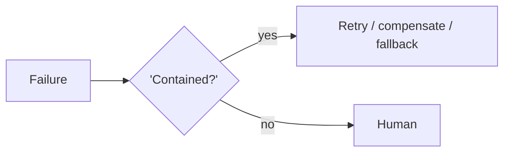

# Chapter 99: Self-Healing Replan

**Part VIII — Resilience & Reliability**

## Self-Healing Replan Pattern Overview

On failure, agent diagnoses root cause and re-plans — with containment so healing doesn't compound harm.

**Self-Healing Replan** is catalogued in the **Resilience & Reliability** part of the catalog (id `self-healing-replan`). It is tagged for devops, operations and is assembled from 3 components.

Failure observed; diagnose (bounded); contain, re-plan, verify fix. The healer's dilemma: diagnosis and repair are themselves actions with blast radius — an unbounded healer "fixes" the outage by tearing down production (runaway remediation, critical), and oscillating repairs flap forever without converging. Remediation allowlists per system class, destructive actions always gated, max attempts then human paging, change windows with blast-radius caps: healing as a finite, fenced episode, never an open-ended campaign.

**Definition 1 (Fenced healing).** Self-healing is *fenced* iff (i) diagnosis is bounded (attempt cap, then human), (ii) remediation is allowlisted per system class with destructive actions always gated, (iii) change windows and blast-radius caps bound every repair, and (iv) the fix is verified before recovery is declared (no declared victory on unconfirmed repair).

**Theorem 1 (Healing must not compound harm).** Under fenced healing, the worst case of automated repair is a bounded, verified no-op — never a bigger outage: runaway remediation is gated, flapping is capped, and unverified fixes do not count as recovery.

*Proof.* Runaway remediation (tearing down production to "fix" it) requires an ungated destructive action: the allowlist plus always-gated destructive steps (i, ii) deny it by construction — the healer cannot do what the gate forbids, however confident the diagnosis. Flapping (oscillating remediations) requires unbounded attempts: the attempt cap plus human paging bounds the episode, and fix verification (iv) distinguishes recovery from oscillation (verified fix vs. repeated trying). Change windows and blast-radius caps bound each repair's place and size. The catalogued proof (wrong-fleet restart during an incident) is exactly unfenced healing: diagnosis without containment, repair without gates, harm compounded by the helper. Bound the diagnosis, gate the destructive, cap the attempts, verify the fix — or page the human and stop. ∎

## Practical Applications & Use Cases

Domains the catalog tags this pattern for:

- devops
- operations

1 documented failure scenario exercises it:

| Scenario | Severity | Likelihood | Domain |
|---|---|---|---|
| Self-healing agent restarts the wrong fleet during an incident | Critical | Medium | operations |

It also appears in 4 composition cascades:

| Cascade | Class | Blast radius | Impact |
|---|---|---|---|
| SRE / DevOps Agent Playbook — over-broad 'fix' | Inherent | single-agent | Critical |
| Self-Healing Replan — runaway remediation | Inherent | single-agent | Critical |
| Self-healing agent restarts the wrong fleet during an incident | Derived | service | Critical |
| Compounding partial failures | Emergent | service | High |

## How It Works

1. Failure observed.
2. Diagnose (bounded).
3. Contain → re-plan → verify fix.

## Components

- Failure classifier
- Containment policy
- Re-planner

## Control-Flow Diagram

## Failure Modes and Risks

2 failure modes are documented for this pattern:

| Failure mode | Severity | What happens |
|---|---|---|
| Runaway remediation | Critical | Agent 'fixes' an outage by tearing down production. |
| Flapping | Medium | Oscillating remediations. |

## Protections

1. Remediation allowlist per system class; destructive actions always gated.
2. Max remediation attempts, then page a human.
3. Change windows and blast-radius caps.

## At a Glance

| Field | Value |
|---|---|
| Catalog id | `self-healing-replan` |
| Part | VIII — Resilience & Reliability |
| Domains | devops, operations |
| Components | Failure classifier, Containment policy, Re-planner |
| Failure modes | 2 |
| Protections | 3 |
| Related patterns | Agent Incident Response Playbook, Plan-and-Execute |
| Linked scenarios | 1 |
| Linked cascades | 4 |

## Key Takeaways

- On failure, agent diagnoses root cause and re-plans — with containment so healing doesn't compound harm.
- Remediation allowlist per system class; destructive actions always gated.
- Max remediation attempts, then page a human.
- Change windows and blast-radius caps.
- Know its failure modes: Runaway remediation (critical); Flapping (medium).

## References and Related Patterns

| Related pattern | Part | Summary |
|---|---|---|
| Agent Incident Response Playbook | Safety, Security & Governance | Pre-rehearsed steps when an agent misbehaves: contain, revoke, assess blast radius, notify, recover, learn. |
| Plan-and-Execute | Planning & Reasoning | Make a full plan up front with a planner model, then execute steps with a cheaper executor, re-planning only when reality diverges. |

## Council deliberation

- **Safety researcher:** Self-Healing Replan diagnoses root cause on failure and re-plans under containment so healing does not compound harm, moving from observed failure through bounded diagnosis into containment, re-planning and fix verification, with a failure classifier, containment policy and re-planner. Failures are runaway remediation where the agent worsens an outage by destructive repair, and flapping between oscillating remediations. Protections use a remediation allowlist per system class with destructive actions always gated, cap remediation attempts before paging a human, and enforce change windows with blast-radius caps, tied to incident playbooks across devops and operations.
- **Continual-learning researcher:** Bounded diagnosis is theflags discipline I would stress: an agent that investigates forever is itself an incident. Allowlisted remediations plus attempt caps plus human paging turn healing into a finite episode rather than an open-ended campaign. Change windows and blast-radius caps give each repair a place and a size, and verifying the fix before declaring recovery keeps flapping visible instead of letting oscillating repairs masquerade as progress.

## Council reading

- **Red team:** Start with Runaway remediation (critical): Agent 'fixes' an outage by tearing down production. Self-healing agent restarts the wrong fleet during an incident is the catalogued proof — critical severity, operations domain — so rehearse that exact chain before any other.
- **Blue team:** Hold with Remediation allowlist per system class; destructive actions always gated; Max remediation attempts, then page a human. Then layer the remaining 1: defence here is the list, not any single item. Compose with Agent Incident Response Playbook, Plan-and-Execute so a failure in one pattern meets a control in another.
- **Operator:** Deploy where it is tagged (devops, operations), and watch the 4 linked cascades — SRE / DevOps Agent Playbook — over-broad 'fix' first, because composition is where small faults amplify. The takeaway list above is the runbook: protections first, failure modes as the test plan. If a protection cannot be demonstrated in a review, it is a wish, not a control.

## Conclusion

In the catalog this chapter was generated from, **Self-Healing Replan** is one of 107 patterns in *Resilience & Reliability*, carrying 2 documented failure modes and 3 listed protections. Use it as a starting point, not a specification: the protection list is the part that survives contact with an adversary.

---
