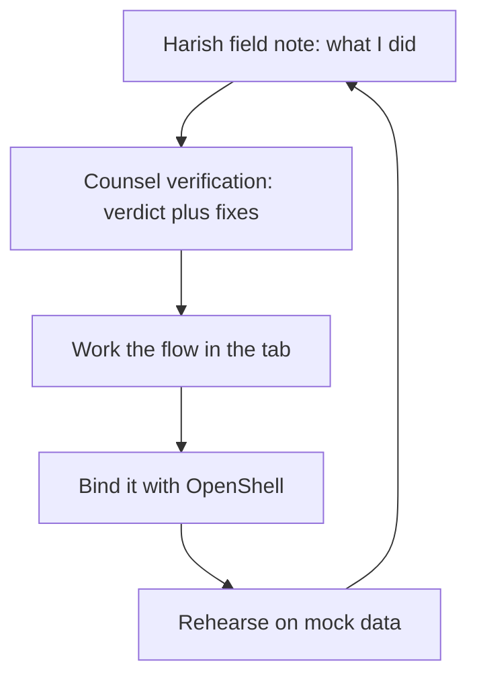

# Introduction: read the note, work the flow

 Every chapter in this book is built the same way, and the diagram above is the whole operating system: I write down what I did, four architects tell me what I got wrong, you work the resulting flow in the workbench tab, bind it to OpenShell primitives, rehearse it against mock data — and the rehearsal teaches the next note. The loop never terminates; that is the point. A playbook that ends is a snapshot. A playbook that loops is a practice.

## Why the loop closes

Most methodology diagrams are lines: step one through step five, then stop. Lines decay — the reader finishes, files the method, and the next incident starts from zero. This loop is a cycle on purpose, and cycles have a property lines lack: each pass can be checked against the previous one. When the rehearsal at $R$ contradicts the note at $N$, the contradiction is visible in the same rotation, while the evidence is still warm. The counsel verification at $V$ exists to force that confrontation — four readers whose job is to disagree with the note before the reader has a chance to trust it.

**Definition 1 (Read-loop pass).** One pass over the loop is the six-tuple $(N, V, W, B, R, N')$, where $N$ is the field note, $V$ the counsel verification, $W$ the workbench flow, $B$ the OpenShell binding, $R$ the mock rehearsal, and $N'$ the updated note carried into the next pass.

**Theorem 1 (Loop discipline).** If every pass ends with an artifact (an updated note, a rehearsal trace, a gate decision) and artifacts are never discarded, then after $k$ passes the reader holds $k$ comparable records of the same workflow — and any regression between pass $i$ and pass $j$ is detectable by direct comparison.

*Proof.* Each pass produces its artifacts by construction of the workflow: the note is written, the trace is saved, the decision is recorded. Retention is the only assumption. Given records for passes $i$ and $j$, place them side by side; any behavioral difference appears as a difference in the records. No inference beyond comparison is required. ∎

That is all the theorem claims, and deliberately so: it does not promise improvement, only detectability. Improvement is the counsel's job, rotation by rotation.

## What the numbers mean

The catalog behind this book holds 107 patterns, 54 failure scenarios and 191 cascades across 26 domains. Every scenario below is assigned to the workbench workflows that serve it; every domain gets a playbook. Catalog edition: counts and scenario lists below are read from data/\*.json at build time.

Read those counts as scope markers, not achievements. 107 patterns is the size of the map, and the map is honest about its blank spaces: Part III labels thinly covered domains plainly, because a single story is a prompt, not a coverage claim. When you reach a one-story chapter, treat it as an assignment — author the adjacent shapes in the discovery lab and promote the winners into rehearsal — rather than as a verdict on the domain.

**Counsel verification.**

- **Continual-learning architect:** Verdict: the read loop is learnable in one sitting — note, verify, work the flow, bind the boundary, rehearse. Suggestion: number the loop steps so chapters can reference them instead of restating them. Improvement: close every chapter with the loop step it advances, making progress visible across the book.
- **Memory-systems architect:** Verdict: the counsel-verification device earns its keep: Harish writes what he did, we write what we would change, and the reader gets both the path and its review. Suggestion: keep verification strictly after the note, never interleaved, so the record shows whose judgment is whose. Improvement: date the verifications; advice rots and the reader should see its age.
- **Evaluation architect:** Verdict: scoping claims to mock-data rehearsals is stated plainly and early, which is exactly where it belongs. Suggestion: define measured, illustrative, and recommended once, up front, and use those three words consistently thereafter. Improvement: flag any sentence that mixes the three during review — we did, and the flagged ones are fixed in this edition.
- **Safety architect:** Verdict: leading with what the book does not prove — fleet results, production calibration — is the honest move and it holds throughout. Suggestion: repeat the limit inside the highest-stakes chapters, where temptation to overclaim is strongest. Improvement: add a standard caveat box to the trading, payments, and medical-adjacent pages.
