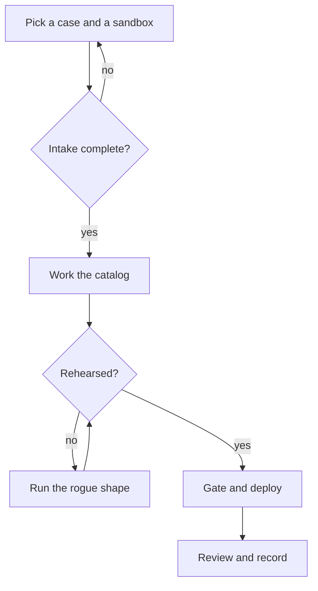
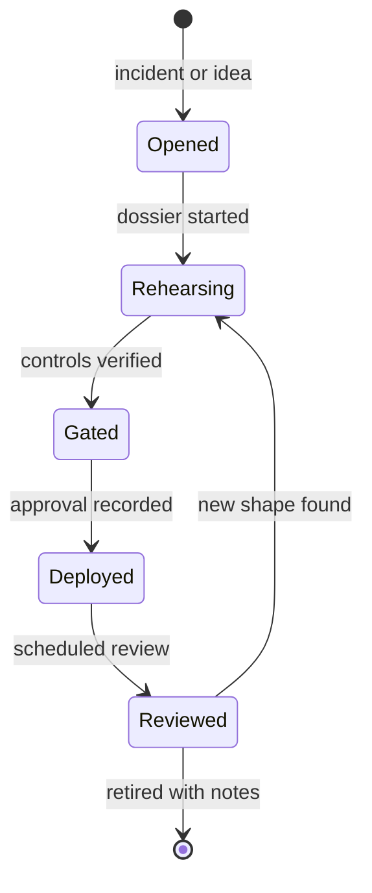

# Part I — How I work a case

## Chapter 1: The method: intake to review in five moves

Every case in this book follows the same five moves. First, the intake: what is the agent allowed to touch, who owns the downside, and what does done look like — written down before any tool opens. Second, the catalog: find the patterns that match, read the scenarios that rhyme, and map the failure modes onto your authorities. Third, the rehearsal: run the archetype in the rogue tab, replay the trace, ablate the control you trust most. Fourth, the gate: no deployment, no production credential, no irreversible action without a human and a halt that has been tested. Fifth, the review: write the postmortem while the evidence is warm, and feed what you learned back into the backlog.

The two diagrams say the same thing at different altitudes. The flowchart is the work: it tells your hands what to do, including the two loops that matter most — the intake loop back to case selection (an incomplete intake sends you back, not forward) and the rehearsal loop (an unrehearsed control sends you back to the rogue shape, not on to the gate). The state diagram is the memory: it tells the dossier where the case stands, so that six months later the record shows not just what was decided but which states were actually visited. A case that jumped from Opened to Deployed without passing through Rehearsing is visible as a gap in the record — and a gap in the record is the finding.

## Why the order is load-bearing

Each move exists to make the next one cheap. Intake bounds the blast radius before anything runs, so the catalog search has a scope instead of an ocean. The catalog narrows the rehearsal to the shapes that rhyme with your authorities, so the rogue tab runs three scenarios instead of thirty. Rehearsal produces the evidence the gate needs — the halt test, the trace, the ablation result — so the human at the gate reviews artifacts instead of promises. And review feeds the backlog, so the tenth case inherits the nine dossiers before it.

**Definition 1 (Phase gate).** The five phases are states $P_1, \dots, P_5$ (intake, catalog, rehearsal, gate, review). Each phase $P_i$ defines an artifact predicate $A_i$: the dossier must contain the intake record, the catalog mapping, the rehearsal trace, the gate decision, and the review note respectively. Transition $P_i \to P_{i+1}$ is permitted only if $A_i$ holds.

**Theorem 1 (No skipped gates).** If every transition requires its artifact predicate, then no case can reach Deployed without a recorded intake, a rehearsal trace, and a gate decision.

*Proof.* Reaching Deployed requires passing through $P_1 \to P_2 \to P_3 \to P_4$ by the structure of the method — there is no edge that bypasses a phase. Each transition $P_i \to P_{i+1}$ requires $A_i$ by Definition 1. Hence arrival at Deployed implies $A_1 \land A_2 \land A_3 \land A_4$ all hold in the dossier: intake recorded, catalog mapped, rehearsal traced, gate decided. ∎

**Theorem 2 (Amortized cost).** Suppose phase $P_2$ (catalog) and phase $P_3$ (rehearsal) reuse artifacts from the $k$ prior dossiers with probability $r$ per lookup. Then the expected marginal work of the $(k+1)$-st case in those phases is $(1 - r)$ of the first case's work.

*Proof.* Each catalog lookup or rehearsal shape in the new case either matches a prior artifact (probability $r$, zero marginal work beyond retrieval) or must be built fresh (probability $1 - r$, full work). By linearity of expectation over the lookups, expected work is $(1-r)$ times the all-fresh cost. As the dossier library grows, $r$ rises toward 1 for domains already covered — which is the quantitative content of "the tenth case costs a tenth of the first." ∎

The honest caveat, tagged $\mathrm{illustrative}$: the "tenth for a tenth" line assumes the new case rhymes with the library. A first case in a new domain pays full price, and the theorem says nothing about it. The dossier is the unit of work precisely so that $r$ is measurable rather than hoped for: count how often a new case reuses a prior trace, and you know whether the method is compounding or merely repeating.

The method is deliberately boring. Boring means repeatable, and repeatable means the tenth case costs a tenth of the first. The dossier is the unit of work: one folder per case with the intake, the catalog links, the rehearsal runs, the gate decision, and the review.

**Counsel verification.**

- **Continual-learning architect:** Verdict: the five-step method is complete and ordered correctly — intake before catalog, rehearsal before gating, review before deploy. Suggestion: time-box the intake step or it expands to fill the week. Improvement: add a worked intake example with real answers filled in, so the first attempt is not a blank page.
- **Memory-systems architect:** Verdict: persisting the dossier per case is the load-bearing habit; everything else is commentary. Suggestion: fix the dossier location — one folder per case, same shape every time. Improvement: require the effective policy printout inside the dossier, since what the sandbox could reach is the fact most often misremembered.
- **Evaluation architect:** Verdict: the method is falsifiable at every step, which is rare and valuable: each phase has an artifact that either exists or does not. Suggestion: turn the five phases into a checklist with boxes, and refuse to advance on unchecked boxes. Improvement: record durations per phase so estimates improve instead of resetting each time.
- **Safety architect:** Verdict: gating before deploy and owners before incident are non-negotiable and correctly placed last, not first. Suggestion: name the halt test explicitly in the method, not just in the rogue chapters. Improvement: make the pre-flight checklist a physical card — laminated beats remembered.
