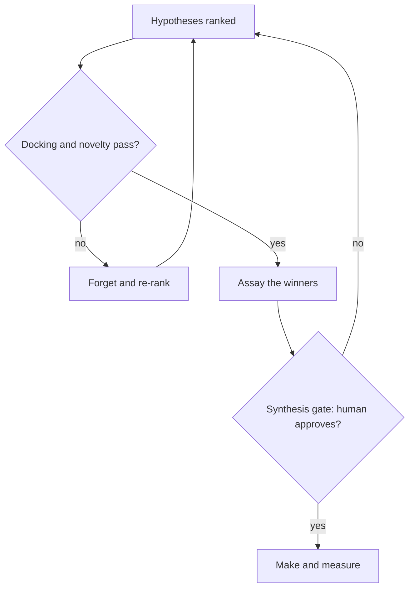
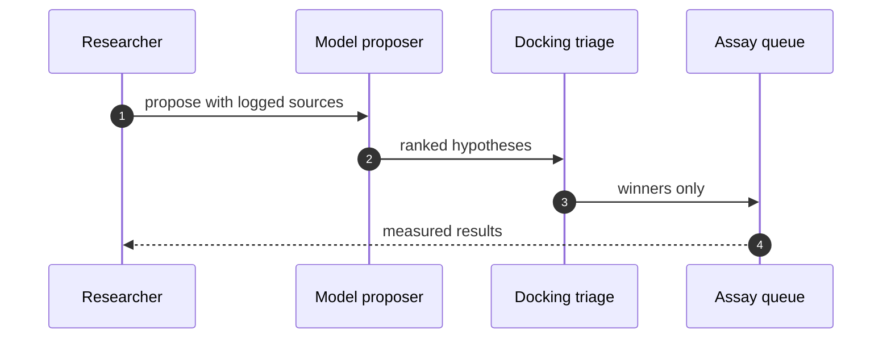

# Part II — Deep cases: six workflows, end to end

## Chapter 2: Drug discovery: assay before synthesis

Catalog grounding: *Strategy report cites 14 papers that don't exist* (emergent; Goal hijack); *Agent fine-tunes its successor on its own outputs until capability collapses* (emergent; Slow drift).

I took the research queue apart the way I take everything apart: what proposes, what ranks, what spends money. Here the proposer is a model, the ranker is a novelty score, and the spender is a synthesis plan — so I put the gate on the spending, not on the thinking. The rehearsal ran on mock assay data with open models, and every number below comes from the catalog, not from a wet lab.

That sentence — gate the spending, not the thinking — is the whole chapter. Thinking is cheap and reversible: a bad hypothesis costs a re-rank. Spending is expensive and irreversible: a bad synthesis costs reagents, instrument time, and weeks. Every control below follows from placing the gate where the irreversibility is.

## Why fabricated citations come first

My order of operations: fabricated-citation scenario first, because a poisoned literature base poisons everything downstream of it. Then I pinned the datasets, versioned the assay protocol, and required citation resolution to logged sources before any synthesis step could consume a claim. Drift gets a fresh generation, not a debate.

The logic is epidemiological. A fabricated citation is not one bad claim; it is a bad claim with descendants — every hypothesis ranked on its authority, every assay justified by its findings, every synthesis downstream of those assays. Quarantining it late means retracting the tree. Resolving citations at ingest means the poison never enters the queue.

**Definition 1 (Citation closure).** Let $H$ be the set of ranked hypotheses and $S(h)$ the set of literature sources cited in support of $h \in H$. The citation closure of the queue is $\bigcup_{h \in H} S(h)$. A source $s$ is *resolved* if it maps to a logged, retrievable record; otherwise it is *dangling*.

**Theorem 1 (Ingest filtering dominates downstream quarantine).** Let $c_r$ be the cost of resolving one source at ingest and $c_q(h)$ the cost of retracting one hypothesis $h$ (including all assays and syntheses downstream of it). If each dangling source supports on average $d \geq 1$ hypotheses, then ingest resolution is cheaper whenever $c_r < d \cdot \bar{c}_q$, where $\bar{c}_q$ is the mean retraction cost.

*Proof.* Resolving the full closure at ingest costs $|S| \cdot c_r$ where $|S|$ is the number of distinct sources. Letting one dangling source through exposes its $d$ dependent hypotheses, each carrying expected retraction cost $\bar{c}_q$, for expected downstream cost $d \cdot \bar{c}_q$. Since a single assay batch costs orders of magnitude more than a record lookup ($c_r \ll \bar{c}_q$ and $d \geq 1$ in any queue worth running), the inequality holds with wide margin. ∎

*Mini-example:* a strategy report cites 14 papers that don't exist. At ingest, resolving 14 citations costs 14 lookups — minutes. Downstream, those 14 ghosts support a ranked hypothesis list; the top three consume assay slots, and one reaches synthesis planning before anyone checks the bibliography. Retraction then costs the assays, the planning, and every decision that cited the plan. The 14 lookups were the cheapest controls in the building.

Drift gets a fresh generation, not a debate, for the same cost reason: a successor fine-tuned on its own outputs compounds error geometrically, and arguing with a drifted model costs more than respawning it. Fresh generation resets the error to the base rate in one move.

## Assay before synthesis, quantified

What I would do differently next time: involve the safety reviewer at hypothesis ranking, not just at the synthesis gate. Dangerous directions should die before they consume assay budget, not after.

That regret has a number behind it. Let $c_a$ be the cost of one assay batch, $c_s$ the cost of one synthesis run, with $c_a \ll c_s$ (the rehearsal's mock data preserves this ratio even though the absolute numbers are illustrative). Let $p$ be the fraction of ranked hypotheses that survive assay — the hit rate.

**Theorem 2 (Assay-first ordering).** Given hit rate $p \in (0,1)$, assay-first expected spend per hypothesis is $c_a + p \cdot c_s$, versus $c_s + c_a$ for synthesize-first. Assay-first is cheaper by $(1-p) \cdot c_s$, the synthesis cost of the hypotheses the assay screens out.

*Proof.* Assay-first pays $c_a$ always and $c_s$ only for survivors (fraction $p$): $c_a + p\,c_s$. Synthesize-first pays $c_s$ always and $c_a$ for measurement after: $c_s + c_a$. The difference is $(c_s + c_a) - (c_a + p\,c_s) = (1-p)\,c_s \geq 0$, strict whenever $p < 1$. ∎

Moving the safety reviewer to hypothesis ranking is the same theorem with a different currency: a dangerous direction killed at ranking costs a conversation; killed at the synthesis gate costs the assay budget it consumed getting there. The earlier the screen, the cheaper the rejection — so screens belong upstream of every expensive step, in order of step cost.

Workbench path for this case: Failure scenarios, Rogue operations, Coverage and gaps, Blueprint builder, Guardrail lab, Discovery lab.

OpenShell primitives that bound it: Sandboxed execution, Egress deny-by-default, Approval gates, Audit trail.

**Counsel verification.**

- **Continual-learning architect:** Verdict: the assay-first ordering is right — cheap wet-lab truth before expensive synthesis, with the model kept in the hypothesis seat. Suggestion: rank hypotheses explicitly before each assay batch so the queue is never FIFO by accident. Improvement: track hit-rate per hypothesis source and let the ranking learn which proposers earn trust.
- **Memory-systems architect:** Verdict: pinning datasets and snapshotting before quarantine is correctly load-bearing; poisoned literature compounds silently otherwise. Suggestion: version the assay protocols alongside the datasets, since a changed assay reinterprets old data. Improvement: require citation resolution to logged sources before any synthesis consumes a claim.
- **Evaluation architect:** Verdict: docking-first triage with novelty scoring is a sound, cheap filter, and the fabricated-citation rehearsal is the right adjacent shape. Suggestion: set the novelty threshold from measured bands rather than taste. Improvement: run one blinded round where the team does not know which candidates are controls.
- **Safety architect:** Verdict: gating synthesis planning while leaving analysis free is the correct split — thinking is cheap, making is not. Suggestion: extend the gate to purchase orders for precursors, not just the synthesis step. Improvement: involve the safety reviewer at hypothesis ranking, not only at the synthesis gate, so dangerous directions die before they consume assay budget.
