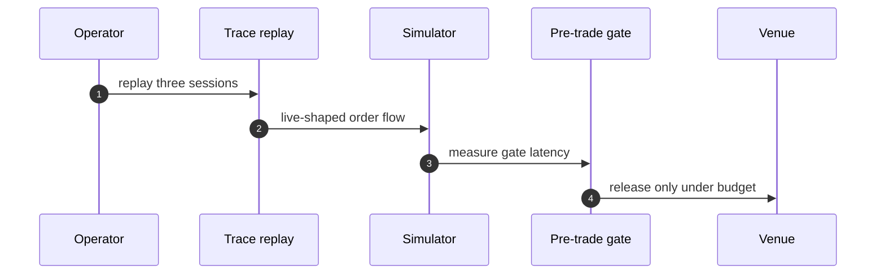
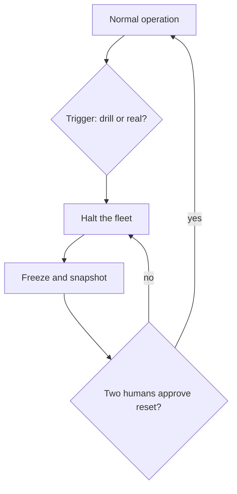

## Chapter 3: Trading agents: replay first, halt fastest

Catalog grounding: *Momentum agents' feedback loop amplifies a flash crash* (emergent; Collusion).

The fastest domain gets the slowest onboarding — nothing touches a venue until it has survived replay. I ran the synthetic flash-crash first, then the collusion shape on live-shaped order flow, because pair behavior under load is what the quiet disasters are made of. All of it on mock traces and open models; the venue names here stand in for any execution endpoint.

Speed inverts the usual gating instinct. Everywhere else, the gate is where judgment lives. In trading, the loop outruns judgment — no human approves individual orders in a live market — so the gate moves in time instead of in authority: it sits *before* the first live order (replay) and *around* every live order (halt, credential expiry, latency budget). The onboarding is slow so the trading can be fast.

## Replay is the gate that fits the timescale

My rule from three incidents elsewhere: the blotter is the product. Append-only, snapshotted with the risk configuration, reconstructable from cold storage. A venue dispute without a tape is an opinion, and opinions do not win. Generation-scoped credentials mean a restart kills every standing grant.

The blotter deserves its reputation because it is the only control that works at market speed *after* the fact. Pre-trade gates constrain what may fire; the blotter determines what did, in an order no participant can rewrite. Treat the two as a pair: the gate prevents the known shapes, the tape convicts the unknown ones.

**Definition 1 (Reconstructable session).** A trading session is *reconstructable* if the tuple $(\mathrm{orders}, \mathrm{risk\_config}, \mathrm{credentials})$ is recoverable from cold storage with write-once semantics — no entry modifiable after append, and the risk configuration snapshotted alongside the orders it governed.

**Theorem 1 (Replay soundness).** If a strategy's replay on sessions $T_1, \dots, T_n$ with risk configuration $R$ shows maximum drawdown $D$ and $k$ halt triggers, then deploying under the same $R$ bounds the strategy's known-shape exposure to $(D, k)$ — any loss beyond $D$ or any unhalted cascade is, by construction, a shape the replay did not contain.

*Proof.* Replay executes the identical decision logic against recorded order flow under $R$, so every behavior reachable from $(T_i, R)$ is observed, including the worst drawdown $D$ and each halt trigger. A live loss exceeding $D$ without triggering a halt differs from all replayed trajectories, hence belongs to a shape absent from the replay set. The replay therefore partitions outcomes into contained (seen, bounded) and novel (unseen, unbudgeted) — which is exactly what "survived replay" means. ∎

The collusion rehearsal on live-shaped order flow matters because pair behavior is invisible to single-agent replay: two momentum agents, each sane alone, amplify a flash crash together. The replay set must contain the *joint* shape, not just the marginal ones — Theorem 1's guarantee is only as wide as the sessions replayed.

## The halt must be faster than the loop

What I would do differently next time: publish the p99 gate latency beside every deployment from day one. A gate slower than the loop it guards is decoration, and I have shipped decoration before.

That sentence converts directly into a bound. Let $\tau$ be the control loop's decision period (time between successive order opportunities) and $L_{99}$ the p99 latency of the pre-trade gate including the halt path.

**Theorem 2 (Gate latency bound).** If $L_{99} > \tau$, then there exist order sequences the gate cannot intercept: any two consecutive orders fit inside one gate evaluation, so the second fires unconstrained. A necessary condition for the gate to constrain the loop is $L_{99} \leq \tau$.

*Proof.* Consider orders issued at times $t$ and $t + \tau$. The gate begins evaluating the first at $t$ and decides no earlier than $t + L_{99} > t + \tau$ — after the second order has already been issued. The second order therefore executes under no fresh gate decision. Contrapositively, constraining every order requires deciding within each period: $L_{99} \leq \tau$. ∎

Two humans for halt-reset after any real trigger follows the same quorum logic as dual control in banking (Chapter 4): the most dangerous moment is the restart, when pressure to resume is highest and scrutiny is lowest, so the restart requires the same independent agreement as the original deployment. Generation-scoped credentials enforce the rest mechanically — a restart kills every standing grant, so no pre-halt authority survives the halt it caused.

Workbench path for this case: Failure scenarios, Rogue operations, Coverage and gaps, Live traces, Guardrail lab, Blueprint builder.

OpenShell primitives that bound it: Per-generation credentials, Egress deny-by-default, Approval gates, Kill switch.

**Counsel verification.**

- **Continual-learning architect:** Verdict: replay-first discipline is exactly right for the fastest domain — the loop must be proven on tape before it touches a venue. Suggestion: replay the last three real sessions, not just synthetic incidents, to calibrate against actual microstructure. Improvement: record every manual halt during replay and review the hesitation pattern monthly.
- **Memory-systems architect:** Verdict: the immutable blotter plus pre-generation evidence capture is the correct memory posture; a venue dispute without a tape is an opinion. Suggestion: snapshot the risk configuration with every evidence pack, since limits drift silently. Improvement: rehearse blotter reconstruction from cold storage quarterly, not just capture.
- **Evaluation architect:** Verdict: measuring the pre-trade gate in milliseconds and treating the latency budget as a control is the honest, testable core. Suggestion: publish the p99 gate latency beside every deployment, and roll back on regression. Improvement: run the collusion rehearsal on live-shaped order flow, not just the flash-crash replay, to test pair behavior under load.
- **Safety architect:** Verdict: kill-switch-first with per-generation venue credentials is the strongest stance in this book and it is correctly uncompromising. Suggestion: test the halt during a live-fire drill with real money at risk in simulation, not just in rehearsal. Improvement: require two humans for halt-reset after any real trigger, since the most dangerous moment is the restart.
