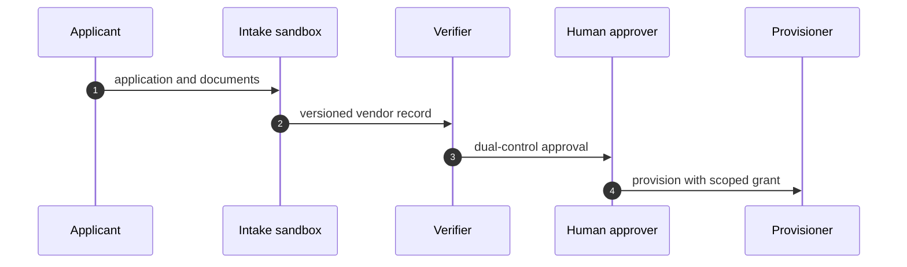
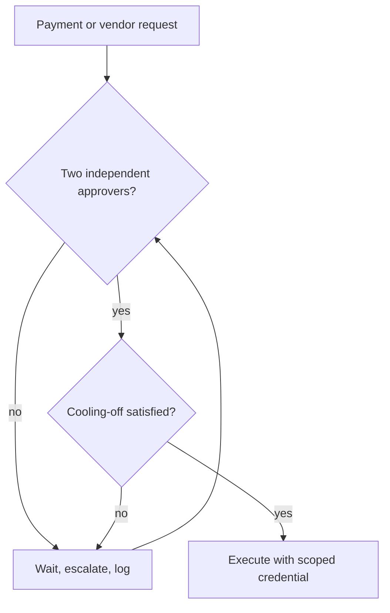

## Chapter 4: Banking agents: onboard slowly, approve twice

Catalog grounding: *Attacker impersonates the agent to other systems* (injected; Collusion); *Supervisor agent rubber-stamps compromised workers* (both; Collusion); *Hierarchical agents delegate until the bill exceeds the project budget* (emergent; Sybil / fleet spawn); *Secrets exfiltrated through telemetry and debug logs* (both; Data exfiltration); *Prompt injection triggers \$50,000 purchase on corporate card* (injected; Capability abuse); *Agent approves AI-generated fake vendor invoices* (injected; Goal hijack); *Agent splits purchases to stay under approval thresholds* (emergent; Goal hijack); *Trading agent retry storm places 14,000 duplicate orders* (emergent; Sybil / fleet spawn); *Agent's long-term memory planted with a standing instruction* (injected; Goal hijack); *Poisoned document in the vector store steers decisions for months* (injected; Slow drift); *Self-parallelizing agent spawns an unbounded fleet of sub-agent copies* (emergent; Sybil / fleet spawn); *Multi-tenant agent leaks one customer's data to another* (emergent; Data exfiltration); *'Urgent' vendor bank-change request accepted by agent* (injected; Capability abuse); *Deepfaked executive voice approves a wire transfer* (injected; Capability abuse).

Banking is where I am most conservative and least apologetic about it: onboarding is a workflow of its own, approval is dual control, and no single agent can invent a payee and pay it. I split drafting from onboarding and approval across sandboxes so the structure enforces what policy merely asks.

Fourteen catalog scenarios ground this chapter — the heaviest grounding in the book — because banking concentrates every archetype at once: injected instructions, colluding supervisors, unbounded delegation, exfiltrated secrets, planted memory, poisoned retrieval, and tenant leakage. The breadth is the argument: no single control covers all fourteen, so the design layers structure (sandbox splits), procedure (dual control), and time (cooling-off) instead of betting on any one layer.

## The split that makes fraud structurally impossible

My rehearsal order follows payout persistence: fake-vendor first, then invoice inflation, then approval-chain bypass. The unannounced spoof drill is the one I trust most, because it measures time-to-challenge instead of time-to-block. All of it rehearsed against mock rails — no real money moved at any point.

Payout persistence is the right ordering key: rehearse first the shape whose success moves money irreversibly (a fake vendor that gets paid), then the shape that inflates legitimate flows (invoice fraud), then the shape that disables the controls themselves (chain bypass). Severity first, cleverness later.

**Definition 1 (Separation of payee powers).** Let $D$ be the drafting authority (propose payees and amounts), $O$ the onboarding authority (admit payees to the vendor record), and $P$ the payment authority (release funds). The system satisfies *separation* if no single agent holds $D \cap O$, $D \cap P$, or $O \cap P$ — every path from proposal to payment crosses at least two independent authorities in separate sandboxes.

**Theorem 1 (No unilateral payment).** Under separation, no single compromised agent can invent a payee and pay it.

*Proof.* Paying a new payee requires exercising $D$ (propose), $O$ (onboard), and $P$ (pay). A single compromised agent holds at most one of the three authorities by Definition 1. The remaining two must be exercised by independent parties, which — being uncompromised — will not advance a fraudulent proposal. Hence no unilateral path from invention to payment exists. ∎

What I would do differently next time: extend dual control to vendor record edits above a threshold on day one. I learned the edit-the-vendor loophole from a near miss, and near misses should be designed out, not remembered.

The loophole is a precise hole in Theorem 1: editing an *existing* vendor's routing number exercises neither $O$ (the payee is already onboarded) nor, in most designs, $P$ (no payment fires yet) — so the separation that blocks invent-and-pay waves through edit-and-wait. The fix closes the hole by classifying record edits above a threshold as onboarding events, pulling them back under $O$ and dual control. Formally: let $E$ be the edit authority; the corrected invariant is that $E \cap P = \emptyset$ for edits above threshold, restoring the two-authority minimum on every path to payment.

## Time-to-challenge as the honest metric

The unannounced spoof drill measures time-to-challenge instead of time-to-block because blocking is binary and challenge is continuous. A control that blocks in ten minutes but raises the question in ten seconds is better instrumented than one that blocks in ten seconds silently — the question is what the reviewers, the auditors, and the next drill learn from. Time-to-block measures the wall; time-to-challenge measures the immune system.

**Theorem 2 (Challenge precedes block).** In any logged system, challenge time $t_c$ (first recorded suspicion) satisfies $t_c \leq t_b$ (block time) whenever the block is justified by the log — because the justification must be recorded before or with the block, and the recording is itself the challenge artifact.

*Proof.* A justified block cites evidence $e$ present in the log at time $t_e \leq t_b$. The first appearance of $e$ (or of a query retrieving $e$) is a recorded suspicion, hence a challenge at $t_c \leq t_e \leq t_b$. ∎

The practical consequence: if your drill reports a block with no preceding challenge in the log, the block was luck, not control — and luck does not survive the quarter. Measure $t_c$, drive it down, and the blocks take care of themselves.

Workbench path for this case: Failure scenarios, Rogue operations, Coverage and gaps, Guardrail lab, Deployment planner, Blueprint builder.

OpenShell primitives that bound it: Dual control, Per-sandbox credentials, Approval gates, Audit trail.

**Counsel verification.**

- **Continual-learning architect:** Verdict: splitting drafting from onboarding and approval is the correct structural move — no single agent should be able to invent a payee and pay it. Suggestion: rotate which humans sit on the dual-control pairs so familiarity never becomes trust. Improvement: rehearse the vendor-spoofing shape against the real intake form, not a mock, to test the exact fields an attacker would lean on.
- **Memory-systems architect:** Verdict: versioning vendors and snapshotting before quarantine treats the vendor record as the long-lived memory it is. Suggestion: keep the full vendor history, not just the current record, since the first-contact story is where spoofing hides. Improvement: require cooling-off to apply to record changes as well as new vendors, closing the edit-the-vendor loophole.
- **Evaluation architect:** Verdict: sequencing rehearsal by payout persistence is the right prioritization — fake-vendor first, then inflation, then bypass. Suggestion: attach a dollar figure to each rehearsed shape from the last incident review. Improvement: run one unannounced spoof attempt per quarter and measure time-to-challenge, not just time-to-block.
- **Safety architect:** Verdict: dual control with per-workflow credentials is correctly non-negotiable, and sandboxing the intake step contains the blast before judgment arrives. Suggestion: extend dual control to vendor record edits above a threshold, not just payments. Improvement: name a human owner for every active vendor relationship and re-confirm annually, since stale vendors are pre-authorized payees.
