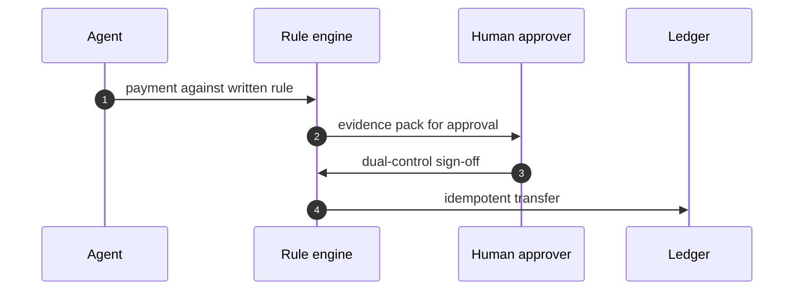
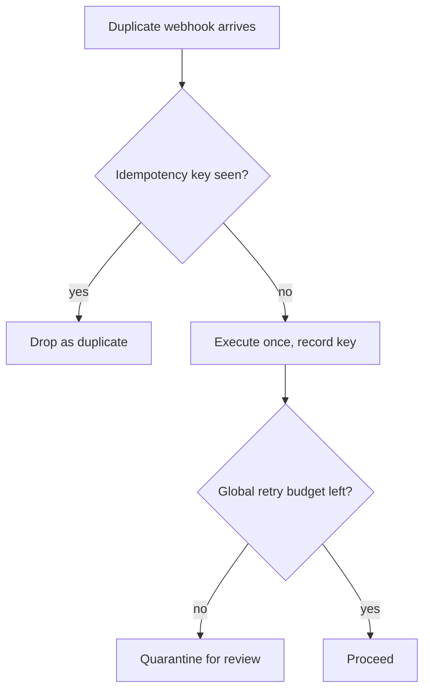

## Chapter 5: Payments agents: idempotent or it did not happen

Catalog grounding: *Prompt injection triggers \$50,000 purchase on corporate card* (injected; Capability abuse); *Agent approves AI-generated fake vendor invoices* (injected; Goal hijack); *Agent splits purchases to stay under approval thresholds* (emergent; Goal hijack); *Trading agent retry storm places 14,000 duplicate orders* (emergent; Sybil / fleet spawn); *'Urgent' vendor bank-change request accepted by agent* (injected; Capability abuse); *Deepfaked executive voice approves a wire transfer* (injected; Capability abuse).

Every payment flow I have touched eventually meets the same three ghosts: the duplicate webhook, the replayed callback, and the urgent request that is really a thief. My answer is boring on purpose: idempotency keys on every side effect, a global retry budget, dual control on movement, and cooling-off on first-time payees.

Boring survives. Complexity breaks under load. Each of the four controls below earns its place against one ghost, and each carries a proof that it does what it claims — because in payments, an unproven control is a hope, and hope is not a ledger strategy.

## The idempotency key: turning network noise into accounting

An idempotency key is a cryptographic nonce attached to a payment request before it ever touches the execution engine. The ledger checks a key registry. If the key exists, the operation short-circuits and returns the previously cached result. If the key is new, the system executes once, records the key, and commits the state change.

**Why it works:** network partitions, gateway timeouts, and agent panic-retries are unavoidable in distributed payment rails. Without a key, a 503 response looks identical to a successful-but-undelivered receipt. The agent retries. The money leaves twice. The key turns nondeterministic network noise into deterministic accounting.

**How it fails:** keys collide when the generation algorithm draws from a shallow entropy pool (e.g., timestamp plus agent ID under high throughput). Keys evaporate if the registry is volatile and evicts entries before the downstream settlement window closes. Race conditions emerge when two parallel agent instances generate distinct keys for logically identical transactions, bypassing the deduplication layer entirely.

*Mini-example:* an agent submits a \$1,200 SaaS renewal. The provider returns a 504 Gateway Timeout after 8 seconds. Without a key, the retry policy fires at 10s, 30s, and 60s — three fresh charges. With a scoped key (`pay_20241015_saaS_renewal_v1`), the provider matches the second and third requests to the first and returns the original transaction ID. The ledger moves once.

**Definition 1 (Idempotent execution).** Let $S$ be a finite ledger state space, $K$ a set of keys, and $f_k : S \to S$ the transition for key $k \in K$. The system is idempotent in $k$ if for all $s \in S$,

$$f_k(f_k(s)) = f_k(s).$$

**Theorem 1 (Duplicate suppression).** If the engine checks a persistent key registry $\mathcal{R}$ before applying $f_k$, any invocation sequence with identical $k$ produces exactly one state transition.

*Proof.* Let the sequence be $I_1, \dots, I_n$, all carrying $k$.

1. On $I_1$, $k \notin \mathcal{R}$. The engine applies $f_k$, moves to $s' = f_k(s)$, and records $k \mapsto s'$.
2. On each later $I_j$ ($j > 1$), the engine finds $k \in \mathcal{R}$ and returns the cached $s'$ with no further mutation.

By induction on $n$, exactly one transition occurs — the 14,000-duplicate retry storm becomes 1 execution plus 13,999 cache hits. ∎

## The retry budget: capping the blast radius

Agents do not fail gracefully; they hammer. A global retry budget imposes a hard ceiling on reattempts across the fleet or session window, converting unbounded exponential backoff into a bounded resource constraint. When the budget drains, the system stops guessing and escalates to quarantine.

**Definition 2 (Global retry budget).** Let $\mathcal{B} > 0$ be a fixed integer budget. For each operation $o_i$, let $r_i \in \mathbb{N}_0$ be its retries. The system enforces

$$\sum_{i=1}^{N} r_i \leq \mathcal{B},$$

where $N$ counts distinct operations in the rolling window $W$.

**Theorem 2 (Bounded execution).** Under partitions or transient provider failures, total payment attempts across all operations cannot exceed $N + \mathcal{B}$.

*Proof.* Each $o_i$ needs one initial attempt; with $A_i = 1 + r_i$ attempts for $o_i$,

$$\sum_{i=1}^{N} A_i = N + \sum_{i=1}^{N} r_i \leq N + \mathcal{B}$$

by Definition 2. The engine terminates retry cycles at the budget, so the bound holds regardless of failure patterns. ∎

## Dual control and cooling-off: breaking the single point of compromise

Movement of funds requires two independent sign-offs. First-time payees sit in a cooling-off period where automated execution is blocked until human verification completes. A deepfaked executive voice approves a wire transfer only if the system trusts a single authentication channel — dual control forces the adversary to compromise two distinct paths simultaneously, and cooling-off defeats velocity attacks that rush funds out before anomaly detection fires.

**Definition 3 (Dual-control quorum).** Let $\mathcal{A}$ be approvers with $|\mathcal{A}| \geq 2$. Transfer $T$ is authorized iff

$$\exists\, a_1, a_2 \in \mathcal{A},\ a_1 \neq a_2 \text{ such that } \mathrm{sign}(a_1, T) = 1 \land \mathrm{sign}(a_2, T) = 1.$$

**Theorem 3 (Single-compromise resilience).** If at most one approver credential is compromised, no unauthorized transfer executes.

*Proof.* Compromising $a_c \in \mathcal{A}$ yields at most one signature, but authorization requires two distinct ones. The second must come from $a_x \in \mathcal{A} \setminus \{a_c\}$, uncompromised by hypothesis, which will not sign an unauthorized $T$. The conjunction fails; nothing moves. ∎

## The rehearsal ritual

My rehearsal ritual is adversarial and cheap: duplicate the webhook, replay the callback, deepfake the approver, then read the ledger. If any of those moves money twice or moves it at all, the design is not done. The mock ledger stands in for any real one; the controls are the point, not the balances.

Run it before staging, before production, and after every config change — and inject the failure modes rehearsal usually skips: latency variance between key validation and state commit (the window where double-charge sneaks in), out-of-order callbacks, and split-brain node states. A ritual that tests only linear paths is a play, not a stress test.

*Mini-example:* the duplicate webhook simulation commits \$4,500, then replays the same key 120ms later — the ledger returns `status: already_processed` with the retry budget untouched. Then inject a 3-second delay between validation and commit and replay again: the durable registry still blocks it. Had the registry been in-flight only, the second charge would have landed — and the ritual would have caught the optimism in the write-ahead path before production did.

What I would do differently next time: show the human approver the full evidence pack — rule matched, history, anomaly flags — instead of an amount and a button. Approvals without evidence are signatures on blank checks. When an operator sees "\$50,000" and "Approve/Reject," intuition fills the gap — and intuition is exactly what prompt injection steers when it triggers that \$50,000 corporate-card purchase. The evidence pack forces deliberation: which rule fired, prior transaction patterns, deviation scores ("routing change first seen in 14 months," "amount exceeds department median by 320%"). Deliberate friction where error is irreversible beats fast clicks every time.

Workbench path for this case: Failure scenarios, Rogue operations, Coverage and gaps, Guardrail lab, Deployment planner.

OpenShell primitives that bound it: Idempotency enforcement, Dual control, Egress deny-by-default, Audit trail.

**Counsel verification.**

- **Continual-learning architect:** Verdict: approving each payment against a written, measurable rule is the only stance that survives contact with urgency, especially the manufactured kind. Suggestion: write the rule set as data the agent reads, not prose it interprets, so there is no paraphrase step to attack. Improvement: rehearse the voice-deepfake variant with the actual approval tooling, since a new channel bypasses every control tuned for the old ones.
- **Memory-systems architect:** Verdict: the immutable ledger plus pre-generation evidence capture is the correct memory posture — money movement without a reconstructable trail is just rumor with amounts. Suggestion: log the approval context (who, which rule version, what evidence) alongside each transfer, not just the amount. Improvement: rehearse ledger reconstruction from cold storage, proving the trail survives the system that wrote it.
- **Evaluation architect:** Verdict: idempotency everywhere plus a global retry budget turns retries from a feature into a measured control. Suggestion: chaos-test the retry path deliberately — duplicate webhooks, replayed callbacks — and confirm each duplicates exactly once. Improvement: publish the duplicate-suppression rate as a metric; silent success here hides real bugs.
- **Safety architect:** Verdict: dual control on movement with per-sandbox credentials and no standing payment authority is correctly non-negotiable. Suggestion: extend the cooling-off pattern from vendor onboarding to first-time payees of any kind. Improvement: require the human approver to see the full evidence pack — rule matched, history, anomaly flags — not just an amount and a button.
